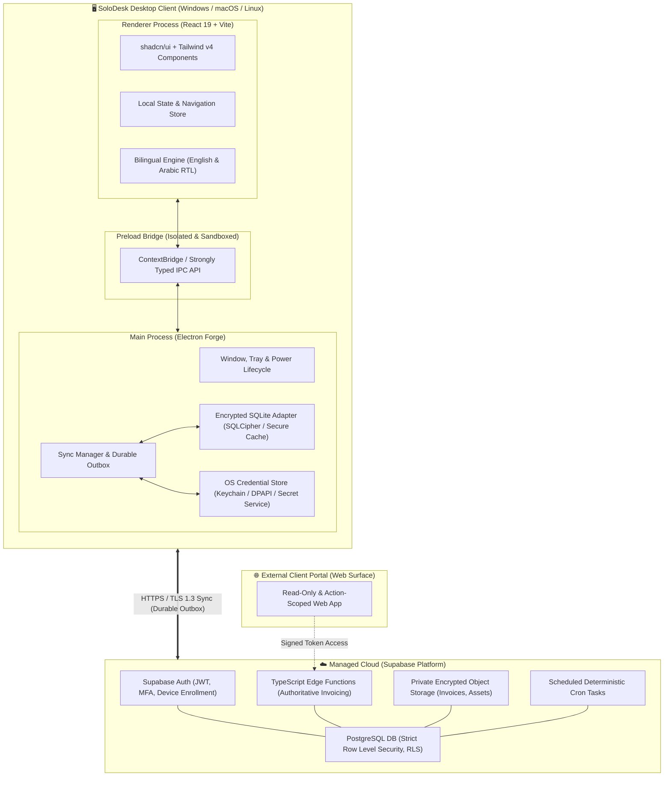

<div align="center">
  

  <br />
  <br />

  <h1>SoloDesk</h1>

  <p>
    <strong>Freelance work, from the first conversation to the final payment.</strong>
  </p>

  <p>
    A native, offline-first desktop workspace engineered for freelance software developers, independent consultants, and boutique technical studios. Uniting client relationships, proposals, project delivery, time tracking, expense tracking, and authoritative financial operations into one high-performance cockpit.
  </p>

  <p>
    <a href="https://coderabbit.ai"></a>
    
    
    
    
    
    
    
    
  </p>

  <p>
    <a href="#getting-started"><strong>Quick Start</strong></a> &nbsp;•&nbsp;
    <a href="docs/README.md"><strong>Documentation Index</strong></a> &nbsp;•&nbsp;
    <a href="plan.md"><strong>151-Phase Plan</strong></a> &nbsp;•&nbsp;
    <a href="implementation-plan-map.md"><strong>Plan Map</strong></a> &nbsp;•&nbsp;
    <a href="DESIGN.md"><strong>Design System</strong></a> &nbsp;•&nbsp;
    <a href="docs/design/reference.html"><strong>Visual Reference</strong></a> &nbsp;•&nbsp;
    <a href="docs/planning/decisions.md"><strong>Decisions Register</strong></a>
  </p>
</div>

---

## Table of Contents

- [Overview & Vision](#overview--vision)
  - [The Problem We Solve](#the-problem-we-solve)
  - [The SoloDesk Solution](#the-solodesk-solution)
- [Product Foundations](#product-foundations)
- [Project Status & Roadmap](#project-status--roadmap)
  - [Current Implementation State](#current-implementation-state)
  - [10 Milestone Domains (P00–P09)](#10-milestone-domains-p00p09)
  - [Critical Delivery Path](#critical-delivery-path)
- [System Architecture](#system-architecture)
  - [Architecture Topology](#architecture-topology)
  - [Security & Trust Boundaries](#security--trust-boundaries)
- [Functional Capabilities Matrix](#functional-capabilities-matrix)
- [UI Design System & Aesthetics](#ui-design-system--aesthetics)
- [Technology Stack](#technology-stack)
- [Getting Started](#getting-started)
  - [System Prerequisites](#system-prerequisites)
  - [Installation & First Launch](#installation--first-launch)
  - [Available Scripts](#available-scripts)
  - [Platform Notes & Troubleshooting](#platform-notes--troubleshooting)
- [Repository Structure](#repository-structure)
- [Complete Documentation Index](#complete-documentation-index)
- [Development & Contribution Workflow](#development--contribution-workflow)
- [License & Governance](#license--governance)

---

## Overview & Vision

### The Problem We Solve

Independent engineers and boutique software teams run their businesses across a dizzying patchwork of disconnected SaaS applications:

- **Lead tracking & notes:** Scattered across Notion, Obsidian, spreadsheets, or chat threads.
- **Proposals & agreements:** Cobbled together in Word or Google Docs, tracked via email exchanges.
- **Task & sprint management:** Hosted on Jira, Linear, or Trello, disconnected from billable hours.
- **Time tracking:** Logged manually into Toggl or Clockify, creating risk of unbilled work and audit friction.
- **Invoicing & billing:** Handled on generic accounting software that fails to capture project milestones, partial payments, and exact hourly rate histories.

This fragmentation causes lost billable hours, context switching, reconciliation headaches, invoice disputes, and operational fatigue.

### The SoloDesk Solution

SoloDesk unifies the entire client-to-cash lifecycle into a single, cohesive desktop application:

```text
┌─────────────────┐     ┌──────────────────┐     ┌──────────────────┐
│  Client & CRM   │ ──► │ Work Management  │ ──► │  Time Tracking   │
│ Leads, Proposals│     │ Tasks, Milestones│     │ Persistent Timer │
└─────────────────┘     └──────────────────┘     └──────────────────┘
         │                                                 │
         ▼                                                 ▼
┌─────────────────┐     ┌──────────────────┐     ┌──────────────────┐
│ Financial Ops   │ ◄── │ Billable Review  │ ◄── │ Capacity & Rates │
│ Exact Invoices  │     │ Approvals & Scope│     │ Rounding & Proof │
└─────────────────┘     └──────────────────┘     └──────────────────┘
```

1. **Leads to Agreements:** Capture opportunities, build structured service estimates, issue versioned proposals, and record agreed payment milestones.
2. **Projects to Deliverables:** Track sprint deliverables, dependencies, Kanban boards, and scope amendments directly linked to the commercial agreement.
3. **Time to Evidence:** Track active time with crash-resilient persistent timers, tamper-resistant evidence logging, idle detection, and unallocated billable alerts.
4. **Exact Invoicing & Cash Flow:** Generate immutable invoice snapshots, partial payments, credit notes, expense reimbursements, and retainers with precision arithmetic down to currency minor units.
5. **Business Intelligence:** Permission-aware cash forecasts, accounts receivable aging, client profitability, and utilization analytics.

---

## Product Foundations

SoloDesk is designed around strict, non-negotiable architectural principles established in our [Decision Register](docs/planning/decisions.md):

- **Offline-First with Cloud Authority:** Work without internet on airplanes or remote sites. Changes save locally to an encrypted SQLite cache with a durable outbox. When online, state syncs deterministically with server authority over legal and financial operations.
- **Authoritative Financial Issuance:** Draft invoices and estimates can be created offline. However, **final invoice issuance and number allocation require authoritative online transactions**, preventing duplicate sequence numbers, tax calculation drift, or stale ledger state.
- **Exact Money & Time Arithmetic:** Monetary values are modeled in integer minor units (e.g., cents) or versioned rational fractions; no floating-point rounding errors. Time is tracked in exact integer seconds before applying versioned rounding profiles.
- **Multiplatform Native Desktop:** Engineered with Electron Forge, Vite, React 19, Tailwind CSS v4, and shadcn/ui. Responsive, fast local interactions with native OS window chrome and system tray support.
- **First-Class Bilingualism (English & Arabic):** Built from day one with dual English and Arabic support, including full RTL (Right-to-Left) layouts, bidirectional typography (Inter + Noto Sans Arabic), localized numeric formatting, and culturally adapted document generation.
- **Privacy & Fail-Closed Security:** Encrypted device storage, secure OS credential store integration (Keychain / Secret Service / DPAPI), encrypted cloud backups, strict tenant-scoped Row Level Security (RLS), and comprehensive audit trails.
- **Deterministic & AI-Free Core:** **No unsolicited AI features or LLM integrations.** SoloDesk prioritizes rock-solid deterministic rules, automated recurring jobs, and verified mathematical correctness over non-deterministic machine learning outputs.

---

## Project Status & Roadmap

### Current Implementation State

> [!IMPORTANT]
> **SoloDesk is in active early development.**
> The current runnable artifact is a minimal desktop shell (Phase F000) verifying the Electron runtime, React 19 welcome screen, custom title bar, dark/light theme switching, and the planned-features viewer.
> Business logic, cloud backend provisioning, authentication, local database encryption, sync outbox, and the external client portal are documented in detail and await their scheduled implementation phases.

### 10 Milestone Domains (P00–P09)

The complete product vision is structured across 10 milestone domains, broken down into **151 granular feature phases (F001–F151)**:

| Domain  | Scope & Focus Areas                                                                                             | Phase Range   |
| :------ | :-------------------------------------------------------------------------------------------------------------- | :------------ |
| **P00** | **Product Rules, Scope & UX:** Design foundations, bilingual tokens, decision register, and PR governance.      | `F001`–`F009` |
| **P01** | **Platform & Cloud Foundation:** Cloud auth, MFA, workspaces, roles, encrypted SQLite, and sync engine.         | `F010`–`F025` |
| **P02** | **Clients, Sales & Agreements:** CRM contacts, sales pipeline, service catalog, estimates, and proposals.       | `F026`–`F040` |
| **P03** | **Projects & Work Management:** Tasks, dependencies, milestones, Kanban boards, and change requests.            | `F041`–`F055` |
| **P04** | **Time & Productivity:** Resilient timers, idle detection, timesheet approvals, and rate histories.             | `F056`–`F070` |
| **P05** | **Billing & Commercial Finance:** Invoices, partial payments, credit notes, expenses, retainers, and tax rules. | `F071`–`F090` |
| **P06** | **Business Visibility & Knowledge:** Financial reporting, cash forecasts, knowledge base, and unified search.   | `F091`–`F105` |
| **P07** | **Integrations & Automation:** Deterministic rule engine, calendar/code repository webhooks, and notifications. | `F106`–`F120` |
| **P08** | **Client Review Portal:** Scoped browser portal for clients to review proposals, approve deliverables, and pay. | `F121`–`F135` |
| **P09** | **Distribution, Release & Support:** Multiplatform installers, auto-updates, restore drills, and telemetry.     | `F136`–`F151` |

### Critical Delivery Path

Every feature phase follows a strict dependency order:

```text
F001: PR Standards & Governance
  └─► F010: Managed Cloud Authentication (Supabase Auth)
        └─► F011: Multi-Factor Authentication & Account Recovery
              └─► F012: Workspace & Tenant Multi-Tenancy Boundary
                    ├─► F014: Encrypted Local SQLite Persistence
                    ├─► F015: Bidirectional Sync Engine & Outbox
                    └─► F026+: Core Business Domain Engines
```

For the complete visual breakdown of all 151 phases, review the [Implementation Plan](plan.md) and [Plan Diagrams Map](implementation-plan-map.md).

---

## System Architecture

### Architecture Topology

SoloDesk employs an **offline-first desktop client** coupled with a **managed cloud backend** and a separate **client-facing web portal**:



### Security & Trust Boundaries

| Trust Boundary             | Protection Mechanism                                                      | Authority & Guarantee                                                         |
| :------------------------- | :------------------------------------------------------------------------ | :---------------------------------------------------------------------------- |
| **Local Storage**          | Encrypted SQLite database; OS-native keychain for wrapped keys            | Fails closed if encryption cannot be initialized; protected at rest.          |
| **Electron Sandbox**       | Sandboxed renderer, isolated context bridge, no Node integration in UI    | Protects host OS from malicious renderer script execution.                    |
| **Data Synchronization**   | Idempotency keys, optimistic local updates, monotonic conflict resolution | Prevents duplicate writes and reconciles concurrent device edits.             |
| **Financial Authority**    | Server-side PostgreSQL transactions and Edge Functions                    | Only the cloud server issues final invoice numbers and ledger postings.       |
| **Multi-Tenancy**          | PostgreSQL Row-Level Security (RLS) bound to authenticated workspace ID   | Strict data isolation; zero cross-tenant query leakage.                       |
| **External Client Portal** | Ephemeral, cryptographically signed tokens with least-privilege grants    | Clients can only access their specific proposals, deliverables, and invoices. |

For deep technical specifications, consult [Architecture Overview](docs/architecture/overview.md) and [Security & Privacy](docs/architecture/security-and-privacy.md).

---

## Functional Capabilities Matrix

The planned capabilities cover eight major business areas:

| Area                       | Key Capabilities & Features                                                                                                                                            |
| :------------------------- | :--------------------------------------------------------------------------------------------------------------------------------------------------------------------- |
| **👥 Clients & CRM**       | Multi-contact organization, lead qualification pipeline, interaction timelines, service catalog items, versioned PDF proposals, and formal client sign-off.            |
| **📋 Projects & Work**     | Task hierarchies, subtasks, block/depend relationships, interactive Kanban, calendar milestones, capacity planning, and formal scope change orders.                    |
| **⏱️ Time & Productivity** | Menu-bar persistent timers, one-click start/stop, crash and sleep recovery, tamper-resistant audit logs, timesheet submission, and billing rate allocations.           |
| **💰 Finance & Billing**   | Multi-currency support, tax rules, invoice series, partial milestone billing, credits/refunds, expense receipt attachments, retainers, and bank reconciliation.        |
| **🏢 Workspaces & Teams**  | Cloud-synced user profiles, workspace invitations, granular role-based permissions (Owner, Admin, Manager, Contributor, Finance, Viewer), and multi-device enrollment. |
| **📊 Insights & Search**   | Real-time cash forecasting, accounts receivable aging buckets, project profit margin analytics, team utilization, knowledge base, and full-text search.                |
| **🔌 Integrations**        | Deterministic automation triggers, GitHub/GitLab issue syncing, calendar integration, automated client reminders, and audit-logged webhooks.                           |
| **🌐 Client Portal**       | Frictionless browser portal for clients: review project milestones, approve change requests, inspect timesheets, and pay invoices online.                              |

---

## UI Design System & Aesthetics

SoloDesk's interface is built around clarity, spaciousness, and focus. Designed to eliminate distraction during deep technical work:

- **Bilingual Typographic Pairing:** Modern, legible sans-serif typography pairing **Inter** (for Latin scripts) and **Noto Sans Arabic** (for Arabic scripts) with optical sizing and proportional line-heights.
- **Full Bidirectional (RTL) Parity:** Every component, layout, navigation rail, and dialog adapts gracefully to right-to-left layout without visual glitches or misaligned iconography.
- **Paired Theme Tokens:** Cohesive Light and Dark modes with curated contrast ratios that exceed WCAG 2.1 AA standards:

| Token Name         | Light Mode Hex            | Dark Mode Hex | Usage                                            |
| :----------------- | :------------------------ | :------------ | :----------------------------------------------- |
| `primary`          | `#285BCB` (SoloDesk Blue) | `#9EBEFF`     | Core actions, primary buttons, active highlights |
| `canvas`           | `#F5F7FA`                 | `#10151D`     | Application background behind cards and panels   |
| `surface`          | `#FFFFFF`                 | `#171E28`     | Main working containers, dialogs, cards          |
| `graphite` / `ink` | `#18212F`                 | `#EDF2F8`     | Primary readable text and headings               |
| `secondary-ink`    | `#536173`                 | `#9BAEC8`     | Subtext, timestamps, metadata labels             |
| `divider`          | `#D5DDE7`                 | `#232E3F`     | Structural rules and component separators        |

Explore the complete [UI Design System](DESIGN.md), [Component Visual Specs](docs/design/component-visual-specs.md), and the interactive [Bilingual Visual Reference](docs/design/reference.html) covering 73 screen families.

---

## Technology Stack

| Layer                   | Selected Technology                                                                            | Role in Project                                                                                       |
| :---------------------- | :--------------------------------------------------------------------------------------------- | :---------------------------------------------------------------------------------------------------- |
| **Desktop Runtime**     | [Electron 44](https://www.electronjs.org/) + [Electron Forge 8](https://www.electronforge.io/) | Native multiplatform lifecycle, secure IPC bridge, native menu & tray integration                     |
| **Frontend Framework**  | [React 19](https://react.dev/) + [TypeScript 7](https://www.typescriptlang.org/)               | Declarative component tree, strict static typing, performant concurrent UI                            |
| **Build & Dev Tooling** | [Vite 8](https://vite.dev/)                                                                    | Sub-second Hot Module Replacement (HMR) and optimized production compilation                          |
| **Styling & Design**    | [Tailwind CSS v4](https://tailwindcss.com/) + [shadcn/ui](https://ui.shadcn.com/)              | Modern atomic styling, accessible unstyled primitives ([Base UI](https://base-ui.com/)), Lucide icons |
| **Local Persistence**   | SQLite (`better-sqlite3` installed)                                                            | High-speed local cache; encrypted SQLCipher adapter planned for P01                                   |
| **Cloud & Backend**     | [Supabase](https://supabase.com/) (PostgreSQL + Auth + Storage)                                | Recommended managed cloud: strict RLS, Edge Functions, transactional financial safety                 |
| **Quality & Testing**   | Node.js Test Runner + TypeScript Compiler                                                      | Fast, zero-dependency unit and launcher regression suites, strict type verification                   |

---

## Getting Started

### System Prerequisites

Before installing SoloDesk, ensure your development environment satisfies:

1. **Node.js:** `24.x` (LTS or current) required by `package.json`. Verify with:
   ```bash
   node --version
   ```
2. **Package Manager:** `npm` (bundled with Node.js).
3. **Version Control:** `git` (2.x or higher).
4. **Native Build Toolchain (C/C++ & Python):** Required when rebuilding native dependencies such as `better-sqlite3`:
   - **Linux (Debian/Ubuntu):** `sudo apt-get install build-essential python3`
   - **macOS:** `xcode-select --install`
   - **Windows:** Visual Studio C++ Build Tools and Python 3.

### Installation & First Launch

Follow these steps to clone the repository, install dependencies, configure Electron, and launch the application:

```bash
# 1. Clone the repository
git clone https://github.com/m07amed25/SoloDesk.git
cd SoloDesk

# 2. Install dependencies strictly matching the lockfile
npm ci

# 3. Download the matching Electron platform binary
npm run setup:electron

# 4. Launch the application in development mode
npm start
```

For subsequent development sessions, simply run:

```bash
npm start
```

> [!NOTE]
> Keep the terminal window open while developing.
>
> - **Renderer changes** (React, components, Tailwind styles) reload instantly via Vite HMR without restarting the app.
> - **Main process changes** (Electron window controls, IPC handlers) trigger an automated app restart.
> - Press `Ctrl+C` in your terminal or close the window to stop the application.
> - A live Supabase connection is **not required** to run the current welcome shell.

### Available Scripts

| Command                  | Action & Purpose                                                                    |
| :----------------------- | :---------------------------------------------------------------------------------- |
| `npm start`              | Launches the Electron app via `tooling/start.mjs` with environment sanitization.    |
| `npm run setup:electron` | Downloads and verifies the matching Electron prebuilt platform binary.              |
| `npm run typecheck`      | Executes `tsc --noEmit` to validate TypeScript types across main and renderer code. |
| `npm run test:launcher`  | Runs unit tests verifying the Linux environment launcher and path cleanup logic.    |
| `npm run ui:info`        | Displays shadcn/ui configuration, registry status, and dependency alignment.        |
| `npm run build`          | Compiles both Vite bundles (main process and renderer) for production validation.   |

### Platform Notes & Troubleshooting

- **Linux (Ubuntu / Debian / Fedora / Arch):**
  If launching from an integrated terminal inside a Snap-packaged VS Code, GTK library path conflicts can occur. The SoloDesk launcher (`tooling/start.mjs`) automatically strips inherited Snap paths (`SNAP_NAME`, `LD_LIBRARY_PATH`, `GSETTINGS_SCHEMA_DIR`) to ensure a clean launch.
- **Wayland vs X11:**
  Electron 44 runs smoothly on both Wayland and X11. If you encounter graphics driver glitches on Linux Wayland, test with `ELECTRON_OZONE_PLATFORM_HINT=auto npm start`.
- **macOS:**
  First-time launch on macOS may request microphone/camera permissions if future screen sharing or audio plugins are added; the current shell requires no special system permissions.

For extended environment setup and debugging history, refer to [Development Setup](docs/development/setup.md).

---

## Repository Structure

```text
SoloDesk/
├── .agents/                    Local agent skill library and development workflows
├── .specify/                   Feature specification templates and constitutional memory
├── app/
│   ├── main/                   Electron main process entry point, lifecycle, and IPC handlers
│   └── renderer/               React 19 renderer, design tokens, UI components, and views
├── docs/                       Comprehensive 10-domain architectural and product documentation
│   ├── architecture/           System topology, backend selection, data model, APIs, and security
│   ├── design/                 UI design specs, token mappings, and bilingual reference views
│   ├── development/            Environment setup, launcher details, and local verification
│   ├── modules/                Domain responsibilities, event boundaries, and subsystem ownership
│   ├── operations/             Packaging, release runbooks, support, and incident response
│   ├── planning/               Milestone roadmaps, decision registers, risks, and requirement coverage
│   │   └── phases/             Individual phase specifications (P00 through P09)
│   ├── product/                Product brief, user workflows, screens, and localization rules
│   ├── quality/                Acceptance criteria, test strategy, and verification matrices
│   └── specs/                  Detailed domain logic (work management, finance, time, CRM)
├── public/                     Brand assets, typography previews, and GitHub banner
├── tooling/                    Custom start launcher, environment isolation, and tests
├── AGENT.md                    Agent task routing, skill catalogue, and development boundaries
├── AGENTS.md                   Repository entry point for AI development assistants
├── DESIGN.md                   Visual design system, color palette, and component foundations
├── PRODUCT.md                  Product brief, target users, and confirmed business boundaries
├── plan.md                     Authoritative 151-phase feature implementation plan
├── implementation-plan-map.md  Implementation tree, dependency graphs, and delivery flow
├── package.json                Engine versions, npm scripts, and runtime dependencies
└── tsconfig.json               TypeScript compiler options and path aliases
```

---

## Complete Documentation Index

SoloDesk maintains an exhaustive, authoritative documentation suite. Explore specific topics below:

### Product & Design

- **[Product Brief](PRODUCT.md):** Target audience, business outcomes, operating models, and core boundaries.
- **[UI Design System](DESIGN.md):** Color schemes, typography, spacing, component styles, and theme tokens.
- **[Screen Contracts & Hierarchy](docs/product/screens.md):** Layout templates, navigation patterns, and view states.
- **[Bilingualism & Localization](docs/product/ux-and-localization.md):** English/Arabic RTL, formatting, and translation dictionaries.
- **[Domain Glossary](docs/product/glossary.md):** Canonical domain terms and Arabic terminology reference.
- **[Interactive Visual Reference](docs/design/reference.html):** Visual HTML catalog showcasing 73 screen families.

### Architecture & Security

- **[Architecture Overview](docs/architecture/overview.md):** Desktop, cloud, and portal architectural responsibilities.
- **[Backend Architecture & Costs](docs/architecture/backend-stack.md):** Supabase architecture, free-tier limits, and cost triggers.
- **[Data Model & Schema](docs/architecture/data-model.md):** PostgreSQL entities, relationships, constraints, and migrations.
- **[API & IPC Contracts](docs/architecture/api-contracts.md):** Desktop-to-main IPC commands, validation, and error shapes.
- **[Sync & Conflict Engine](docs/architecture/sync-and-collaboration.md):** Cursors, outbox persistence, and conflict resolution rules.
- **[Security & Privacy Architecture](docs/architecture/security-and-privacy.md):** Threat modeling, encryption keys, and tenant isolation.
- **[Data Lifecycle & Backups](docs/architecture/data-lifecycle.md):** Local persistence, exports, and encrypted restore procedures.

### Business Domain Specifications

- **[Platform & Workspaces](docs/specs/platform-and-workspaces.md):** Identity, team roles, and multi-tenant management.
- **[Client Lifecycle & CRM](docs/specs/client-lifecycle.md):** Leads, proposals, agreements, and client onboarding.
- **[Work Management](docs/specs/work-management.md):** Tasks, milestones, Kanban boards, and change requests.
- **[Time & Productivity](docs/specs/time-and-productivity.md):** Resilient timers, idle detection, timesheets, and rate calculations.
- **[Finance & Billing Operations](docs/specs/finance.md):** Exact money arithmetic, invoices, partial payments, and expenses.
- **[Business Insights & Knowledge](docs/specs/insights-and-knowledge.md):** Financial reports, cash projections, and search indexing.
- **[Integrations & Automation](docs/specs/integrations-and-automation.md):** Scheduled rules, provider connectors, and webhooks.

### Planning, Quality & Operations

- **[Authoritative Implementation Plan](plan.md):** Granular phases (F001–F151) with acceptance criteria.
- **[Plan Dependency Diagrams](implementation-plan-map.md):** Visual dependency trees and milestone paths.
- **[Decision Register](docs/planning/decisions.md):** Confirmed user choices, architectural recommendations, and open gates.
- **[Requirements Coverage Matrix](docs/planning/coverage.md):** Traceability from requirement IDs to tests and phases.
- **[Test Strategy](docs/quality/test-strategy.md):** Automated unit, integration, RTL, and recovery testing.
- **[Release & Support Runbooks](docs/operations/release-and-support.md):** Packaging, signed auto-updates, and incident handling.

---

## Development & Contribution Workflow

Follow [delivery governance](docs/development/delivery-governance.md), the
[F001 feature guide](docs/features/F001.md) and [observed QA](docs/qa/F001.md).
The [PR template](.github/pull_request_template.md) records scope, evidence and owner decision.
F001 implements local governance; remote CI enforcement belongs to F002.

To maintain absolute software stability and financial accuracy, SoloDesk adheres to a structured, disciplined development cycle:

```text
Select Feature Phase (plan.md)
  │
  ▼
Create Dedicated Branch (feat/f###-short-slug)
  │
  ▼
Implement Bounded Code + Comprehensive Unit/Integration Tests
  │
  ▼
Verify TypeScript Types (`npm run typecheck`) & Tests (`npm run test:launcher`)
  │
  ▼
Open Pull Request with Evidence & QA Checklist
  │
  ▼
Current Automated Checks → Agent QA → Explicit User Final Approval
  │
  ▼
Merge to Main
```

### Contributor Golden Rules

1. **One Feature Phase = One Pull Request:** Never mix features across different roadmap phases into a single PR.
2. **Never Break Financial Precision:** All financial calculations must use exact integer minor units or rational types. No raw floating-point operations.
3. **Preserve Bilingual Parity:** Any new screen or UI modification must support both English (LTR) and Arabic (RTL) layout rendering.
4. **Offline First:** Never assume internet connectivity for core drafting operations. Always integrate with the local cache and outbox.
5. **No AI Features:** Do not introduce LLM calls, automated AI agent integrations, or external model APIs.

For automated agent assistance guidelines, read [AGENT.md](AGENT.md) and [AGENTS.md](AGENTS.md).

---

## License & Governance

SoloDesk is a proprietary software project developed by [m07amed25](https://github.com/m07amed25). All rights reserved.

- **Bugs & Proposals:** Open an issue on our [GitHub Issue Tracker](https://github.com/m07amed25/SoloDesk/issues).
- **Security Vulnerabilities:** Please report sensitive security vulnerabilities privately to the repository owner rather than posting public issues.
