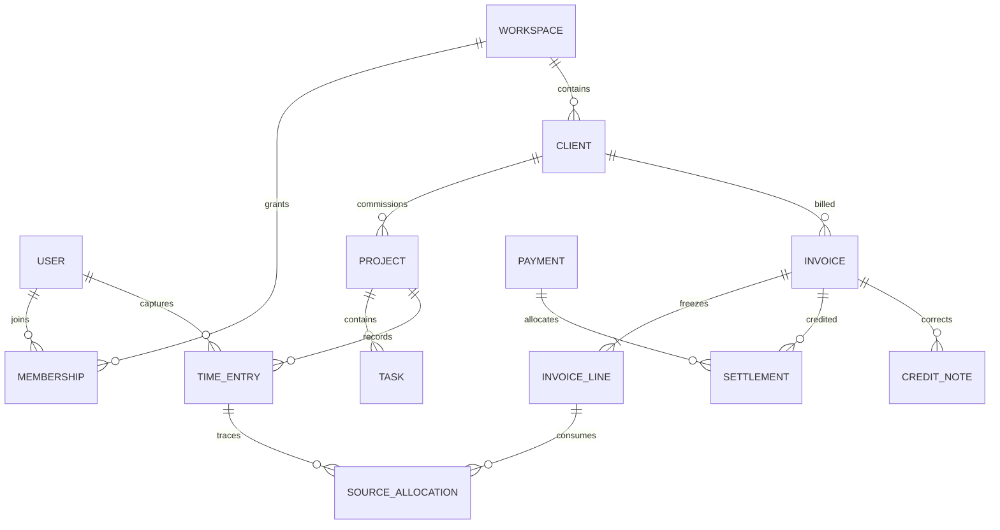

# Conceptual data model and integrity catalogue

Design only: no schemas/migrations exist. PostgreSQL holds authoritative accepted business data; encrypted local SQLite holds permitted replicas, capture and outbox. Document field types below are conceptual, not executable SQL.

## Shared fields and types

Tenant records carry `workspace_id`, stable ID, entity/schema version, revision, created/updated instants and actor references. Server commit order/cursor is separate from client occurred-at. Archived/tombstoned/purged are distinct. IDs of removed users remain pseudonymous audit references as policy permits. Calendar dates remain date-only; event instants are UTC with original timezone/offset when meaningful.

Money holds currency code, currency exponent/profile version and exact decimal/minor-unit value. Unit prices, FX rates, quantities and tax rates use bounded exact decimal strings or rational values; JSON binary floats are not authoritative. Negative values require an explicit adjustment type. Original/converted amounts and rate source/date are distinct. Time is integer seconds with canonical source ranges; UI display precision cannot change it.

## Entity catalogue

| Aggregate / records | Essential fields and relationships |
| --- | --- |
| User, account, device session | Verified identity, preferences, device/key references, enrollment/revocation, auth lease; credentials outside ordinary business tables |
| Workspace, legal entity, membership, role/grant | Tenant, owner, timezone/locales/defaults, seller registrations/currencies; role plus project/action scopes; no cross-tenant references |
| Client, contact, relationship | Legal/display/billing profiles, multiple contacts/addresses, tax identifiers, locale, owner/tags, merge alias/history |
| Opportunity, activity, follow-up | Pipeline semantics, probability/value/currency, next action, source, responsible member and chronology |
| Catalog, estimate, proposal revision, decision evidence | Exact versioned scope/lines/options, frozen parties/terms, publication/acceptance evidence; manual versus authenticated provenance |
| Agreement, amendment, obligation, onboarding checklist | Versioned files/parties/term/notice dates, linked project/proposal, assignees/criteria/status |
| Project, baseline, change request, milestone | Client, members/grants, lifecycle/archive, dates, currency/billing profile, scope/budget revisions and approval history |
| Task, checklist, dependency, cycle, recurrence | Parent/project, assignees, semantic state, priority/estimate/dates, bounded DAG, occurrence key/template revision |
| Comment, mention, note, knowledge revision | Target scope, internal/client visibility, authors/revisions, resolution, safe body and links |
| Attachment version, local blob, upload | Object/content hash/type/size, scope/grants, encrypted local path token, staged/verified/published state; bytes separate from metadata |
| Timer session/segment/checkpoint | Workspace/user/device, project/task, UTC and monotonic evidence, pause/recovery flags, canonical duration |
| Time entry, approval, rate/cost policy | Work date/timezone, seconds/source revision, billable/review/approval state, effective-dated rate snapshots |
| Invoice draft/revision, issued snapshot, line | Seller/client/currency, issue/due dates, document series/number, locale, tax/discount components, immutable totals/terms/render metadata |
| Draft reservation, time/expense allocation | Source revision/range or amount, owning draft/line, server accepted status, release/reversal chain; source consumption unique |
| Credit note, write-off, correction | Original issued line/component links, exact remaining entitlement, reason/approver and immutable posting |
| Payment, settlement, refund, unapplied credit | Cash source/currency/date, provider/manual ID, invoice allocations, fees/FX, reversals; many-to-many settlement with exact conservation |
| Expense, receipt, project split, reimbursement | Supplier/original currency/tax, approvals, eligible portions, cost attribution, document evidence and allocation history |
| Retainer agreement, receipt, consumption, period | Monetary versus service allowance, rollover/expiry/overage policy, exact linked consumption and corrections |
| Recurring schedule/occurrence | Timezone/calendar rule, template, next occurrence, enabled/generation/issue/send policies, unique occurrence key |
| Bank/provider import, reconciliation match | Original external account/transaction IDs, amounts/fees, status/provenance, explicit match graph/history |
| Notification, automation, job/outbox, connector | Enabled rule/scopes/recipients, version/occurrence, lease/retry/receipt, provider event IDs; secrets in approved vault |
| Audit, command receipt, sync operation/cursor/conflict/tombstone | Actor/tenant/operation/digest/revisions/commit order, candidates, permission scope, retention |
| Backup/import/export manifest | Schema/app versions, scope/as-of/cursors, checksums/blob inventory, encryption/key metadata, validation and recovery state |

## Relationship map

Diagram shows selected authoritative relationships, not every table. Drafts can have zero lines; issued invoices cannot. Same-workspace constraints apply to every edge, including polymorphic links and files.

## Integrity invariants

1. All relationships and mutations validate tenant, project/client scope and current permissions; user IDs are not tenant IDs.
2. Task hierarchy and dependency graphs are acyclic; time task belongs to its project; assignees are eligible members.
3. Local change and outbox append commit atomically; accepted server change/receipt/audit/cursor commit atomically. Replay cannot duplicate an effect.
4. One active timer per user/device; concurrent devices retain evidence and review overlaps before billing. Removal of membership cannot authorize old outbox writes.
5. Rate/tax/rounding/terms versions are frozen where they affect issued values. Draft refresh is explicit; client/profile edits never mutate historical snapshots.
6. Issuance requires online transaction: validate preview/source revisions → allocate unique number → freeze snapshot → consume eligible source → append receipt/audit/outbox. Any failure rolls back business effects.
7. Consumed source-second ranges and expense portions cannot overlap/exceed available source. Rounding does not mint additional source seconds. Credits/refunds do not automatically release work for rebilling.
8. Invoice numbers are unique for seller/type/series/period and never reused. Restore/rejoin cannot decrement authoritative numbering.
9. Settlement/credit/refund allocations obey exact bounds and currency. Gross, fees, net cash and debt effects remain separate; a cash refund does not necessarily remove the debt.
10. Issued content and posted finance events are immutable; corrections reference originals. Referenced legal/financial source records cannot be hard-deleted while retention requires them.
11. Attachments become committed references only after verified upload, or remain explicitly local pending; published output references an exact immutable version.
12. Search/analytics/export projections must apply current grants and basis/as-of; projections cannot become a competing source of finance totals.
13. Deletion is a permission-aware tombstone; stale devices resnapshot rather than resurrect purged records. Retention and legal holds control physical purge.
14. No recovery/import can overwrite cloud finance history or restore revoked sessions; source identities and number imports undergo duplicate validation.

## Indexing, migrations and evidence

Index from query plans: workspace+scope+status/date, parent/project/assignee, due date, normalized search, source allocation, unique external/operation IDs, recurrence occurrence and server cursor. Partial financial/allocation constraints supplement transactional locks. Specify maximum numeric/string/blob sizes before schema approval. Do not claim complete scalability from conceptual indexes.

Separate local/server schema histories with protocol compatibility; additive migrations first, data backfills validated, destructive cleanup last. Backup, retry, checksum and rollback/forward-repair plans accompany every migration. [Finance](../specs/finance.md) owns equations; [data lifecycle](data-lifecycle.md) owns restore/import; [test strategy](../quality/test-strategy.md) owns required evidence.

## F003 implementation — 18 October 2026

F003 now implements bounded immutable decimal/rational/money/seconds/date/instant/identity values under `packages/domain/src`, and versioned plain-data envelope/intent/error schemas under `packages/contracts/src`. This is a pure value model; no SQL tables, migration, storage or financial posting exists. See [F003](../features/F003.md) and [evidence](../qa/F003.md).
