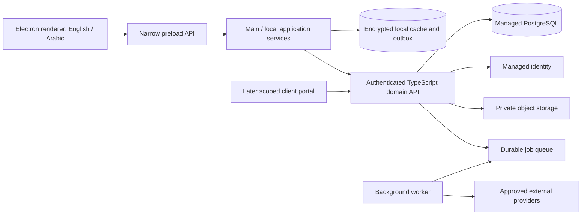

# System architecture

Status: proposed architecture for the confirmed cloud-account, team, offline and encryption product. Only main/renderer welcome-shell code exists. No backend, bridge, domain service, database, encryption or sync implementation exists.

## System boundaries

The server is authority for membership, grants, accepted revisions, financial postings, document numbers, source allocations and external side effects. The device is authority only for its durable unsynchronized capture until validation; server rejection must not silently destroy that capture. Local and cloud storage have different roles, not competing masters. Cache reads identify completeness/as-of/sync status.

## Layers and ownership

| Layer | Responsibility | Boundary |
| --- | --- | --- |
| Renderer | Navigation, accessible localized forms, cache status, previews | No SQL, filesystem, raw IPC, secrets or authoritative finance |
| Preload | Explicit typed commands, subscriptions, sanitized results | No generic execute/open-path/channel access |
| Main/local services | Lifecycle, secret-store access, local validation/transactions, sync, constrained native dialogs | No arbitrary renderer-directed shell/network execution |
| Domain | Pure state transitions, exact arithmetic, permission capabilities, policy versions | No Electron/SQL/HTTP/UI dependencies |
| Server API | Authentication, current authorization, domain commands, transactional authority, idempotency | Never trusts client totals/roles or tenant ID alone |
| Worker | Durable schedule/connector jobs, reconciliation, bounded retries | Same domain authorization and audit; no hidden privileged shortcut |
| Persistence adapters | Encrypted local cache, Postgres, private files, migrations | Constraints enforce domain invariants; adapters do not invent policies |
| Portal | Explicit published projections and allowed guest actions | No generic internal workspace API or broad object serialization |

Share pure domain rules and serializable contracts where safe; each trust boundary still validates. Transactions changing invoices/allocations/sequence/audit/command receipts are atomic on the server. External email/payment API calls occur after commit through an outbox, never inside a long database transaction.

## Recommended backend

See [backend stack](backend-stack.md) for Supabase edge-function/job-batch selection, alternatives and deployment gates. The desktop bundles only public configuration; service keys/signing keys stay server-side. Postgres row policies are defense in depth; the API also enforces resource/action grants. Realtime signals trigger authorized incremental pulls; they are not a complete durable sync log or conflict resolver.

## Local data and encryption

Use app-data storage, isolated by account/workspace/profile, with encrypted database, attachments, indexes and staged files. better-sqlite3 is installed but standard builds do not meet the encrypted-storage requirement. An encrypted SQLite-compatible adapter must pass a cross-platform proof before P01 exits. OS secret storage wraps keys; it does not encrypt the whole database automatically. Missing secure storage cannot fall back silently to plaintext.

Single-instance coordination protects local migrations/timers/outbox. Heavy import, PDF and encryption work use bounded workers/utility processes so the main event loop stays responsive; privileged services remain outside the renderer. Backups and sync apply the [data lifecycle](data-lifecycle.md) and [sync contract](sync-and-collaboration.md).

## Deployment and compatibility

Desktop app, API, worker, database migrations and future portal have independent version/build identities. Contracts declare supported protocol/schema range. Expand schema and deploy compatible readers before enabling new writes; remove old forms only after the published compatibility window. Unsupported clients preserve local data and request upgrade; never discard unknown fields/events.

Environments are isolated development/staging/production with different accounts, storage, keys and provider sandboxes. No real customer data is required in development. Runtime configuration names allowed endpoints/features but cannot enable privileges or change signed update trust roots without a controlled release. Service health and incident modes distinguish auth, sync, finance, storage and provider outages.

[Security](security-and-privacy.md), [API](api-contracts.md), [data model](data-model.md), [test strategy](../quality/test-strategy.md), and [release operations](../operations/release-and-support.md) are binding design references for their own concerns. Their requirements are proposals under confirmed product choices; none is a passed implementation gate.
