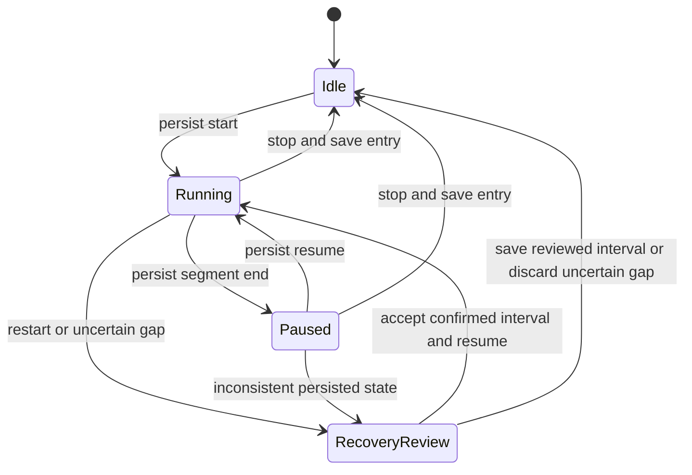

# Time tracking and productivity specification

Status: **proposed documentation, not implemented behavior**. This specification expands the earlier basic timer proposal into staged capabilities. Final phase assignment is in the [roadmap](../planning/roadmap.md); unresolved policy choices belong in the [decision register](../planning/decisions.md). A documented capability does not authorize implementation.

## Scope and delivery gates

| Gate | Capabilities | Prerequisites |
| --- | --- | --- |
| Time core | Persistent timer, manual entries, review, search, basic reports, unbilled selection | Durable storage, project/task identities, audit trail, timezone preferences |
| Billing core | Rate snapshots, billable eligibility, whole-entry reservations and allocations | Approved financial calculation policy; [finance specification](finance.md) |
| Productivity advanced | Budget forecasts, focus sessions, suggestions, detailed exports, partial allocations | Trusted time records and tested recovery |
| Collaboration / integrations | Optional approvals, imported time, cross-device conflict review | P01 teams/sync foundation and approved reviewer/provider scopes |

Time is evidence of work. An estimate, task completion, code commit, focus session, idle signal, or calendar event must not silently become billable time. Reports distinguish recorded time, reviewed time, approved time where applicable, billable time, invoiced source time, rounded invoice quantity, and paid invoices.

## Requirements and user behavior

| ID | Requirement and acceptance boundary |
| --- | --- |
| TIM-001 | Start a timer for an active project and optional task, with description and billable flag. The task must belong to the project. Persist the start before showing a running state. |
| TIM-002 | Permit one active timer per workspace user on a device. Starting another offers switch, cancel, or keep current. A switch atomically stops the previous segment and starts the new one at the same instant; retries do not duplicate entries. |
| TIM-003 | Pause closes the active segment; resume creates a new segment. Paused time never contributes duration. Stop creates or updates a recoverable entry and clears active state in one transaction. |
| TIM-004 | Recover a persisted timer after application failure, forced termination, shutdown, or restart. Present the last confirmed activity and uncertain interval; do not invoice uncertain time before review. |
| TIM-005 | Support manual duration-only entries and interval entries. Require project, work date, positive duration, and source. Optional start/end instants must agree with stored duration under the selected pause policy. |
| TIM-006 | Edit, split, merge, duplicate as a new unbilled record, and move unallocated entries with explicit preview. Splits conserve source seconds; merge requires matching project, task, currency, billable state, rate policy, and approval state. |
| TIM-007 | Detect overlapping intervals for the same user. Explain the conflicting records; default to blocking billable overlap until the user resolves it or records an allowed exception. Duration-only entries cannot be proven nonoverlapping and are labeled accordingly. |
| TIM-008 | Separate a calendar work date from UTC instants and the entry timezone. Correctly display cross-midnight work, daylight-saving transitions, different report zones, and locale formats. |
| TIM-009 | Separate display rounding from billing rounding. Retain original integer seconds, raw segments, and policy versions. Invoice creation previews raw time, billed quantity, rounding difference, and effective rate. |
| TIM-010 | Resolve a rate explicitly using dated overrides; proposed precedence is entry override, task, project, client, workspace. Require matching currency. Do not substitute zero or convert currency silently when no rate is available. |
| TIM-011 | Mark billable/nonbillable independently from approval and allocation. Unbilled means eligible source seconds not consumed by a finalized allocation; a fixed-fee project's time remains cost evidence unless explicitly billed by time. |
| TIM-012 | Reserve selected time for an invoice draft and validate it again on finalization. Prevent duplicate consumption across drafts, finalized invoices, imports, retries, and future sync conflicts. |
| TIM-013 | Lock allocated source facts. Correct billed work through an audited time adjustment and the applicable credit/replacement process; a normal edit must not rewrite an issued invoice or make the same seconds available again. |
| TIM-014 | Provide list, day/week calendar, project, task, client, tags, billable, review, approval, allocation, and source filters; aggregate in exact seconds before display rounding. Save personal views without changing underlying data. |
| TIM-015 | Offer optional idle detection with a visible threshold setting and local processing. On return, choose keep, discard, split, or revise the suspected interval. Idle detection never proves that no work occurred. |
| TIM-016 | Configure app-close/tray behavior explicitly. Close with a running timer offers keep running in tray where supported, stop, or cancel; actual OS exit must leave a recoverable timer. OS permission failures must expose a working in-app alternative. |
| TIM-017 | Compare recorded hours and cost against versioned task/project estimates and budgets. Show threshold alerts once per crossing, current scope, pending review, and forecasting assumptions. Never auto-stop work or issue an invoice when a threshold is crossed. |
| TIM-018 | Provide optional focus sessions, breaks, reminders, daily goals, and weekly review. Focus sessions reference time entries only after explicit assignment; breaks and goals do not alter billing records. |
| TIM-019 | Optional timesheet submission and approval use reviewer identity, covered period, source revisions, comments, and event history. Approval can be required before invoicing only when that policy is enabled. |
| TIM-020 | Import time through a preview with field mapping, source identifiers, timezone, units, duplicate detection, error rows, and batch rollback before financial allocation. Export filtered raw time plus metadata without exposing private notes by default. |
| TIM-021 | Provide utilization, billable ratio, estimated-versus-actual, unbilled aging, and effective earnings reports with explicit formulas and denominators. No active-user surveillance or screenshots are part of this proposal. |
| TIM-022 | For the confirmed multi-device/team model, retain independent capture events, detect concurrent timers/overlap, and require reconciliation before billing affected records. Offline capture cannot guarantee a global single timer. |
| TIM-023 | Undo recent unallocated edits through a new revision. Delete unused entries with confirmation and recoverability; retain audit events and referenced financial evidence according to an approved retention policy. |
| TIM-024 | Keep a visible, keyboard-accessible timer indicator with project name and elapsed time. Global shortcuts, tray actions, notifications, and screen-reader announcements respect OS permission and accessibility settings. |

## State model

Timer capture and entry review are separate state machines. Pausing a timer does not approve an entry; stopping does not allocate it to an invoice.

Entry review states are `needs_review → ready`; a correction to a previously ready entry can return it to `needs_review`. Optional approval states are `not_required`, `draft`, `submitted`, `approved`, and `rejected`. Submitted records are frozen for reviewer comparison; withdraw creates an event. Rejection includes a reason. An approved entry correction creates a new revision requiring approval; financial allocation of an old revision remains historical evidence. Deleting or editing a source record cannot remove an approval event.

Allocation state is derived from committed source-second allocations: `unallocated`, `partially_allocated` in the advanced gate, or `fully_allocated`. A draft reservation is visible as `reserved`; it is not a finalized allocation. Review, approval, and allocation labels may coexist.

## Persistence, clocks, and recovery

Persist a timer session ID, workspace/user/device identity, project/task, billable flag, description, rate-policy reference, segment start instant, capture timezone, and last durable checkpoint. Persist completed segments and every pause/switch/stop transaction. The initial proposed checkpoint interval is 30 seconds; performance and durability testing may change this value before implementation.

Use monotonic elapsed measurement while the process runs and UTC timestamps for persisted chronology. A wall-clock jump must not create negative or enormous duration. Suspend/resume notifications, clock discontinuities, and unexplained checkpoint gaps create a review item. Never infer billable duration by simply subtracting restart time from a stale start timestamp.

The proposed sleep default excludes suspended time, keeps the pre-sleep segment, and asks whether work continued after wake. The proposed crash default retains confirmed seconds and marks the remaining gap uncertain. Both defaults require user approval because freelancers may work away from the keyboard. Recovery shows the evidence and exact interval to be retained or discarded. Duration discarded from billing may remain as an audit fact; private activity content is not collected.

Save failure keeps the timer visibly running with an unsaved warning and retry action; it must not display a successful stop before commit. A database failure must never create an additional timer just because the user presses Stop twice. Commands include an idempotency key and expected timer revision; stale actions reload the current state.

## Time arithmetic and allocation policy

Durations are integer seconds. A duration-only entry has one integer duration and an explicit work date; an interval entry derives duration from its reviewed segments. Daily reports split intervals at midnight in the chosen report timezone, preserving the same overall seconds. Ambiguous local clock times require an offset or explicit first/second occurrence; nonexistent local times are rejected with a suggested valid time.

**Proposed default for approval:** bill exact source seconds, combine entries only when client, project, currency, effective rate, tax treatment, discount eligibility, and billing description policy match, then round money once per invoice line using the finance policy. The displayed hours are a convenience; the source-second numerator is authoritative. For example, 90 seconds at 120.00 currency units/hour is `12000 × 90 / 3600 = 300` minor units, even if a two-decimal hour display shows `0.03 h`.

Optional contract policies may round durations to a configured increment using nearest, ceiling, or floor; a minimum billable duration can also be specified. Each policy must state the grouping boundary (entry, day/project/rate, or invoice line), tie-breaking rule, increment, and minimum. Preview and save the policy version. Never apply a new policy retroactively to an issued document.

Example: two 2-minute entries at 60.00/hour total 4.00 under exact seconds. Ceiling each entry to 6 minutes totals 12.00; grouping the entries and then ceiling once totals 6.00. The UI must expose this difference before finalization. A minimum billable duration can exceed actual time, but reports retain both actual and invoiced quantities. A credit reverses the original rounded amount rather than recalculating it using the current policy.

Whole-entry allocation is the proposed first billing implementation. Advanced partial allocation represents each source entry as nonoverlapping half-open second ranges `[start, end)` over its reviewed canonical duration. A 3,600-second entry can allocate `[0, 1800)` and later `[1800, 3600)`; allocating `[1700, 1900)` must fail. Partial allocation does not duplicate or rewrite the source entry. Rounding affects billed quantity, not the number of available source seconds. Each allocation records source revision, seconds, invoice line, rate/policy snapshots, and reversal status.

Draft reservation changes are atomic and retain a revision. A second draft must explain which draft already holds time. Reservations are explicitly released on draft deletion or deselection; abandoned reservations are recoverable through a visible review action, not an invisible timeout that allows competing bills. Finalization acquires authoritative allocation ownership in one transaction. Server authority revalidates allocation ownership and finalizes only online, as confirmed by D-13. Offline draft source selections are provisional candidates; they cannot claim a global reservation until the service acknowledges it. Conflicting/offline finalization is blocked while capture remains available.

## Rates, corrections, and billing handoff

The proposed rate policy snapshots the resolved rate and currency when an entry is created or stopped, using the work date's effective rate. The user sees rate source and any later rate change. Updating client/project defaults changes future entries; an explicit bulk action may reprice eligible unbilled entries with a before/after preview and audit event. Changing a rate does not change recorded duration. Draft invoices retain their previewed rate until the user accepts a refresh.

A billed-entry correction records original entry/revision, corrected facts, reason, actor, and financial impact. If 120 minutes were invoiced but only 90 were worked, retain the original allocation and correct the 30-minute overcharge through a linked credit according to the original policy. Do not simply shorten the historical entry below its allocated range. If extra time was omitted, create a new adjustment entry with its own identity and eligibility review. If only an internal note changes, preserve the original customer-facing description snapshot.

Voiding an invoice can release allocations only under the finance lifecycle policy and a deliberate rebilling review. Credit notes do not automatically release source seconds. A correction that permits rebilling must explicitly identify the released source range and replacement chain; the same work must not be billed again merely because a payment was refunded.

## Productivity and reporting definitions

- Recorded hours = sum of reviewed actual seconds / 3,600. Show uncertain time separately.
- Billable ratio = billable reviewed seconds / all reviewed seconds for the same filters; an empty denominator displays “No data.”
- Utilization = scheduled capacity hours spent on selected work categories / capacity hours. Capacity is user configured; it is not inferred from computer activity.
- Effective collected hourly earnings = invoice cash collected allocated to the selected work scope, excluding configured taxes/refunds, / associated actual hours. It is undefined where cash-to-work allocation is unknown.
- Remaining estimate = max(0, latest approved estimate − actual reviewed hours). Overrun is reported separately, not hidden by this floor.
- Unbilled aging starts at the source work date and excludes active draft reservations from “available now” while showing them in a separate total.

Reports disclose inclusion of expenses, nonbillable work, fixed-fee work, taxes, refunds, and currency conversions. Never sum unlike currencies into an unlabeled total. Saved reports preserve filters and definitions; a shared/exported report snapshots data as of a timestamp.

## Acceptance scenarios and failure recovery

| Scenario | Expected evidence |
| --- | --- |
| TIM-A01: Start → pause → resume → stop, then restart | One source entry; only active segments contribute; no active timer remains. |
| TIM-A02: Double-click Stop / retry after response loss | Same command result and entry ID; no duplicate time. |
| TIM-A03: Crash between persistence steps | Atomic start/stop/switch; recover confirmed duration and separately review the uncertain interval. |
| TIM-A04: System clock changes backwards or machine sleeps | No negative duration; anomaly review blocks invoicing uncertain time. |
| TIM-A05: Work crosses midnight or a daylight-saving boundary | Daily buckets sum to the original seconds, with offsets shown where necessary. |
| TIM-A06: Two drafts select the same entry | First reservation succeeds; second explains conflict; finalization revalidates. |
| TIM-A07: Change default rate after work, after draft, and after issue | Future default updates; existing entry/draft refresh is explicit; issued amount is unchanged. |
| TIM-A08: Split an eligible 3,601-second entry | New portions total 3,601 seconds; tags and provenance remain traceable. |
| TIM-A09: Correct time linked to a paid invoice | Historical allocation remains intact; correction creates a linked adjustment/credit flow. |
| TIM-A10: Approver rejects a submitted period | Reason and source revision retained; user revises and resubmits; old approval cannot authorize new data. |
| TIM-A11: Remote/imported duplicate or overlapping timer | Exact duplicate is idempotent; overlap is flagged; affected billing waits for resolution. |
| TIM-A12: Full disk during stop | Unsaved state remains visible; retry does not lose or duplicate captured work. |
| TIM-A13: Optional shortcut/tray/notification permission unavailable | Normal in-app controls remain usable; no silent assumption that the timer stopped. |
| TIM-A14: Partial allocation with an overlapping second range | Transaction rejected; existing allocations and draft remain unchanged. |

## Decisions requiring user input

Confirm exact versus rounded billing, increment/grouping/minimum rules, rate precedence and snapshot timing, overlap exceptions, sleep/idle handling, desired tray/shortcut behavior, approval roles, expected import sources, and required productivity metrics. These affect stored evidence or invoice amounts and must be resolved before their dependent gates. No calendar, activity-monitoring, or external time service integration is assumed approved.
