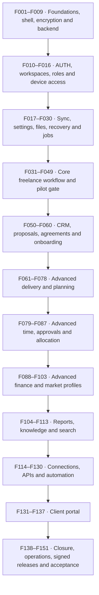
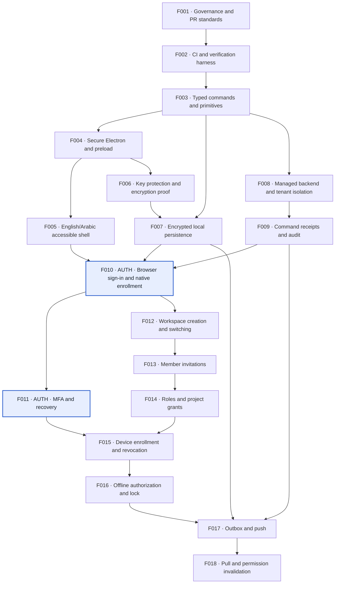
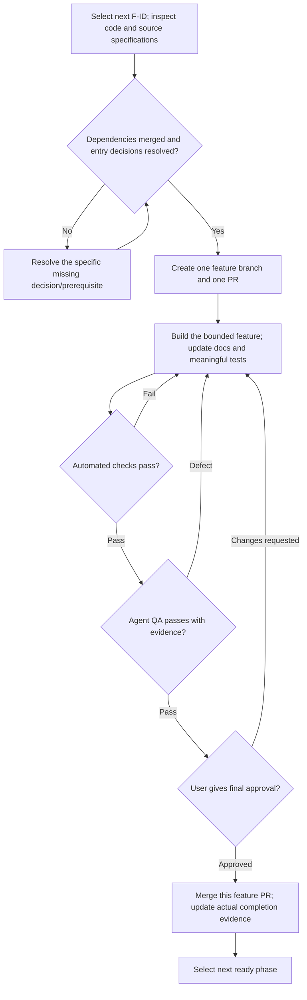

# SoloDesk implementation plan — tree and diagrams

Updated 17 October 2026. **All phases are planned; this file does not mark implementation, testing or PRs complete.**

This is a visual companion to [plan.md](plan.md), which remains the authoritative implementation plan. It contains **all 151 phases**, preserves their exact names and direct prerequisites, and highlights where authentication belongs. No app code, branches, GitHub PRs or cloud resources are created by this document.

## How to read the map

- Each **F-ID is one feature/platform phase and one GitHub PR**. The twelve branches below are reading groups, not extra phases or extra PRs.
- The complete tree follows the proposed merge order. `needs:` lists every direct prerequisite from plan.md; all of them must merge and the phase's entry decisions must resolve before starting that phase.
- P00–P09 are existing domain/release milestone labels, not the feature PR sequence. Their label on a leaf does not override dependencies.
- The overview arrows show the broad reading/delivery sequence. The foundation diagram shows actual direct dependency arrows. The complete tree retains cross-group dependencies that a small overview cannot show.
- Documentation, automated testing, agent QA, English/Arabic/accessibility, permission/offline behavior and your final approval apply to every relevant feature PR.

## Delivery overview



F049 is a **core pilot acceptance gate**, not permission to bypass recovery, signing, bilingual or platform verification applicable to that pilot. F151 accepts only the explicitly enabled release scope with all applicable included prerequisites/gates; optional providers and commercial product billing are never silently treated as complete.

## Where authentication is built

Main user authentication is [F010](plan.md#f010), after the secure shell, encrypted persistence and server command/audit groundwork. [F011](plan.md#f011) adds MFA/recovery. [F012](plan.md#f012)–[F016](plan.md#f016) cover workspace/team/device authorization. Client-guest authentication is separately [F131](plan.md#f131).

The diagram below is an exact dependency subset for F001–F018: **every inbound prerequisite for those phases is shown**. An arrow means the earlier phase must merge first. Unconnected branches may be independently ready, but concurrency still requires an agreed integration/file-ownership plan.



Authentication is implemented **before the business modules**. The foundation dependencies protect the native callback, local device data and authoritative account/workspace operations; auth is not postponed to the portal or final release.

## Complete implementation tree

Each leaf is `phase — exact feature name [milestone; needs: direct prerequisites]`. These are planned F-IDs, **not GitHub PR numbers**.

```text
SoloDesk
├── Delivery foundations, UI shell and encrypted/backend groundwork (F001–F009)
│   ├── F001 — Delivery governance and PR standards [P00; needs: none]
│   ├── F002 — Automated CI and verification harness [P01; needs: F001]
│   ├── F003 — Shared typed commands and domain primitives [P01; needs: F002]
│   ├── F004 — Secure Electron lifecycle and preload bridge [P01; needs: F003]
│   ├── F005 — Accessible English/Arabic application shell [P01; needs: F004]
│   ├── F006 — Cross-platform key protection and encryption proof [P01; needs: F004]
│   ├── F007 — Encrypted local persistence and migrations [P01; needs: F003, F006]
│   ├── F008 — Managed backend and tenant isolation [P01; needs: F003]
│   └── F009 — Authoritative command receipts and audit [P01; needs: F008]
├── Authentication, workspaces, permissions and device access (F010–F016)
│   ├── F010 — Browser sign-in and native enrollment [P01; needs: F005, F007, F009]
│   ├── F011 — MFA and account recovery [P01; needs: F010]
│   ├── F012 — Workspace creation and safe switching [P01; needs: F010]
│   ├── F013 — Member invitations [P01; needs: F012]
│   ├── F014 — Roles and project-scoped grants [P01; needs: F013]
│   ├── F015 — Device enrollment and revocation [P01; needs: F011, F014]
│   └── F016 — Bounded offline authorization and lock [P01; needs: F015]
├── Offline sync, settings, files, recovery and scheduled jobs (F017–F030)
│   ├── F017 — Durable local outbox and push [P01; needs: F007, F009, F016]
│   ├── F018 — Incremental pull and permission invalidation [P01; needs: F017]
│   ├── F019 — Conflict review center [P01; needs: F018]
│   ├── F020 — Deletion tombstones and stale-device rejoin [P01; needs: F019]
│   ├── F021 — Personal, device and workspace settings [P01; needs: F012, F014]
│   ├── F022 — In-app and OS notification center [P01; needs: F014, F018, F021]
│   ├── F023 — Private versioned attachments [P01; needs: F007, F014, F018]
│   ├── F024 — Safe staged import framework [P01; needs: F003, F023]
│   ├── F025 — Encrypted device backup export [P01; needs: F007, F023]
│   ├── F026 — Isolated restore and reviewed cloud rejoin [P01; needs: F020, F025]
│   ├── F027 — Scoped portable data export [P01; needs: F014, F023]
│   ├── F028 — Feature and policy configuration [P01; needs: F021, F009]
│   ├── F029 — Native callback, packaging and signing feasibility [P01; needs: F004, F006, F010]
│   └── F030 — Durable scheduled job execution [P01; needs: F009, F014, F028]
├── Core client → project → task → time → invoice/payment pilot (F031–F049)
│   ├── F031 — Clients and contact profiles [P02; needs: F018, F021, F027]
│   ├── F032 — Project creation and lifecycle [P03; needs: F031, F014]
│   ├── F033 — Task creation, ownership and states [P03; needs: F032, F005]
│   ├── F034 — Task lists, filters and bulk editing [P03; needs: F033]
│   ├── F035 — Manual reviewed time entries [P04; needs: F033, F018]
│   ├── F036 — Persistent timer start, pause, switch and stop [P04; needs: F035, F004]
│   ├── F037 — Timer crash, sleep and exit recovery [P04; needs: F036]
│   ├── F038 — Timezone and overlap reconciliation [P04; needs: F037, F019]
│   ├── F039 — Dated selling and internal cost rates [P04; needs: F035, F021]
│   ├── F040 — Exact money and calculation profiles [P05; needs: F003, F028]
│   ├── F041 — Offline invoice draft editor [P05; needs: F031, F039, F040]
│   ├── F042 — Authoritative time/expense draft reservations [P05; needs: F041, F009]
│   ├── F043 — Invoice numbering and atomic online issuance [P05; needs: F042, F040]
│   ├── F044 — English/Arabic invoice PDF export [P05; needs: F043, F023]
│   ├── F045 — Manual delivery and invoice status [P05; needs: F044]
│   ├── F046 — Partial payments and unapplied client credit [P05; needs: F043, F009]
│   ├── F047 — Expense recording and receipt evidence [P05; needs: F040, F023]
│   ├── F048 — Core work and receivables overview [P06; needs: F034, F038, F045, F046]
│   └── F049 — Core pilot release and cross-domain evidence [P09; needs: F026, F027, F029, F048]
├── Advanced client acquisition and agreements (F050–F060)
│   ├── F050 — Client archive, merge and relationship integrity [P02; needs: F031, F043]
│   ├── F051 — Opportunity pipeline and weighted forecast [P02; needs: F031, F040]
│   ├── F052 — Relationship activities and follow-ups [P02; needs: F051, F022, F030]
│   ├── F053 — Versioned service catalog [P02; needs: F039, F040]
│   ├── F054 — Estimate scenarios and comparison [P02; needs: F053]
│   ├── F055 — Proposal revisions and document sharing [P02; needs: F054, F044]
│   ├── F056 — Acceptance evidence and disputes [P02; needs: F055, F009]
│   ├── F057 — Agreements, amendments and obligations [P02; needs: F056, F023, F030]
│   ├── F058 — Client onboarding checklists [P02; needs: F057, F033, F023]
│   ├── F059 — Accepted engagement project handoff [P02; needs: F056, F058, F032]
│   └── F060 — Renewals and deterministic client health [P02; needs: F052, F057, F048]
├── Advanced project planning and delivery (F061–F078)
│   ├── F061 — Task hierarchy and checklists [P03; needs: F033]
│   ├── F062 — Accessible Kanban workflow [P03; needs: F034, F061]
│   ├── F063 — Task dependency graph [P03; needs: F061]
│   ├── F064 — Milestone completion and acceptance [P03; needs: F063, F056]
│   ├── F065 — Task calendar view [P03; needs: F034, F038]
│   ├── F066 — Project timeline planning [P03; needs: F063, F065]
│   ├── F067 — Team capacity and leave calendars [P03; needs: F014, F066]
│   ├── F068 — Sprints and delivery cycles [P03; needs: F034, F064]
│   ├── F069 — Recurring task generation [P03; needs: F030, F033, F038]
│   ├── F070 — Project and task templates [P03; needs: F061, F063, F064]
│   ├── F071 — Typed custom fields [P03; needs: F070, F003]
│   ├── F072 — Scope baseline and change requests [P03; needs: F059, F064, F040]
│   ├── F073 — Versioned deliverables and internal review [P03; needs: F064, F023, F056]
│   ├── F074 — Scoped comments, mentions and threads [P03; needs: F014, F022, F033]
│   ├── F075 — Project notes and attachment revisions [P03; needs: F023, F074]
│   ├── F076 — Budget baselines and threshold alerts [P03; needs: F039, F048, F072]
│   ├── F077 — Portfolio health, risks and decisions [P03; needs: F076, F052]
│   └── F078 — Archive, task transfer and handover [P03; needs: F073, F074, F042]
├── Advanced time, approvals and source allocation (F079–F087)
│   ├── F079 — Unallocated time editing and conservation [P04; needs: F042, F038]
│   ├── F080 — Time list and calendar views [P04; needs: F079, F065]
│   ├── F081 — Versioned billing time-rounding policies [P04; needs: F040, F079]
│   ├── F082 — Optional idle detection and review [P04; needs: F037]
│   ├── F083 — Focus sessions and breaks [P04; needs: F036, F022]
│   ├── F084 — Timesheet submission and approvals [P04; needs: F014, F079]
│   ├── F085 — Partial time-source allocation [P05; needs: F043, F079, F084]
│   ├── F086 — Time imports and detailed exports [P04; needs: F024, F027, F080]
│   └── F087 — Utilization and effective-rate metrics [P06; needs: F080, F046, F067]
├── Advanced finance and validated document profiles (F088–F103)
│   ├── F088 — Credit notes and invoice correction [P05; needs: F043, F046]
│   ├── F089 — Refund recording and settlement reversals [P05; needs: F088]
│   ├── F090 — Expense approval, splits and reimbursement [P05; needs: F047, F084, F042, F088]
│   ├── F091 — Deposits and final-invoice application [P05; needs: F046, F088]
│   ├── F092 — Milestone billing schedules [P05; needs: F064, F091, F054]
│   ├── F093 — Monetary prepaid retainers [P05; needs: F089, F091]
│   ├── F094 — Included-service retainers and overages [P05; needs: F085, F093]
│   ├── F095 — Client subscriptions and proration [P05; needs: F091, F094, F030]
│   ├── F096 — Recurring invoice draft generation [P05; needs: F030, F041, F095]
│   ├── F097 — Collection reminder schedules [P05; needs: F030, F045, F046, F022]
│   ├── F098 — Bank-file reconciliation [P05; needs: F024, F046, F090, F089]
│   ├── F099 — Portable accounting transaction exports [P05; needs: F027, F088, F090, F098]
│   ├── F100 — Cross-currency settlement records [P05; needs: F046, F089, F040]
│   ├── F101 — Disputes, write-offs and collection notes [P05; needs: F088, F089, F097]
│   ├── F102 — Branded bilingual document templates [P05; needs: F044, F055, F088]
│   └── F103 — Validated market invoice profiles [P05; needs: F040, F043, F088, F102]
├── Dashboards, business reports, knowledge and search (F104–F113)
│   ├── F104 — Customizable home dashboards [P06; needs: F048, F077, F087]
│   ├── F105 — Revenue and collection reports [P06; needs: F099, F100, F101]
│   ├── F106 — Receivables aging and cash scenarios [P06; needs: F105, F051, F097]
│   ├── F107 — Project operational profitability [P06; needs: F105, F090, F039]
│   ├── F108 — Delivery and capacity analytics [P06; needs: F067, F068, F077, F087]
│   ├── F109 — Consolidated FX reporting [P06; needs: F105, F100]
│   ├── F110 — Knowledge library and safe reusable notes [P06; needs: F075, F070]
│   ├── F111 — Permission-aware global text search [P06; needs: F110, F105, F018]
│   ├── F112 — Reproducible report snapshots and exports [P06; needs: F105, F106, F107, F109, F044]
│   └── F113 — Business goals and explained threshold alerts [P06; needs: F104, F105, F108, F022]
├── Connections, APIs and deterministic automation (F114–F130)
│   ├── F114 — Connector registry and OAuth secret lifecycle [P07; needs: F014, F030, F015]
│   ├── F115 — Typed deterministic automation rules [P07; needs: F114, F030, F028]
│   ├── F116 — GitHub project context and issue import [P07; needs: F114, F033, F111]
│   ├── F117 — GitLab project context and issue import [P07; needs: F114, F033, F111]
│   ├── F118 — Explicit engineering-status synchronization [P07; needs: F115, F116, F117]
│   ├── F119 — Calendar availability and event import [P07; needs: F114, F065, F067]
│   ├── F120 — Calendar export and invitations [P07; needs: F119, F115]
│   ├── F121 — Verified outbound business email [P07; needs: F114, F115, F097, F102]
│   ├── F122 — Hosted payment links and checkout [P07; needs: F114, F043, F103]
│   ├── F123 — Verified payment webhooks and payout matching [P07; needs: F122, F098, F100, F009]
│   ├── F124 — Provider refunds, disputes and chargebacks [P07; needs: F123, F089, F101]
│   ├── F125 — Read-only bank-feed connection [P07; needs: F114, F098]
│   ├── F126 — Accounting-tool connector [P07; needs: F114, F099, F123]
│   ├── F127 — Scoped developer API [P07; needs: F009, F014, F114]
│   ├── F128 — Signed outgoing webhooks [P07; needs: F127, F115, F030]
│   ├── F129 — Job and connector health/repair console [P07; needs: F114, F115, F121]
│   └── F130 — Scheduled report delivery [P07; needs: F112, F121, F129]
├── Client portal and external review/payment (F131–F137)
│   ├── F131 — Scoped client portal authentication [P08; needs: F010, F014, F015]
│   ├── F132 — Exact-version external publication [P08; needs: F131, F073, F055, F102]
│   ├── F133 — Client deliverable feedback and approval [P08; needs: F132, F074]
│   ├── F134 — Client proposal acceptance and signing adapter [P08; needs: F132, F056, F057, F114]
│   ├── F135 — Client invoice balance and payment portal [P08; needs: F132, F123, F103]
│   ├── F136 — Client questionnaires and onboarding responses [P08; needs: F131, F058, F023]
│   └── F137 — Portal brand and notification preferences [P08; needs: F132, F121]
└── Closure, optional product billing, operations and stable distribution (F138–F151)
    ├── F138 — Account and workspace closure workflow [P01; needs: F020, F026, F027, F101, F015]
    ├── F139 — SoloDesk plan and seat entitlements [P09; needs: F028, F124, F138]
    ├── F140 — Privacy-safe diagnostics and support access [P09; needs: F009, F014, F129]
    ├── F141 — Cloud database/blob recovery drills [P09; needs: F026, F123, F129]
    ├── F142 — API/schema rolling compatibility [P09; needs: F020, F043, F129]
    ├── F143 — Performance and resource-budget verification [P09; needs: F111, F112, F129]
    ├── F144 — Bilingual accessibility regression gate [P09; needs: F137, F112, F005]
    ├── F145 — Signed Windows installer [P09; needs: F029, F142, F143]
    ├── F146 — Signed and notarized macOS distribution [P09; needs: F029, F142, F143]
    ├── F147 — Supported Linux package distribution [P09; needs: F029, F142, F143]
    ├── F148 — Verified updates and safe rollback/repair [P09; needs: F145, F146, F147, F142]
    ├── F149 — Operational alerts, quotas and incident controls [P09; needs: F140, F141, F148]
    ├── F150 — Vendor exit and full workspace portability [P09; needs: F099, F138, F141, F142]
    └── F151 — Stable release promotion and acceptance [P09; needs: F103, F139, F144, F148, F149, F150]
```

## Every leaf follows the same PR lifecycle



Every feature PR contains its `docs/features/Fxxx.md` and `docs/qa/Fxxx.md`, relevant specification/design/runbook updates, automated results, observed QA evidence, migrations/rollback notes where applicable, and your final approval. A successful visual reference, green CI or agent review alone is not permission to merge. Fix failures in the same open phase PR; do not split its code, docs and tests into separate phase PRs.

## Decision gates remain visible

The [decision register](docs/planning/decisions.md) and plan.md section8 own the full open-policy details. These gates do not block unrelated ready foundation work.

| Before this work                              | Resolve the relevant decision                                                                              |
| --------------------------------------------- | ---------------------------------------------------------------------------------------------------------- |
| Real hosted data/capacity promises            | Cloud region, budget, expected scale and recovery profile                                                  |
| Customer data on device / real offline access | Native encryption/key recovery and bounded offline authorization duration                                  |
| Public authentication/enrollment              | Sign-in, MFA, account-recovery and invitation policy                                                       |
| Real financial issuance                       | Seller/country profile, exact tax/discount/time-rounding/numbering rules and permitted correction behavior |
| Timer recovery/idle behavior                  | Sleep, crash uncertainty, idle and tray/close policy                                                       |
| Team approvals and private cost visibility    | Explicit capability and approval matrix                                                                    |
| External sends, payments or connectors        | Approved provider, scopes, sender identity, country and reconciliation behavior                            |
| Guest publication/signatures                  | Guest identity/expiry and exact-version acceptance/signatory evidence                                      |
| Shipping a platform                           | Supported OS/CPU, native QA, installer/signing/update trust and recovery evidence                          |
| Commercial product billing or data closure    | Product pricing/seat/grace and retention/export/deletion policy                                            |

## Related implementation references

- [Full phase cards and dependency index](plan.md)
- [UI design foundations](DESIGN.md)
- [Exact buttons, borders, radii and component specifications](docs/design/component-visual-specs.md)
- [Feature-to-UI coverage](docs/design/phase-coverage.md)
- [Domain documentation index](docs/README.md)
- [Agent workflow and skill routing](AGENT.md)

## Keeping this view accurate

This view was derived from the phase index and cross-checked against all151 detailed cards. It contains each F-ID exactly once as a tree leaf; all direct dependencies match plan.md and point to earlier phases. Update this companion whenever phase names, numbering, scope grouping or prerequisites change. Do not change only the diagram while leaving the implementation plan stale. The tree does not add durations, completion claims or new authorization.
