# Tasks: F001 — Delivery Governance and PR Standards

**Input**: Design documents from `specs/001-delivery-governance/`.
**Created**: 2026-10-17. **Status**: Technical verification complete through T047; publication/freeze in progress; owner/merge/outcome pending.
**Prerequisites**: [plan](plan.md), [specification](spec.md), [research](research.md),
[record model](data-model.md), [contracts](contracts/) and [validation guide](quickstart.md).
**Parent requirement**: NFR-014. **Feature/milestone**: F001 / P00.

**Tests**: Explicitly required by specification FR-012/FR-013 and the phase contract. Use existing
Node 24 built-ins and meaningful independently expected fixtures. Story tests precede the behavior
they verify; demonstrate a failure attributable to missing behavior, not a missing import, broken
fixture or intentional unconditional failure. Do not introduce an unrelated TDD approval gate.

**Organization**: Setup → shared foundations → five prioritized user stories → cross-cutting
verification and separately gated delivery outcomes. This command creates only this task document;
generation itself did not execute a branch, code, delivery record, test, PR, approval or merge.
The subsequent user request now authorizes F001 implementation; final merge approval is separate.

## Format: `[ID] [P?] [Story] Description`

Every executable task uses `- [ ] T### [P?] [US#?]` and exact repository-relative paths.
`[P]` identifies same-phase tasks on different files after their stated prerequisites pass.
Story phases require `[US1]` through `[US5]`; setup/foundation/final tasks have no story label.
Model constraints are quoted in their owning task descriptions to preserve exact field rules.
No checkbox is an authorization source or proof of completion.

## Path Conventions

- Future tooling stays in `tooling/check-governance.mjs`, `tooling/check-governance.test.mjs` and
  named synthetic files under `tooling/fixtures/governance/`; no new application layer/database.
- Future policy/docs use `.specify/memory/constitution.md`, `.github/pull_request_template.md`,
  `docs/development/delivery-governance.md`, `docs/features/F001.md` and `docs/qa/F001.md` with
  `docs/qa/F001.evidence.json`.
- Root `plan.md` remains programme authority; this feature's `plan.md` is a separate design input.
  Existing package/lockfile/application/launcher sources remain unchanged.
- Future output paths are code text rather than links to nonexistent files. Current design links
  above resolve inside this feature. Shared-file edits are serialized across stories.

## Phase 1: Setup (Shared Infrastructure)

**Purpose**: Inspect and preserve the existing project; do not reinitialize, install packages or
provision services. A later implementation request must authorize execution of these tasks.

- [X] T001 Inventory the current branch/head, root `plan.md`, `.specify/memory/constitution.md` and all existing `specs/001-delivery-governance/` inputs; create a pending baseline/preservation section in `docs/qa/F001.md` without discarding or claiming authorship of prior working changes.

- [X] T002 When F001 implementation is authorized, verify latest `main`, preserve unrelated files and prepare only `feat/f001-delivery-governance-and-pr-standards`; record its actual baseline and authorized scope in `docs/qa/F001.md` against root `plan.md#f001`; do not reset/reinitialize the checkout or create a second feature branch. Depends on T001.

- [X] T003 Inspect Node against `package.json` (`>=24 <25`), existing `tooling/start.test.mjs` and available checks; record actual availability and any delivery-time read-only remote-constraint observations in `docs/qa/F001.md`; leave unknown remote facts unobserved and do not install packages/configure GitHub. Depends on T002.

---

## Phase 2: Foundational (Blocking Prerequisites)

**Purpose**: Shared record vocabulary, an import-safe test harness and a bounded read-only CLI
transport. Complete T004–T007 before story work. Transport alone is not a passed governance check.

- [X] T004 Create pending shared sections in `docs/features/F001.md`, `docs/qa/F001.md` and `docs/qa/F001.evidence.json` with `schema_version: 1`, unique `pack_id`, unique `snapshot.id` and sections `phase`, `proposal`, `snapshot`, `categories`, `evidence`, `findings`, `decisions`, `approval`, `transitions`; initialize real results as not run and real approval as pending; never prefill a PR/merge identity. Depends on T003.

- [X] T005 Create the shared import-safe `node:test` harness in `tooling/check-governance.test.mjs` with isolated temporary fixture roots, cleanup and independent expectations for read-only CLI arguments, bounded paths, no record-command/network execution, safe diagnostics and exit codes 0/1/2 from `specs/001-delivery-governance/contracts/local-validation.md`; avoid live-secret or destructive fixtures. Depends on T004.

- [X] T006 Implement only shared CLI/IO transport in `tooling/check-governance.mjs`: default policy mode, `--evidence`, `--format json`, test-root selection, unknown-argument rejection, symlink/traversal guards, inert data and limits “2 MiB per document/record file, 32 MiB cumulative input, 512 selected local targets and 2,048 records per collection”; use Node built-ins, no merge/approve/write/network behavior or bypass flag; make T005 transport assertions pass. Depends on T005.

- [X] T007 Add shared identity/type/reference validators and safe pending-record handling in `tooling/check-governance.mjs`, with corresponding harness assertions in `tooling/check-governance.test.mjs`; namespace F001-local FR/A/SC IDs, keep unknown schema versions nonzero with no rewrite, and preserve prior records rather than reusing IDs. Depends on T006.

  Shared model constraints (verbatim): `record_id`: “nonempty, unique within the evidence pack; references must resolve to one record.”
  `phase_id` / requirement namespace: “an existing root-plan `F###` identity; F001 here. `requirement_ids` resolve to their owning register; F001-local FRs and A scenarios always identify this feature as their namespace.”
  `timestamp`: “ISO 8601 date/time with timezone; document-created dates use `YYYY-MM-DD`.”
  `classification`: “`confirmed`, `recommended`, `open`; the last two never imply user adoption.”
  `revision`: “actual Git commit identity, or an explicitly labeled uncommitted snapshot consisting of observed head, comparison base and digest of the declared reviewed files.”
  Revision constraint: “A snapshot must never masquerade as a committed/published revision.”
  `artifact_reference`: “bounded repository-relative file, or an explicit external evidence/source reference.”
  Artifact constraint: “Existence of a URL is not proof of its content, availability or authenticity.”
  Preservation constraint: “Pending real-world facts remain null with an honest explanation.”

**Checkpoint**: Shared transport/harness is runnable, but no incomplete story or self-reported
approval can produce a claim that the real phase is delivered. Foundation creates no app models,
services, routes, migrations, CI or new dependencies.

---

## Phase 3: User Story 1 - Find the governing scope and rules (Priority: P1) — MVP checkpoint

**Goal**: Make scope, constitutional principles and decision ownership discoverable and validate
policy references without confusing proposed behavior with implemented capability.
**Independent Test**: Starting from AGENTS.md, identify governing sources/NFR-014 and classify
confirmed/recommended/open cases; demonstrate A-01–A-04 with synthetic policy trees and an actual
source audit, independently of real PR publication or approval.

### Tests for User Story 1

- [X] T008 [US1] Create labeled synthetic source/link/ID fixtures in `tooling/fixtures/governance/policy-references.json` covering positive local links, HTML/heading anchors, Unicode/repeated headings, percent/angle paths, reference links, broken/unsupported links, future code paths, external catalogue links, unknown/retired/reused IDs and confirmed/recommended/open decisions; define expected findings before the parser exists. Depends on T007.

- [X] T009 [US1] Add US1 contract/scenario assertions in `tooling/check-governance.test.mjs` for A-01–A-04 and the fixtures in T008, including missing sources and approval-policy clauses; run `node --test --test-name-pattern=US1 tooling/check-governance.test.mjs` and confirm failures reflect missing governance behavior rather than transport/import errors. Depends on T008.

### Implementation for User Story 1

- [X] T010 [P] [US1] Review the existing eight principles in `.specify/memory/constitution.md`, preserve applicable version/date/content, remove only the temporary Sync Impact Report before commit, and document any actual amendment through its established owner/version rules; do not invent answers to Q-01–Q-16. Depends on T009.

- [X] T011 [P] [US1] Create the scope/source/amendment sections of `docs/development/delivery-governance.md`, subordinate to constitution/root policy; explain NFR-014, current authorization, decision classification, stable-ID preservation and amendment rationale/owner/compatibility/verification requirements without changing product choices. Depends on T009.

- [X] T012 [US1] Validate the Feature Phase and Governance Decision record fields in `tooling/check-governance.mjs` against owning sources; reject self/cyclic prerequisites and silent promotion of recommendations/open decisions, preserving pending delivery and historic records. Depends on T010 and T011.

  Model constraints (verbatim from `specs/001-delivery-governance/data-model.md`):
  `id`, `milestone`, `parent_requirements`: “F001, P00 and NFR-014 for this delivery; required”.
  `outcome`, `included_scope`, `excluded_scope`: “Concrete bounded result; nonempty”.
  `prerequisites`: “Existing F-IDs; empty for F001; no self/cyclic dependencies”.
  `blocking_decisions`: “Existing decision references plus blocked action/owner; empty only when none block current scope”.
  `responsible_roles`: “Contributor, reviewing agent and user/owner; independent reviewer only when actually required”.
  `delivery_state`: “One lifecycle value from the transition table below”.
  `condition`: “`active`, `blocked` or `failed`; blocked/failed require reason, owner and next action”.
  `last_valid_state`, `history_refs`: “Preserve recovery context and supporting transitions”.

  Governance Decision constraint (verbatim): “Only an actual authorized amendment changes confirmed policy.”
  Governance Decision fields (verbatim): “A **Governance Decision** has ID, classification, owner, rationale, affected principles/requirements, compatibility/migration and verification consequences, authorization reference and version/date.”

- [X] T013 [US1] Implement bounded source/link/anchor/ID checks in `tooling/check-governance.mjs` using the declared governance set and explicit references; exclude fenced future examples from live-file assertions, report unsupported relevant syntax and external references honestly, never crawl home/installed bundles or fetch URLs, and make the US1 fixture assertions pass. Depends on T012.

- [X] T014 [US1] Correct the observed stale constitution descriptions in `AGENT.md`, `AGENTS.md` and root `plan.md`, link `docs/development/delivery-governance.md`, and retain F001 as pending with no invented PR/merge outcome; preserve stable product/phase IDs and authorization boundaries. Depends on T010–T013.

- [X] T015 [US1] Record US1 delivered scope and A-01–A-04 expected/observed policy-review outcomes in `docs/features/F001.md` and `docs/qa/F001.md`; rerun US1 checks after T014, distinguish synthetic amendment examples from actual amendments and leave global delivery approval/merge pending. Depends on T014.

**Checkpoint**: US1 is independently reviewable as the first governance MVP increment. This is
not a merge/release candidate for the whole F001 phase; the remaining stories still apply.

---

## Phase 4: User Story 2 - Prepare one bounded, reviewable feature proposal (Priority: P1)

**Goal**: Supply one PR identity/body convention and validate a complete proposal, split and repair
workflow. **Independent Test**: Prepare complete/malformed synthetic proposals and assess A-05–A-08
without publishing a PR; a reviewer can identify every required field and rejected split/bypass.

### Tests for User Story 2

- [X] T016 [US2] Create complete/missing-field/wrong-target/multi-primary/split/fix/maintenance proposal cases in `tooling/fixtures/governance/proposals.json` with independent A-05–A-08 outcomes, null real identities before publication and no fake PR number derived from F001. Depends on T015.

- [X] T017 [US2] Add US2 PR-description/proposal contract assertions in `tooling/check-governance.test.mjs`, checking every required section from `specs/001-delivery-governance/contracts/pull-request.md`, proposed versus real identities and split-before-implementation rules; verify semantic failures before implementing T018–T020. Depends on T016.

### Implementation for User Story 2

- [X] T018 [P] [US2] Create `.github/pull_request_template.md` with problem/result, IDs/dependencies, included/excluded scope, docs, current verification/QA, impacts/applicability, recovery, limits/rollout and owner-decision-source sections; no checkbox or green check counts as approval; F001 bootstraps this prepared body manually until adoption. Depends on T017.

- [X] T019 [P] [US2] Implement proposal identity/field and required-body-section checks in `tooling/check-governance.mjs`, using synthetic records until real publication; keep exactly one primary feature PR and make relevant US2 assertions pass. Depends on T017.

  Model constraints (verbatim from `specs/001-delivery-governance/data-model.md`):
  `phase_id`, `title`, `branch`, `target`: “One F-ID; `[F###] <outcome>`; `feat/f###-short-slug`; target `main`”.
  `pr_url`: “Null while merely proposed; actual primary PR URL once open; no fake number derived from F-ID”.
  `problem`, `result`, `scope`, `doc_refs`: “Required description contract; references resolve”.
  `head_revision`, `base_revision`, `snapshot_ref`: “Real review identity; pending explicitly before capture”.
  `impact`, `recovery`, `limitations`: “Each category has a concrete explanation or individual inapplicability reason”.
  `remote_constraints_ref`: “Delivery-time observation of mandatory checks/reviews; unknown is not satisfied”.
  `fix_of`, `maintenance_of`: “Optional linked records; fixes before merge stay in the same primary PR”.

- [X] T020 [P] [US2] Extend `docs/development/delivery-governance.md` with `feat/f###-short-slug`, `[F###] <feature outcome>` targeting `main`, prerequisite/split/file-ownership rules, same-open-PR fixes and linked post-merge maintenance; distinguish reviewable Draft, merged and separately released states without authorizing remote actions. Depends on T017.

- [X] T021 [US2] Document the PR/feature/QA artifact relationships in `docs/features/F001.md` and record actual US2 synthetic proposal review A-05–A-08 in `docs/qa/F001.md`; verify US2 tests and explain the first-PR template bootstrap without creating a remote PR as a test side effect. Depends on T018–T020.

**Checkpoint**: The contributor can prepare and evaluate a bounded complete proposal. Source
inspection and proposal review work without real user approval or a merge.

---

## Phase 5: User Story 3 - Judge evidence and identify incomplete work (Priority: P1)

**Goal**: Validate complete, current, honest evidence and inspect actual policy without claiming
that document checks prove product/native behavior.
**Independent Test**: Review complete, missing, failed, stale, unavailable and unsafe synthetic
packs plus the actual policy for A-09–A-13; only complete current applicable evidence supports its
claimed review stage, with no inference of human authorization.

### Tests for User Story 3

- [X] T022 [P] [US3] Create synthetic evidence/version/status/category/finding cases in `tooling/fixtures/governance/evidence-records.json`, with independently expected diagnostics for missing fields/artifacts/coverage, duplicate or dangling pack/snapshot IDs, unknown versions, blanket waivers, real/synthetic confusion and secret-safe redaction; include a valid pre-owner pending pack. Depends on T021.

- [X] T023 [P] [US3] Create independently computed SHA-256/changed-file cases in `tooling/fixtures/governance/snapshot-digests.json`, covering canonical path ordering, Unicode and raw line endings, omitted checker/tests/new files, only two named evidence exclusions, base/head changes and justified/unjustified carry-forward; isolate symlink/traversal cases in temporary roots. Depends on T021.

- [X] T024 [US3] Add US3 evidence-envelope and finding assertions in `tooling/check-governance.test.mjs` for A-09–A-13, all six result statuses, individual applicability, pending owner state, required artifacts and absence of invented native/product execution; establish semantic failures against T022 before validator implementation. Depends on T022 and T023.

- [X] T025 [US3] Add US3 snapshot/IO-safety assertions in `tooling/check-governance.test.mjs` against T023, including deterministic expected digests, complete changed-file scope, explicit external-source notices, no URL fetch/record-command execution and history preservation; confirm failures are due to missing behavior. Depends on T024.

### Implementation for User Story 3

- [X] T026 [US3] Implement complete snapshot/pack identity and digest/currentness checks in `tooling/check-governance.mjs`: use the exact `F001-review-v1` SHA-256 path/byte framing in `specs/001-delivery-governance/data-model.md`, include every changed non-evidence F001 file and required policy path, inventory unrelated changes explicitly and exclude only `docs/qa/F001.md` and `docs/qa/F001.evidence.json` from the digest. Depends on T025.

  Model constraints (verbatim from `specs/001-delivery-governance/data-model.md`):
  `pack_id`, `schema_version`, `snapshot.id`: “Unique envelope pack ID, schema version 1 and unique snapshot ID within the pack”.
  `observed_head`, `comparison_base`: “Actual identities against which evidence was gathered”.
  `reviewed_paths`, `content_digest`: “Complete declared scope plus every changed non-evidence F001 file; reproducible SHA-256 digest; paths cannot escape repository”.
  `working_tree_state`: “`clean` or `uncommitted`; dirty content must identify the reviewed snapshot honestly”.
  `created_at`, `supersedes`: “Timestamp and optional preceding pack reference”.
  `carry_forward`: “Prior evidence IDs, new snapshot, unchanged subjects, impact assessment and reviewer/date”.

- [X] T027 [US3] Implement evidence envelope/record/status/category/artifact/coverage checks in `tooling/check-governance.mjs`, resolving every pack/snapshot/FR/A reference and requiring actual expected/observed results for claimed passes; a complete pending-owner pack may validate structurally but must retain the authorization notice. Depends on T026.

  Model constraints (verbatim from `specs/001-delivery-governance/data-model.md`):
  `id`, `pack_id`, `scenario_ids`, `requirement_ids`: “Unique and resolvable; coverage maps A-01–A-22 and FRs to NFR-014”.
  `category`, `subject`, `applicable`: “Declared category and concrete inspected/unchanged subject”.
  `snapshot_ref`, `environment`: “Current identity plus runtime/OS/locale or document-review environment”.
  `fixtures_or_documents`, `procedure`: “Synthetic fixture/document inputs; exact steps or commands”.
  `expected`, `observed`, `status`: “Independent expectation, actual observation and one allowed result status”.
  `artifact_refs`, `reviewer`, `recorded_at`: “Safe references, actual reviewing identity/type and timestamp”.
  `finding_refs`, `supersedes`, `applicability_reason`: “Links; reason required for each inapplicable category”.
  `passed`: “Actual expected outcome observed for the identified current subject; counts only if applicable and current”.
  `failed`: “Observed mismatch; repair and repeat affected checks”.
  `not run`: “Planned/procedural description only; cannot count as success”.
  `unavailable`: “Required access/tool/quota/artifact unavailable; blocker for applicable required evidence”.
  `stale`: “Prior result exists but cannot support the current revision/baseline”.
  `not applicable`: “Individually justified unchanged subject; not a pass and cannot waive a required governance check”.

- [X] T028 [US3] Implement safe finding/closure and schema-compatibility diagnostics in `tooling/check-governance.mjs`, rejecting attempts to waive a constitutional MUST or missing approval, missing closure evidence, unknown required semantics and source-authenticity claims inferred from strings; make US3 tests pass without rewriting inputs or printing secrets. Depends on T027.

  Model constraints (verbatim from `specs/001-delivery-governance/data-model.md`):
  `id`, `evidence_refs`, `affected_requirements`: “Unique with resolvable affected records/rules”.
  `severity`, `blocking`: “`blocker`, `major` or `minor`; known governance/constitutional/approval bypasses block”.
  `observation`, `owner`, `next_action`: “Concrete problem and responsible repair role”.
  `disposition`, `closure_evidence`, `supersedes`: “`open`, `fixed` or `accepted limitation`; closure requires observed evidence”.

- [X] T029 [US3] Populate the actual current snapshot, record structure and per-category applicability in `docs/qa/F001.evidence.json`, with QA links in `docs/qa/F001.md`; preserve measured identities and safe artifacts, keep future story outcomes not run and real approval pending, and document global incompleteness rather than forcing the whole-pack check to pass early. Depends on T028.

- [X] T030 [US3] Exercise actual policy and synthetic complete/missing/stale/failure packs, recording A-09–A-13 observations and repair actions in `docs/qa/F001.md` and US3 behavior/limits in `docs/features/F001.md`; verify US3 tests and distinguish local JSON validity, actual agent review and external source authentication. Depends on T029.

**Checkpoint**: US3 diagnoses evidence failures and preserves honest states independently using
synthetic packs. A partial real delivery pack may still be blocked by unfinished stories; do not
convert those missing outcomes or pending consent into pass records.

---

## Phase 6: User Story 4 - Give final approval for the current result (Priority: P1)

**Goal**: Enforce the documented human decision boundary and stale-review rules without letting
an editable evidence record authenticate itself.
**Independent Test**: Classify AP-01–AP-10 and A-14–A-18 with labeled synthetic assumptions plus
inspection of actual policy. Only AP-01 is eligible in that synthetic context; no actual decision
or merge is performed to demonstrate the rule.

### Tests for User Story 4

- [X] T031 [US4] Create the ten AP-01–AP-10 cases in `tooling/fixtures/governance/approvals.json`, plus correctly labeled own-account owner authorization, changes-requested/rejected records, forged source assertions and post-approval material changes; encode independently expected policy classifications and explicitly synthetic trust assumptions, never live consent. Depends on T030.

- [X] T032 [US4] Add US4 structural/negative approval and freshness contract tests in `tooling/check-governance.test.mjs`; require missing/agent/checkbox/stale/withdrawn/misclassified cases to be blocked or marked source-verification-required, prohibit any affirmative real merge-authorized output, and leave genuine provenance inspection to manual QA; verify behavior fails before T033/T034. Depends on T031.

### Implementation for User Story 4

- [X] T033 [P] [US4] Implement approval-record field, kind and reference diagnostics in `tooling/check-governance.mjs`, keeping validity assessment separate from self-reported JSON and treating direct human/inspected authenticated sources as a manual review responsibility; unknown-source strings must never authenticate consent. Depends on T032.

  Model constraints (verbatim from `specs/001-delivery-governance/data-model.md`):
  `id`, `phase_id`, `pr_url`, `snapshot_ref`, `evidence_pack_ref`: “Identifies the concrete result; approval of a proposed/nonexistent PR cannot authorize merge”.
  `decision`: “`pending`, `approved`, `changes requested`, `rejected` or `withdrawn`”.
  `decision_maker`, `decided_at`, `source_reference`: “Required for a non-pending decision; actual human identity/time/source, not an agent transcription alone”.
  `kind`: “`owner authorization` or `independent platform review`; never conflate them”.
  `supersedes`, `limitations`: “Preserve prior decisions and any conditions”.

- [X] T034 [US4] Implement material-change/base-change/missing-assessment/stale-or-withdrawn approval diagnostics in `tooling/check-governance.mjs`, retaining history and requiring justified carry-forward only for unaffected subjects; do not change records/state automatically or create an approval bypass flag; make US4 structural tests pass. Depends on T033.

- [X] T035 [P] [US4] Extend `docs/development/delivery-governance.md` with current automated-results → actual agent-QA → explicit human-owner review, actual head/base/evidence/source binding, own-account versus independent-review rules, all merge prerequisites and the freeze/external-decision pattern avoiding approval transcription commits. Depends on T032.

- [X] T036 [US4] Manually classify every AP case against actual policy and record A-14–A-18 expected/observed outcomes in `docs/qa/F001.md`, with approval behavior/limitations in `docs/features/F001.md`; inspect new policy exceptions beyond automated clause checks and keep the real owner decision pending until final delivery review. Depends on T033–T035.

**Checkpoint**: Policy/record tests distinguish documentary structure, manual source verification
and actual owner authority. A fixture passing AP-01 is not consent to merge the real feature.

---

## Phase 7: User Story 5 - Track outcome, recovery and next-phase handoff (Priority: P2)

**Goal**: Preserve accurate lifecycle/history and recovery, and separate actual merge/release
outcomes from plans or synthetic demonstrations.
**Independent Test**: Walk A-19–A-22 in synthetic transition records with failure, blocked state,
material/base change, rejected approval and outcome evidence; each advance has its required proof
and each pause names an owner/next action without erasing history.

### Tests for User Story 5

- [X] T037 [US5] Create synthetic lifecycle/history/recovery cases in `tooling/fixtures/governance/lifecycle.json`, with expected transitions for active/blocked/failed overlays, rejected/withdrawn consent, partial evidence, fabricated merge/release, actual-event requirements and future F002 handoff; fixtures must not mutate the real phase tracker. Depends on T036.

- [X] T038 [US5] Add US5 transition/event/recovery assertions in `tooling/check-governance.test.mjs` for A-19–A-22, ensuring missing actual outcomes cannot advance merged/released, prior observations survive repairs and a failed/unavailable check never becomes passed; verify semantic failures before T039. Depends on T037.

### Implementation for User Story 5

- [X] T039 [P] [US5] Implement lifecycle/event/reference diagnostics in `tooling/check-governance.mjs` with a phase `condition` overlay and required last-valid-state/reason/owner/action, validating preserved transition and governance-decision records instead of performing transitions; make US5 assertions pass. Depends on T038.

  Model constraints (verbatim from `specs/001-delivery-governance/data-model.md`):
  `planned`: “Phase exists; delivery remains unimplemented”.
  `decision-ready`: “Scope/prerequisites reviewed; no blocking decision for the authorized slice”.
  `building`: “Implementation authorized and begun on the one primary branch”.
  `PR open/draft`: “Real primary PR identity, bounded docs/scope and target recorded”.
  `automated checks passed`: “Every applicable required current automated result passes; no blanket waiver”.
  `agent QA passed`: “Actual policy/scenario observations, repaired blocking findings and current coverage”.
  `awaiting user approval`: “Concrete current result/evidence presented; actual owner decision still absent”.
  `approved`: “Current trusted explicit owner decision; any independent review remains separate”.
  `merged`: “Actual authorized merge event/identity and all readiness gates satisfied”.
  `released`: “Actual separately authorized rollout and required release evidence”.

  Transition constraint (verbatim): “It may record invalidation and return to the earliest unmet review stage; historic later states remain superseded records, not current readiness.”
  Transition fields (verbatim): “A **Transition** has unique ID, phase, prior/next state, timestamp/actor, event/source references, current snapshot/evidence, and reason.”

- [X] T040 [P] [US5] Complete repair/retry, same-PR fixes, linked post-merge maintenance, event/root-status reconciliation and F002 handoff sections in `docs/development/delivery-governance.md`; no future SHA, replacement tracker, CI enforcement, paid service or deployment is implied by the policy. Depends on T038.

- [X] T041 [US5] Document lifecycle/F002 boundaries in `docs/features/F001.md`, then record A-19–A-22 and material/base-change recovery observations in `docs/qa/F001.md` and its sidecar; label A-20 synthetic classification separately from the later real merge event and retain all prior findings/decisions. Depends on T039 and T040.

**Checkpoint**: All five governance journeys can be tested using actual policy plus safe synthetic
records. The real F001 phase remains unmerged/unreleased until the separately gated final tasks.

---

## Phase 8: Polish & Cross-Cutting Concerns

**Purpose**: Finish cross-document consistency, run actual integrated checks and present the
concrete result. T048–T052 are publication/owner/merge/outcome tasks with their stated authority
requirements; they are not actions authorized merely by generating this list.

- [X] T042 [P] Link `docs/development/delivery-governance.md` and F001 feature/QA guidance from the contribution section of `README.md`; preserve unrelated overview/design content and do not claim F001 merged or application capabilities implemented. Depends on T041.

- [X] T043 [P] Add the governance/feature/QA entries to `docs/README.md` without replacing its product/phase source map, and ensure each link identifies actual available documents and accurate pending delivery status. Depends on T041.

- [X] T044 Run the complete `node --test tooling/check-governance.test.mjs` and `node tooling/check-governance.mjs` policy interface from `specs/001-delivery-governance/quickstart.md`; repair failures in the same feature work and record actual commands, snapshot, outputs, safe artifacts and unavailable/stale results in `docs/qa/F001.md` and `docs/qa/F001.evidence.json`. Depends on T042 and T043.

- [X] T045 Run `npm run test:launcher`, `npm run typecheck` and `npm run build` against current unchanged shell sources; record real environment/results in `docs/qa/F001.md`, label their narrow regression subjects, and keep missing checks blocked rather than copying earlier success claims. Depends on T044.

- [X] T046 Audit the complete diff including `.github/pull_request_template.md`, `tooling/fixtures/governance/`, `docs/qa/F001.md`, `package.json` and `package-lock.json` for exposed data, scope/dependency/license changes and preservation of unrelated work; update safe evidence and individually justified applicability in `docs/qa/F001.evidence.json`; do not invent absent external scanner results. Depends on T045.

- [X] T047 Execute the actual agent policy audit and all 22 scenarios/ten approval cases/seven SC targets from `specs/001-delivery-governance/quickstart.md`, consolidate traceability and blockers in `docs/qa/F001.md`, and recheck constitution compliance; retain real SC-006 owner decision and SC-007 merge identity as pending until observed, while separately recording synthetic policy classifications. After recording the audit and regression results, run final `node tooling/check-governance.mjs --evidence docs/qa/F001.evidence.json --format json` validation and repair any failure before review. Depends on T046.

- [ ] T048 Only when PR publication is authorized, open/update the single reviewable F001 PR to `main` using `.github/pull_request_template.md` content manually if needed, with current `docs/features/F001.md` and `docs/qa/F001.md` links; record real PR references before final review, attach the created PR to this chat and preserve Draft/incomplete status until QA is complete. Depends on T047; do not fabricate publication if access is unavailable.

- [ ] T049 Freeze the final reviewed tree, inspect the actual PR head/base and mandatory remote constraints, resolve material-change/record-commit freshness using `docs/qa/F001.evidence.json` and `docs/qa/F001.md`, and present the concrete current scope/results/risks to the user; do not add an approval-transcription commit or infer remote constraints from editable fields. Depends on T048.

- [ ] T050 Obtain the actual explicit final user decision for the identified PR/head/base/evidence referenced from `docs/qa/F001.md`; retain it at its trusted human source without changing the approved head merely to transcribe it, keep owner authorization separate from independent platform review and return to repair/re-review if rejected, withdrawn or stale. Depends on T049; this is a pending human action, never satisfied by agent QA or this task checkbox.

- [ ] T051 Only with current T050 approval, satisfied latest checks/QA and mandatory remote requirements, and authority covering merge, merge the one F001 PR when requested/authorized; capture its actual PR event and merge identity for the outcome reference in `docs/qa/F001.md`/root `plan.md`, preserve original evidence externally if needed and leave release/deployment separate. Depends on T050; reassess changed head/base before acting; no auto-merge from task state.

- [ ] T052 Post-merge follow-up only: reconcile the real F001 PR URL/merge identity/status in root `plan.md` during the next already-authorized documentation/feature change, link the original event and the F002 interface/handoff documented in `docs/development/delivery-governance.md`; do not create a second primary F001 PR or invent a tracker. Depends on actual T051; defer honestly until that change is authorized, and do not make this administrative follow-up a circular prerequisite for F002 once F001 merge is verified.

**Checkpoint**: Technical/policy verification can finish before owner approval. Do not mark
T050–T052 complete from a fixture, planned action, green CLI result or documentation review.
Actual release is outside F001's delivery task scope. All earlier failures/decisions remain
traceable even after a subsequent successful result.

---

## Dependencies & Execution Order

### Phase Dependencies

1. T001 → T002 → T003 establish the existing-project baseline and execution authority.
2. T004 → T005 → T006 → T007 establish common records/transport before story work.
3. Default integration order is US1 (T008–T015), US2 (T016–T021), US3 (T022–T030),
   US4 (T031–T036), then US5 (T037–T041). Each has an independent synthetic/actual-policy
   test, while the real combined records consume the preceding implemented structures.
4. T042/T043 follow all stories. T044–T049 then integrate verification and the concrete review
   package. T050 requires actual user input; T051 requires current authority plus every merge
   condition; T052 is an explicitly deferred post-merge reconciliation in the next authorized change.
5. Any failed/unknown-impact check blocks its dependents; repair in the same primary PR and rerun
   affected evidence. Material changes invalidate affected checks/QA and final approval.

```mermaid
flowchart LR
    S["Setup T001–T003"] --> F["Foundation T004–T007"]
    F --> U1["US1 T008–T015"]
    U1 --> U2["US2 T016–T021"]
    U2 --> U3["US3 T022–T030"]
    U3 --> U4["US4 T031–T036"]
    U4 --> U5["US5 T037–T041"]
    U5 --> V["Integrated review T042–T049"]
    V --> A["Actual user decision T050"]
    A --> M["Authorized merge T051"]
    M --> R["Next authorized reconciliation T052"]
```

### User Story Dependencies

- US1 requires only shared foundation; it delivers the first reviewable scope/source increment.
- US2 adds proposal rules to US1's guide/reference foundation. Synthetic proposal review does not
  require real publication or downstream owner consent.
- US3 uses phase/source/proposal records from US1/US2 for real evidence integration; its own
  fixture packs isolate complete/missing/stale cases without requiring a finished real feature.
- US4 uses US3's evidence/freshness representation. It tests hypothetical source assumptions but
  leaves genuine source inspection and final approval outside machine authority.
- US5 uses the prior phase/evidence/approval records for lifecycle/repair diagnosis; real merge
  and release proof remain future events, not dependencies of the synthetic independent test.

These are incremental integration and shared-file constraints, not permission to merge one PR
per story. Keep one F001 implementation branch and one primary PR for all included stories.

### Within Each User Story

Write meaningful fixture expectations and contract tests before implementing the missing behavior.
Keep common `.mjs` checker/test-file edits serial. Document models before claiming their observed
outcomes; run the story's US-prefixed tests and actual policy audit at its checkpoint. A partial
real evidence pack stays incomplete/pending until its relevant subjects are actually reviewed.

### Parallel Opportunities

Thirteen tasks carry `[P]`, in six safe groups after the indicated prerequisite:

| Ready after | Parallel task group | Distinct outputs |
| --- | --- | --- |
| T009 | T010 and T011 | Constitution review and operational guide scope |
| T017 | T018, T019 and T020 | PR template, checker proposal rules and guide conventions |
| T021 | T022 and T023 | Evidence fixtures and digest fixtures |
| T032 | T033 and T035 | Checker approval fields and guide review rules |
| T038 | T039 and T040 | Checker lifecycle rules and guide recovery/handoff |
| T041 | T042 and T043 | Root README and docs index links |

All other tasks are serial unless this dependency/file-ownership assessment is explicitly revised.
Do not run story writers concurrently against `tooling/check-governance.mjs`, its shared test file,
`docs/development/delivery-governance.md` or the QA/sidecar files. `[P]` documents an opportunity;
it does not request or authorize spawning agents during task generation or implementation.

## Parallel Example: User Story 1

After T009's tests expose missing behavior, T010 can review the existing constitution while T011
writes the guide's scope/source section. Both finish before T012/T013 validate records/references;
T014/T015 then reconcile sources and record the actual independent outcome.

## Parallel Example: User Story 2

After T017, T018 writes the PR template, T019 writes proposal validation and T020 writes branch/
PR/split conventions. They touch separate files and read the same fixed contract. T021 integrates
all three; no other story edits the checker or guide during this group.

## Parallel Example: User Story 3

After T021, T022 and T023 independently write evidence versus digest fixture files. Their expected
outcomes are fixed before T024/T025 implement the shared test assertions, which run sequentially
because they edit the same test file. T026–T030 then implement and inspect the resulting behavior.

## Parallel Example: User Story 4

After T032, T033 implements structural approval fields while T035 documents actual human-source
review rules. T034 follows T033 for currentness diagnostics; T036 waits for both code and guide.
A source-verification fixture is never used as consent for the real PR.

## Parallel Example: User Story 5

After T038, T039 adds transition diagnostics while T040 completes recovery/F002 guidance. T041
then exercises A-19–A-22 and records observations without performing a merge or release.

---

## Implementation Strategy

### MVP First (User Story 1 Only)

Complete T001–T015 under a later implementation authorization, then validate US1's scope/source
journey. That is the smallest useful review checkpoint. It is not full F001 completion, a separate
story PR, a deployment or permission to bypass the remaining evidence/approval requirements.

### Incremental Delivery

Complete US2–US5 in the same F001 branch/primary PR, testing each independently with its own
fixtures and actual policy observations. Integrate current evidence with no blocking defect, then
present the concrete result for the user's final decision. Do not ask for final merge approval
before T049 has made the scope/results reviewable. Existing user authority is honored; task text
is not a reason to repeat permission requests for actions already authorized.

### Parallel Team Strategy

If parallel contributors are explicitly authorized, use only the six distinct-file groups above
and retain one integration owner for shared files. No worktree, branch or additional feature PR
is created just because a task has `[P]`. Dependencies and review evidence remain identical for
serial and parallel execution.

## Coverage and Completion Summary

| Story / phase | Tasks | Count | Acceptance / independent proof |
| --- | --- | --- | --- |
| Setup | T001–T003 | 3 | Existing baseline, scope and check availability preserved |
| Foundation | T004–T007 | 4 | Import-safe transport/harness and shared record constraints |
| US1 — scope/sources | T008–T015 | 8 | A-01–A-04; contributor follows governing sources and classifies decisions |
| US2 — bounded proposal | T016–T021 | 6 | A-05–A-08; complete/malformed/split/fix proposals classified |
| US3 — honest evidence | T022–T030 | 9 | A-09–A-13; missing/stale/failed/unavailable packs correctly diagnosed |
| US4 — final approval policy | T031–T036 | 6 | A-14–A-18, AP-01–AP-10; only synthetic AP-01 eligible, real consent unclaimed |
| US5 — lifecycle/recovery | T037–T041 | 5 | A-19–A-22; preserved history, proof-backed transitions and F002 boundaries |
| Final review/outcomes | T042–T052 | 11 | Full current review, actual decision/merge only when observed, deferred reconciliation |
| Total | T001–T052 | 52 | Technical work through T047 verified; publication/freeze and owner/outcome tasks tracked above |

| Requirements / outcomes | Owning tasks |
| --- | --- |
| FR-001–FR-004; SC-001 | T007–T015, T047 |
| FR-005–FR-008, FR-019; SC-002 | T016–T021, T048 |
| FR-009–FR-014; SC-003 | T022–T030, T044–T047 |
| FR-015–FR-017, FR-020; SC-004–SC-005 | T031–T036, T049–T051 |
| FR-018, FR-021–FR-023, FR-026; SC-006–SC-007 | T037–T041, T047–T052 |
| FR-024–FR-025; exposure/offline/quota/applicability edges | T003–T007, T022–T030, T040, T046–T047 |

## Notes

- Exact data-model field constraints appear within T007/T012/T019/T026/T027/T028/T033/T039.
  No missing nullable/enum/identity/freshness rule is left to implementation-time guessing.
- The checker is local/advisory. Structural validity cannot authenticate a source, authorize
  merge, satisfy absent remote requirements or establish a product/native acceptance result.
- F002's CI/generalized scanning/aggregate enforcement, business UI/storage, cloud provisioning,
  paid services, message sending and release deployment remain outside this task list's scope.
- Pre/post task-generation hook checks found no `.specify/extensions.yml`; no hooks ran.
- The read-only analysis was completed before implementation. Generating this list did not invoke it,
  implement tasks, create tests, change source governance or grant final user approval.
