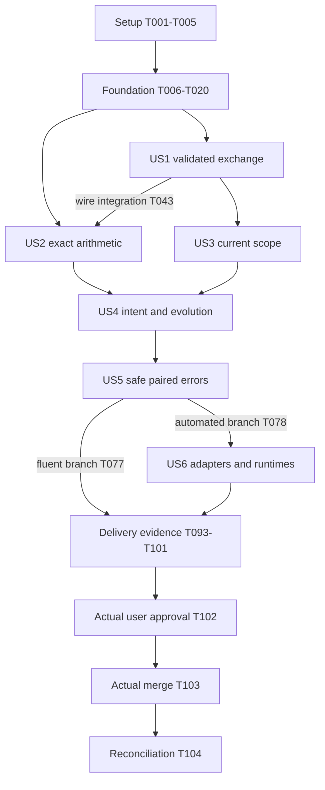

# Tasks: F003 — Shared Typed Commands and Domain Primitives

**Input**: [specification](spec.md), [technical plan](plan.md), [research](research.md), [data model](data-model.md), [contracts](contracts/) and [quickstart](quickstart.md).
**Created**: 2026-10-18. **Status**: Generated, unchecked and not executed; documentation only.
**Prerequisites**: Actual F002 delivery/current relevant defects, current implementation authority and recorded adoption of the proposed bounds/version profile before dependent implementation. No branch, source code, runtime setup, PR, approval, merge or release is created by this task-generation request.
**Tests**: Explicitly required by FR-031 and the specification's acceptance scenarios; meaningful contract, exact-value, permission-negative, version/retry, bilingual, runtime and verification-enrollment tests are included. Test-first tasks capture a behavioral red-to-green result once callable signatures exist; missing tools/imports are not acceptable proof of behavior failure.
**Organization**: Setup → shared foundation → six user-story increments in specification priority order → cross-cutting evidence/review. All work belongs to one future F003 primary PR.

## Format: `[ID] [P?] [Story] Description`

- Every task is unchecked with a unique sequential T-ID and exact repository-relative file paths.
- `[US1]`–`[US6]` appear only in story phases. `[P]` means a dependency-ready task has a documented peer using different files; it does not permit ignoring its explicit prerequisites.
- Each task's `Depends on` clause is authoritative. Default execution follows T-ID order; alternative scheduling must honor every dependency and the phase/story integration gates below.
- Quoted model fields/constraints are copied verbatim from the data model. Full field-level limits/nullability/enums are binding in the linked contracts; constructors and strict wire admission retain their distinct normalization rules.

## Path Conventions

Shared source lives under `packages/domain/src/`, `packages/contracts/src/` and `packages/localization/src/`; test-only fixtures/doubles/suites under `tests/f003/`; fixed coordinators under `tooling/f003/`. Existing `verification/`, `tests/verification/`, `.github/` and root configs are extended only as listed. Future additional tests such as `constructors.test.mjs`, `codec.test.mjs`, `identities.test.mjs` and `authority.test.mjs` must be added explicitly to the existing five suite families, not silently undiscovered. The final performance check must also be enrolled in an existing F003 suite with a reviewed floor update; no sixth suite family or test-discovery glob is implied.

No customer database, migration, real service authorization, encrypted persistence, production screen, billing policy, provider effect or AI capability is in scope. Imports point domain → pure values, contracts → domain, localization → public error types. Standard runtime codecs remain injected ports.

## Phase 1: Setup (Shared Infrastructure)

**Goal**: Establish entry authority, adopt the concrete proposal through the existing review, and prepare shared source/test coverage without migrating the application.

**Independent Test**: Review actual prerequisite ancestry, documented authority/profile adoption and locked toolchain; inspect only owned changed paths. No story implementation begins before entry gates resolve.

### Tasks

- [X] T001 Inspect current F002 merge ancestry, inherited fork/control limitations and actual implementation authorization; then create or reuse the one `feat/f003-shared-typed-commands-and-domain-primitives` branch and record its identity in `docs/features/F003.md`; preserve unrelated changes and stop only dependent work if existing authority or prerequisites are missing (FR-034). Depends on: entry context only; no prior task.

- [X] T002 Prepare the complete bounds/version/runtime entry record in `docs/features/F003.md` and `verification/f003-runtime.v1.json`: initial protocol/payload/event version 1, `F003-bounds-v1`, `F003-intent-v1`, proposed Deno 2.9.7 and all contract ceilings; record proposal versus actual adoption source without treating Q-01–Q-16 as resolved (FR-005, FR-018). Data-model fields: “Version plus byte/depth/node/string/collection/numeric/work/date/error limits”; constraints: “Proposed F003-bounds-v1 must be approved for adoption; immutable interpretation by version”. Depends on: T001.

- [X] T003 Create private ESM source-module markers in `packages/domain/package.json`, `packages/contracts/package.json` and `packages/localization/package.json`, and owned directories under `tests/f003/` and `tooling/f003/`; retain the single root lock and existing Forge/Vite shell, with no new runtime dependency or workspace manager (FR-029). Depends on: T002.

- [X] T004 Expand shared-source inclusion in `tsconfig.json` and add `tsconfig.shared.json` using strict ES2022 ESM, `noEmit`, `types: []`, `allowImportingTsExtensions`, `verbatimModuleSyntax` and `erasableSyntaxOnly`; preserve existing F002 typecheck/lint argv and prevent Node/DOM ambient authority in pure modules (FR-029). Depends on: T003.

- [X] T005 Define the versioned synthetic-only fixture catalogue and literal scenario/expected-value inventory in `tests/f003/fixtures/catalogue.mjs`; reserve the five F003 suite identities and explicit future entries, including foundational constructor tests, without registering nonexistent or empty checks as passed (FR-001, FR-031). Depends on: T004.

**Checkpoint**: Entry record, source layout, TypeScript coverage and synthetic fixture scope are concrete. No task checkbox authorizes implementation, external publication or policy approval by itself.

## Phase 2: Foundational (Blocking Prerequisites)

**Goal**: Provide canonical immutable value constructors, bounded issue vocabulary and narrow shared type contracts used by multiple stories. Arithmetic use cases, message codecs, real authority and localized presentation remain in their story phases.

**Independent Test**: Run direct foundational constructor/type/dependency tests with meaningful assertions. Check exact canonical values, all constructor bounds and absence of upward/platform imports; do not claim the full F003 manifest has run before final enrollment.

### Tests Required by the Specification

- [X] T006 [P] Test: Author independent positive/negative constructor assertions in `tests/f003/unit/constructors.test.mjs` for tagged identities, exact integers/decimals/ratios/money/seconds/dates, raw-before-normalization bounds and invalid floats; establish a meaningful red assertion when callable signatures exist, not an import/runtime setup failure (A-03, A-06–A-14). Depends on: T005.

- [X] T007 [P] Test: Author three independent source-quality checks and inert failing fixture text in `tests/f003/integration/source-quality.test.mjs` and `tests/f003/fixtures/quality/`: isolated typecheck, fixed package lint and actual prohibited import/privileged export detection; stage deliberate type/lint/import defects only into owned temporary copies so ordinary discovery stays valid; do not mutate F002 protected argv (A-29). Depends on: T005.

### Implementation and Integration

- [X] T008 Implement immutable unknown-input tagged-ID constructors in `packages/domain/src/ids.ts`: enforce the closed kind list and canonical lowercase UUIDv4 variant, rejecting nil/max/other versions, wrong runtime tags and display numbers; no ID generation or authority assertion (FR-007). Data-model fields: “Closed `kind`, canonical lowercase UUIDv4 `value`”; constraints: “Runtime tag and grammar; generation outside pure core; no display number or authority”. Depends on: T006.

- [X] T009 Implement exact ASCII integer parsing, primitive-result/issue types, numeric limit constants and revision construction in `packages/domain/src/integers.ts`: ≤38 raw digits and absolute value ≤10^38−1; seconds/revisions 0–9,223,372,036,854,775,807; reject binary-number amounts, -0, leading zeros, plus, whitespace, exponent and locale syntax (FR-011–FR-016). Data-model fields: “Nonnegative exact revision counter or separate bounded opaque cursor”; constraints: “Server owns accepted revision/order; cursors never interpreted as money, time or schema version”. Depends on: T006.

- [X] T010 Implement `F003-bounds-v1` in `packages/contracts/src/bounds.ts` and bounded schema-owned issue/path collection in `packages/contracts/src/validation.ts`: 262,144 bytes, depth 16/root=1, 4,096 nodes, 64 object members, schema keys/operation kinds/profile IDs/message keys ≤64 ASCII characters, 1,000 array entries, 4,096 scalars AND 16,384 decoded string bytes, 32 issues, 16,384 public-error bytes; import numeric ceilings from domain instead of creating an upward dependency (FR-005). Depends on: T009.

- [X] T011 [P] Implement constructor normalization and strict canonical decimal admission in `packages/domain/src/decimals.ts`: coefficient `120`, scale 2 normalizes to `12`, scale 1 only through the constructor; wire input must already be canonical, and raw oversized reducible inputs fail before normalization (FR-012). Data-model fields: “BigInt coefficient and small integer scale internally; strings plus scale externally”; constraints: “≤38 supplied digits, scale≤18, unique zero/trailing-zero normalization; no binary float”. Depends on: T009, T010.

- [X] T012 [P] Implement constructor reduction and strict canonical ratio admission in `packages/domain/src/rationals.ts`: positive nonzero denominator, gcd=1, zero 0/1, ≤38 supplied numerator/denominator digits and a shared ≤1,024-step Euclidean budget; do not approximate a ratio (FR-012–FR-013). Data-model fields: “BigInt numerator/positive denominator internally; canonical strings externally”; constraints: “Reduced gcd, zero 0/1; supplied/reduced bounds; bounded arithmetic iterations”. Depends on: T009, T010.

- [X] T013 Implement ordinary-money and distinct signed-adjustment constructors in `packages/domain/src/money.ts`: ≤38-digit minor units, uppercase three-letter currency, explicit exponent 0–9/profile version, nonnegative ordinary values and no universal two-place default; synthetic precision does not approve Q-03 (FR-011, FR-014). Data-model fields: “Integer minor units, currency, exponent, profile version; explicit signed kind when applicable”; constraints: “Same profile/currency for operations; precision not implicit; ordinary values nonnegative”. Depends on: T011.

- [X] T014 [P] Implement canonical nonnegative source-second constructors in `packages/domain/src/seconds.ts` with the exact signed-64-bit technical ceiling and no timer/billing rounding or product manual-entry maximum (FR-015). Data-model fields: “Nonnegative exact source seconds”; constraints: “Signed-64-bit technical ceiling; no timer/billing policy; integer text externally”. Depends on: T009, T010.

- [X] T015 [P] Implement strict mathematical Gregorian date and UTC-millisecond instant validation in `packages/domain/src/dates.ts`: years 0001–9999, seconds 00–59, original offset −840..840 minutes and zone label ≤64 ASCII characters; reject rollover, local unqualified times, leap seconds and excess precision; actual zone catalogue remains an injected obligation (FR-016). Data-model fields: “Gregorian date or canonical UTC millisecond instant; optional original zone/offset context”; constraints: “Distinct semantic types; strict valid dates/ranges; no inferred local timezone or commit ordering”. Depends on: T009, T010.

- [X] T016 Declare readonly trusted context, typed resource/authority observation and minimal UTF-8/timezone codec port interfaces in `packages/contracts/src/ports.ts`; trusted factories stay in test fixtures, and all public boundary constructors accept `unknown` rather than unchecked casts (FR-008–FR-009, FR-029). Data-model fields: “Verified actor/workspace/device, session observation, current authority observation reference”; constraints: “Trusted nonwire value, created by actual future boundary; fixture factories are test-only”. Depends on: T008, T010.

- [X] T017 Define initial public error/code/key, recovery and outcome-certainty shapes in `packages/contracts/src/errors.ts`, including all 17 public codes and 13 issue keys; provide safe structural VALIDATION results without adding raw exceptions or assuming any code proves nonexecution (FR-025). Data-model fields: “Code/key, allowlisted params, diagnostic, recovery, outcome certainty, bounded issues/truncation; schema-owned field path”; constraints: “Complete paired en/ar catalogue, no secret/private/raw exceptions; bounded inert text”. Depends on: T010, T008.

- [X] T018 Materialize canonical synthetic identities/profiles/contexts and independently authored value expectations in `tests/f003/fixtures/values.mjs` and `tests/f003/fixtures/context.mjs`; include Arabic/Latin legal text unchanged and distinct private sentinels, never customer data or production credentials (FR-006, FR-031). Depends on: T013, T014, T015, T012, T016, T017.

- [X] T019 Run `tests/f003/unit/constructors.test.mjs`, `tests/f003/integration/source-quality.test.mjs` and both TypeScript configs against the completed foundation; record red-to-green reason, nonzero counts, raw-boundary cases and actual results in `docs/qa/F003.md`; no skipped/empty success (FR-031). Depends on: T018, T007.

- [X] T020 Review dependency direction, immutable copies, bounded constructors, actual adopted profile and current evidence in `docs/features/F003.md` and `docs/qa/F003.md`; block story work for any violated bound, missing authority or test/tool gap, while keeping complete F003 readiness unclaimed (FR-034). Depends on: T019.

**Checkpoint**: T006–T020 must pass before any story implementation. Shared constructors live here because command exchange, scope, intent and error contracts all depend on them; US2 owns checked arithmetic/conversions and its independent value journey.

## Phase 3: User Story 1 - Exchange Validated Commands Consistently (Priority: P1) — MVP

**Goal**: Exchange closed bounded named requests/results without coercion or false authority.

**Independent Test**: Exercise A-01–A-05 using synthetic echo/record contracts: accept valid round-trips including exact canonical values/Arabic, reject invalid/duplicate/oversized versions/fields before effect, and preserve each stage/correlation.

### Tests Required by the Specification

- [X] T021 [P] [US1] Test: Author closed request/result and nil/null/empty/unknown-field/operation/correlation assertions in `tests/f003/unit/contracts.test.mjs` using independent literal expected values and initial version 1; record meaningful behavior failure before completing implementation (A-01–A-02, A-04–A-05). Depends on: T020.

- [X] T022 [P] [US1] Test: Author malformed UTF-8, escaped duplicate decoded names, lone surrogate, accessor/prototype and each at/beyond-limit framing case in `tests/f003/unit/codec.test.mjs`; each at-limit fixture must satisfy other ceilings and failures must precede synthetic effects (A-02–A-03). Depends on: T020.

### Implementation and Integration

- [X] T023 [US1] Implement the bounded duplicate-aware token/UTF-8 decoder in `packages/contracts/src/codec.ts` through the injected standard fatal UTF-8 codec: check original bytes first, count before descent/allocation, compare decoded key names and reject disallowed/executable data without parse-then-drop behavior (FR-003, FR-005–FR-006). Depends on: T022.

- [X] T024 [US1] Implement closed own-data-property shape validators, absent/null/empty distinctions and immutable fresh output in `packages/contracts/src/validation.ts`; reject unknown keys, accessors, dangerous prototypes and trap failures without claiming to sandbox live hostile Proxy execution (FR-003–FR-004). Depends on: T021.

- [X] T025 [US1] Implement the discoverable fixed operation-definition registry in `packages/contracts/src/registry.ts` with owner/context/versions/bounds/result alternatives/intent projection; put only `conformance.echo` and `conformance.record` definitions in `tests/f003/fixtures/operations.mjs`, never production handlers (FR-001). Data-model fields: “Owner F-ID; named operation; kind; accepted protocol/payload versions; bounds profile; payload/result validators; required contexts/ref kinds; intent projection”; constraints: “Fixed registry entries, closed fields; F003 provides common registry types and test-only echo/record definitions”. Depends on: T024.

- [X] T026 [US1] Implement command request validation in `packages/contracts/src/envelopes.ts`: protocolVersion 1, supported payloadVersion, adopted boundsProfile, registered operation ≤64 ASCII characters, tagged request/workspace/device context, command-only operationId, applicable expectedRevision and semantic occurredAt (FR-002–FR-004). Data-model fields: “Versions/profile; kind/operation; request/workspace/device IDs; operation ID; applicable expectedRevision/occurredAt; payload”; constraints: “Write operation ID required; actor excluded; null/absence explicitly declared; fresh validated value”. Depends on: T025, T023.

- [X] T027 [US1] Add query-envelope admission and current/cached query-result semantics in `packages/contracts/src/envelopes.ts`, forbidding write operation IDs, mutation receipts and fabricated as-of/revision metadata (FR-002, FR-020). Data-model fields: “Same relevant versions/scope/correlation, closed query payload”; constraints: “No write operation ID or mutation/receipt claim”. Depends on: T026.

- [X] T028 [US1] Implement closed query_result/rejected/local_saved/queued/authoritative_committed/job_accepted/conflict/outcome_unknown result alternatives and request/operation correlation checks in `packages/contracts/src/envelopes.ts`; reject stage-forbidden metadata and incomplete/all-success fabrication (FR-020–FR-021). Data-model fields: “Versions, operation/workspace/correlation, original operation ID where applicable, closed status alternative and stage data”; constraints: “Metadata must agree with stage; unknown is not rejected/success; query data separate from command receipts”. Depends on: T027.

- [X] T029 [US1] Connect canonical domain value admission/encoding to `packages/contracts/src/codec.ts` and `packages/contracts/src/envelopes.ts`; retain exact text, UTC/date meaning and Unicode without process objects, locale coercion or mutating source references (FR-006, FR-017). Depends on: T028, T023.

- [X] T030 [US1] Test: Add a test-only deny-by-default receiver and forged actor/roles/channel fixtures in `tests/f003/unit/request-authority.test.mjs`; prove a structural pass is not authorization and arbitrary privileged operations are never dispatched (A-04). Depends on: T029.

- [X] T031 [US1] Run the focused US1 contract/codec/claim tests and inspect bounded issue counts, independent round-trip bytes and no-effect negatives; capture actual A-01–A-05 results and decoder review defects in `docs/qa/F003.md` (FR-003, FR-005, FR-031). Depends on: T030.

- [X] T032 [US1] Document named catalogue usage, request/result stage examples, immutable values and the validated-versus-authorized boundary in `docs/features/F003.md` and `docs/architecture/api-contracts.md`; retain future native/backend claims as deferred (FR-001, FR-032). Depends on: T031.

**Checkpoint**: The contract-only contributor demo works after foundation + US1. It is not a business release; cross-runtime proof remains US6 and the complete F003 PR includes every story.

## Phase 4: User Story 2 - Preserve Exact Values and Date Meaning (Priority: P1)

**Goal**: Add checked exact arithmetic/conversions and prove source values, signs, dates and locale meaning are preserved.

**Independent Test**: Exercise A-06–A-12 with independent 0/2/3-place profiles, 0.1+0.2, 1/8, 1/3, large integers, 59+61 seconds, unit/sign/overflow/date/locale negatives; pure arithmetic testing needs only the foundation.

### Tests Required by the Specification

- [X] T033 [P] [US2] Test: Author literal independently calculated arithmetic, conversion, unit/sign and input/intermediate/output-overflow assertions in `tests/f003/unit/primitives.test.mjs`, including 9007199254740993+1 and 1/3 nonrepresentability (A-06–A-10). Depends on: T020.

- [X] T034 [P] [US2] Test: Author independent leap/year/offset/timezone/date-only/UTC/precision fixtures in `tests/f003/unit/dates.test.mjs`, with no expected values derived from host Date rollover or the functions under test (A-11–A-12). Depends on: T020.

### Implementation and Integration

- [X] T035 [US2] Implement checked compare/add/subtract and preflight ≤128-digit scratch growth in `packages/domain/src/integers.ts`; reuse supplied-input checks and expose explicit out_of_range/work_limit failures, never wrapping/saturating or converting exact values through `number` (FR-013). Depends on: T033.

- [X] T036 [US2] Implement exact decimal compare/add/subtract/multiply and decimal→rational conversion in `packages/domain/src/decimals.ts`, bounding scale alignment and temporary scale≤36 then revalidating normalized ≤38 digits/scale≤18 outputs (FR-012–FR-013). Data-model fields: “BigInt coefficient and small integer scale internally; strings plus scale externally”; constraints: “≤38 supplied digits, scale≤18, unique zero/trailing-zero normalization; no binary float”. Depends on: T035.

- [X] T037 [US2] Implement checked reduced rational compare/add/subtract/multiply/divide in `packages/domain/src/rationals.ts`, cross-canceling before products with a shared ≤1,024 remainder-step budget and checking every intermediate; zero divisors fail (FR-012–FR-013). Data-model fields: “BigInt numerator/positive denominator internally; canonical strings externally”; constraints: “Reduced gcd, zero 0/1; supplied/reduced bounds; bounded arithmetic iterations”. Depends on: T035.

- [X] T038 [US2] Implement same-currency/exponent/profile money comparisons/add/subtract, explicit signed adjustments and exact decimal↔minor-unit conversion in `packages/domain/src/money.ts`; reject incompatible profiles and discarded nonzero fractions instead of choosing rounding (FR-011, FR-013–FR-014). Data-model fields: “Integer minor units, currency, exponent, profile version; explicit signed kind when applicable”; constraints: “Same profile/currency for operations; precision not implicit; ordinary values nonnegative”. Depends on: T036, T037.

- [X] T039 [US2] Implement source-second comparison/add/subtract in `packages/domain/src/seconds.ts`, preserving 59+61=120 and rejecting negative/output-overflow results without rounding to displayed minutes (FR-015). Depends on: T035.

- [X] T040 [US2] Complete date/instant comparison and declared original-zone/offset validation in `packages/domain/src/dates.ts` through `lookupTimeZone` fixtures; preserve date-only meaning, distinct occurrence/commit instants and explicit unknown offset without host-dependent guesses (FR-016). Depends on: T034.

- [X] T041 [US2] Add reviewed input-adapter examples to `tests/f003/fixtures/numeric-entry.mjs` and `tests/f003/unit/primitives.test.mjs`: `١٢٣٫٤٥`/`123.45` produce equal canonical values, while `1,234` remains unresolved until an explicit interpretation; no production numeric editor or automatic name normalization (FR-017). Depends on: T038.

- [X] T042 [US2] Test: Add bounded independently expected algebraic/seeded generation cases and rational→finite-decimal factor-2/5 checks in `tests/f003/unit/primitives.test.mjs`; distinguish nonterminating conversion from a terminating result outside scale bounds and verify raw oversize cannot be normalized into admission (FR-012–FR-013). Depends on: T037, T036, T041.

- [X] T043 [US2] Test: Integrate exact arithmetic outputs and date/source values with completed wire admission in `tests/f003/unit/contracts.test.mjs` and `tests/f003/unit/dates.test.mjs`; test every numeric/work boundary and confirm locale switches change neither exact data nor IDs (A-03, A-05–A-12). Depends on: T042, T039, T040, T032.

- [X] T044 [US2] Run focused arithmetic/date/wire tests and document actual independent expectations, adopted profile, seeds/work counters and unresolved Q-03/Q-04 policies in `docs/qa/F003.md` and `docs/features/F003.md` (FR-011–FR-017, FR-032). Depends on: T043.

**Checkpoint**: Primitive outcomes are exact or explicit failures; no rounding, tax, FX, billing-minimum or timer policy is introduced. US1 transport integration is checked before closing the story.

## Phase 5: User Story 3 - Keep Operations Inside Their Workspace and Authority (Priority: P1)

**Goal**: Reject wrong resource kinds/tenants and stale authority through trusted synthetic resolver contracts.

**Independent Test**: Exercise A-13–A-17 using two tenants and actors: wrong tagged kind, declared mismatch, opaque actual foreign ID, revocation/project/action denial and indistinguishable missing/private detail, with zero denied effects.

### Tests Required by the Specification

- [X] T045 [P] [US3] Test: Author runtime-kind/declared-tenant substitution and display-number rejection cases in `tests/f003/unit/identities.test.mjs`; distinguish schema tag validation from actual ownership resolution (A-13–A-14). Depends on: T032.

- [X] T046 [P] [US3] Test: Author two-tenant actual foreign-resource, revoked actor, missing project/action, unavailable authority and private/missing-detail assertions in `tests/f003/integration/authority.test.mjs`, with independent effect/disclosure expectations (A-15–A-17). Depends on: T032.

### Implementation and Integration

- [X] T047 [US3] Implement scoped-reference kind/tag/operation/workspace consistency checks in `packages/contracts/src/validation.ts` and `packages/contracts/src/envelopes.ts`; reject explicit tenant mismatch before probing the other workspace (FR-008). Data-model fields: “Resource kind, tagged resource ID, tagged workspace ID”; constraints: “Kind/tag/workspace consistency, then trusted actual resolution; cannot establish access from syntax”. Depends on: T045.

- [X] T048 [US3] Complete denied/revoked/expired/unavailable/permitted current-observation port types in `packages/contracts/src/ports.ts` and fixture-only trusted context creation in `tests/f003/fixtures/context.mjs`; no client role/actor field constructs trusted authority (FR-009). Data-model fields: “Verified actor/workspace/device, session observation, current authority observation reference”; constraints: “Trusted nonwire value, created by actual future boundary; fixture factories are test-only”. Depends on: T046.

- [X] T049 [US3] Implement the test-only map-backed actual resource-kind/workspace resolver in `tests/f003/doubles/map-adapter.mjs`, with separate synthetic permission observations and counters; a claimed matching tenant/tag cannot override real fixture ownership (FR-008–FR-009). Depends on: T047, T048.

- [X] T050 [US3] Implement current action/project checks, unavailable fail-closed behavior and revocation mutation in `tests/f003/doubles/map-adapter.mjs`; recheck immediately before a synthetic effect instead of trusting cached grants (FR-009). Depends on: T049.

- [X] T051 [US3] Implement safe missing/private-resource and protected receipt-access fixture outcomes in `tests/f003/doubles/map-adapter.mjs`, returning RESOURCE_UNAVAILABLE without hidden names/counts/owning tenant; diagnostics use safe tagged references only (FR-010). Depends on: T050.

- [X] T052 [US3] Compose a fixed synthetic-only validation→current context→actual resolver→authorization→effect driver in `tests/f003/fixtures/authority-driver.mjs`; expose no generic execution/channel/path/SQL/URL API and keep no production auth implementation (FR-008–FR-010, FR-029). Depends on: T051.

- [X] T053 [US3] Test: Verify no lookup across explicit tenant mismatch, no denied effect, no private receipt disclosure, wrong-resource-kind rejection and no cached-role resurrection in `tests/f003/integration/authority.test.mjs`; compare private/missing public data independently (A-13–A-17). Depends on: T052.

- [X] T054 [US3] Run identity/authority scenarios and record actual A-13–A-17 outcomes, fixture scope, invocation ordering and the distinction from real service authorization in `docs/qa/F003.md` and `docs/features/F003.md` (FR-007–FR-010). Depends on: T053.

**Checkpoint**: A valid ID or context tag never claims real authentication. Real tenant policies, enrollment and role matrices remain later-feature work.

## Phase 6: User Story 4 - Evolve Contracts and Retry Without False Success (Priority: P1)

**Goal**: Keep supported versions, canonical intent, receipt replay, stage certainty and compatible repair explicit.

**Independent Test**: Exercise A-18–A-22 and A-32: supported/unknown versions/events, current-access receipt replay, changed intent, response loss/cancellation, stage metadata, conflicts and preserved original intent through repair.

### Tests Required by the Specification

- [X] T055 [P] [US4] Test: Author supported/unsupported protocol/payload/event/profile and stage-metadata assertions in `tests/f003/unit/versions.test.mjs`; unknown fields/kinds cannot be acknowledged/applied or advance progress (A-18–A-20). Depends on: T054, T044.

- [X] T056 [P] [US4] Test: Author independent canonical-byte goldens and replay/change-scope assertions in `tests/f003/integration/intent.test.mjs` and `tests/f003/fixtures/intent-goldens.mjs`; include decoded escapes, Arabic combining text, array order, null/omission, new correlation and changed semantic occurrence/profile/revision (A-21–A-22). Depends on: T054, T044.

### Implementation and Integration

- [X] T057 [US4] Implement the explicit supported-contract catalogue and version checks in `packages/contracts/src/versions.ts` and `packages/contracts/src/registry.ts`; initial lists contain only 1 and no additive-field/downgrade/latest fallback is presumed compatible (FR-018–FR-019). Data-model fields: “Contract/operation identity, protocol/payload/event versions, bounds/intent version, compatibility fixtures, consumer identity”; constraints: “Explicit allowlist, initial 1; no inferred future support”. Depends on: T055.

- [X] T058 [US4] Implement closed accepted-event validation in `packages/contracts/src/envelopes.ts`, with distinct entity revision, service commit instant and opaque progress token; model halt/preserve-original behavior for unknown events without implementing real sync application (FR-019). Data-model fields: “Versions, kind, scope/entity/revision, operation, permitted verified actor, service commit instant, progress token, minimal payload”; constraints: “Supported only; actual application/progress atomicity belongs to F018; no unknown-event acknowledgment”. Depends on: T057.

- [X] T059 [US4] Implement versioned canonical intent projection/encoding in `packages/contracts/src/intent.ts`: scope workspace/verified actor/operation kind/ID, include semantic device/revision/policy/payload/occurrence, exclude correlation/transport attempts, sort fixed ASCII keys and preserve array/Unicode meaning (FR-022). Data-model fields: “Intent format; verified receipt scope; semantic versions/context/revision/policy/payload/occurrence fields; canonical bytes”; constraints: “Immutable after validation; array/string meaning preserved; correlation excluded; no raw-body comparison”. Depends on: T056, T057.

- [X] T060 [US4] Extend `tests/f003/doubles/map-adapter.mjs` with scoped original-intent/receipt storage and exact byte comparison; current authority precedes disclosure, identical replay returns the original receipt before expected-revision revalidation, and changed-intent reuse makes zero second effects (FR-023). Data-model fields: “Scope tuple, operation identity, original canonical intent, stage-specific result, observation identity”; constraints: “Synthetic doubles only in F003; future durable uniqueness/retention/financial constraints belong to adapters”. Depends on: T059, T051.

- [X] T061 [US4] Implement synthetic new-operation expected-revision conflict and local_saved/queued/committed transitions in `tests/f003/doubles/map-adapter.mjs`; never attach service metadata to local outcomes or silently overwrite a newer revision (FR-020, FR-024). Depends on: T060, T058.

- [X] T062 [US4] Implement lost-response, before/after-dispatch cancellation and same-operation status resolution fixtures in `tests/f003/fixtures/outcomes.mjs` and `tests/f003/doubles/map-adapter.mjs`; possible effects remain outcome_unknown until resolved, never trigger a fresh-ID retry (FR-024). Depends on: T061.

- [X] T063 [US4] Test: Add job-accepted versus completed-provider and query/local/authoritative certainty negatives in `tests/f003/integration/intent.test.mjs` and `tests/f003/unit/versions.test.mjs`; assert illegal result metadata and generic failures cannot fabricate completion/nonexecution (FR-020–FR-021). Depends on: T062.

- [X] T064 [US4] Implement synthetic compatibility-change records, old pending intent preservation and compatible-backout/incompatible-forward-repair trials in `tests/f003/integration/repair.test.mjs` and `tests/f003/fixtures/compatibility.mjs`; no product migration or historical financial rewrite (FR-033). Data-model fields: “Old/new versions, consumer/pending-data effects, fixtures, rollout/backout/forward repair, reviewer/approval references”; constraints: “Preserve original intent/accepted history; does not create a product-data migration”. Depends on: T058, T059.

- [X] T065 [US4] Test: Add caller-mutation, changed currency/profile/source/device/semantic-time, scope-collision and revoked-receipt-access negatives to `tests/f003/integration/intent.test.mjs`; old canonical bytes and operation identity must remain unchanged (A-21–A-22, A-32). Depends on: T063, T064.

- [X] T066 [US4] Run versions/intent/repair trials and document accepted-version inventory, original-intent recovery, independent byte expectations and actual A-18–A-22/A-32 results in `docs/qa/F003.md` and `docs/features/F003.md` (FR-018–FR-024, FR-033). Depends on: T065.

**Checkpoint**: Known identical replay resolves its permitted original receipt before stale-revision rejection; unknown outcomes reconcile, and no persisted original is rewritten. Receipt durability/concurrency remain unclaimed.

## Phase 7: User Story 5 - Explain Failures in English and Arabic Safely (Priority: P1)

**Goal**: Provide complete paired safe errors, typed parameters, bounded field issues and outcome-aware recovery.

**Independent Test**: Exercise A-23–A-27 for all 17 codes/13 issue keys, missing/unknown translation behavior, parameter mismatch, field-input preservation, secret/markup redaction, uncertainty recovery and readable mixed-direction references.

### Tests Required by the Specification

- [X] T067 [P] [US5] Test: Author error-constructor/recovery/field-path/bounds/secret/unknown-code assertions in `tests/f003/unit/errors.test.mjs`; independently enumerate all 17 codes and outcome-certainty combinations, not exception text (A-24–A-27). Depends on: T066.

- [X] T068 [P] [US5] Test: Author complete 17-code/13-key en/ar parity, missing/empty key, wrong/extra parameter and locale-value invariance assertions in `tests/f003/unit/localization.test.mjs`; missing initial entries must fail despite safe future-code fallback (A-23, A-25). Depends on: T066.

### Implementation and Integration

- [X] T069 [US5] Complete public error constructors and parameter allowlists in `packages/contracts/src/errors.ts`, with content-free diagnostic ID, ≤32 schema-owned issues, truncation flag and ≤16,384 encoded bytes; reject native exceptions, raw values/unknown property names and extra unsafe parameters (FR-025, FR-028). Data-model fields: “Code/key, allowlisted params, diagnostic, recovery, outcome certainty, bounded issues/truncation; schema-owned field path”; constraints: “Complete paired en/ar catalogue, no secret/private/raw exceptions; bounded inert text”. Depends on: T067.

- [X] T070 [P] [US5] Implement every initial English code/issue/fallback message from the contract in `packages/localization/src/en.ts`, with stable keys, complete sentences, typed parameters and no sentence concatenation (FR-026). Depends on: T069, T068.

- [X] T071 [P] [US5] Implement every initial Arabic draft code/issue/fallback message from the contract in `packages/localization/src/ar.ts`, with exactly matching parameter names and explicit review-pending status; no machine-only fluent approval (FR-026). Depends on: T069, T068.

- [X] T072 [US5] Implement safe locale/message selection and unknown-code fallback in `packages/localization/src/errors.ts`; retain codes, canonical values and diagnostic references, prohibit raw unknown prose and keep uncertain outcomes in reconcile/help recovery (FR-026–FR-027). Depends on: T070, T071.

- [X] T073 [US5] Complete correct_fields/sign_in/refresh_access/connect/conflict/correction/reconcile/retry/upgrade/storage/help recovery unions in `packages/contracts/src/errors.ts`; retry_after requires proven safe semantics and integer delay 1–3,600,000 ms, while unknown effects reconcile first (FR-025, FR-027). Depends on: T072.

- [X] T074 [US5] Integrate stable schema-owned field issues and bounded unknown-field markers in `packages/contracts/src/validation.ts` and `tests/f003/unit/errors.test.mjs`; preserve valid inputs and prevent issue/diagnostic expansion or attacker-name echo (FR-026, FR-028). Depends on: T073.

- [X] T075 [US5] Create an inert synthetic-message preview generator in `tooling/f003/error-preview.mjs` with safe text and `<bdi>`-equivalent isolation, long Arabic/Latin/combining samples and no production handler; write only owned artifacts through F002 safe allocation (A-26). Depends on: T074.

- [X] T076 [US5] Exercise the actual generated English/Arabic preview and error scenarios, recording readability, exact mixed identifiers, recovery meaning, input preservation and safe content observations in `docs/qa/F003.md`; screenshots alone do not prove language quality (A-23–A-27). Depends on: T075.

- [ ] T077 [US5] Record actual fluent Arabic reviewer observations/source and repair findings in `docs/qa/F003.md` and `packages/localization/src/ar.ts`; use an already authorized review channel or user-provided evidence, send no unsolicited external message, and leave this task incomplete if required fluent evidence is unavailable (FR-026, SC-008). Depends on: T076.

- [X] T078 [US5] Run errors/localization/affected validation suites and record nonzero complete catalogue counts, redaction/parameter negatives, actual bilingual outcomes, fluent-review status (including an explicit T077 blocking gap) and safe fallback limits in `docs/qa/F003.md` and `docs/features/F003.md` (FR-025–FR-028). Depends on: T076.

**Checkpoint**: Automated catalogue parity and actual agent preview review pass; fluent Arabic evidence is separately recorded and cannot be inferred from draft translations. No production screen is built.

## Phase 8: User Story 6 - Reuse the Same Rules Across Adapters (Priority: P2)

**Goal**: Prove narrow ports, independent adapters and identical shared behavior in the declared runtimes with real F002 enrollment.

**Independent Test**: Exercise A-28–A-32 plus shared A-05 using independent map/journal adapters, a common nonempty fixture pack in Node/Electron/Deno, actual source-quality checks, unavailable-runtime negatives and compatible repair.

### Tests Required by the Specification

- [X] T079 [P] [US6] Test: Author independent map-versus-journal output/effect/revocation/cancellation conformance assertions in `tests/f003/integration/adapters.test.mjs`; implementations may share validators but not effect/receipt logic or generated expected answers (A-28, A-30). Depends on: T078.

- [X] T080 [P] [US6] Test: Author missing/wrong runtime, zero fixtures, stale bundle, permission demand, child timeout and nested-TAP/count failure assertions in `tests/f003/integration/runtime.test.mjs`, with independent expected classifications (A-05, A-29–A-31). Depends on: T078.

### Implementation and Integration

- [X] T081 [US6] Finish named per-use-case resource/action/receipt/status/local-save/commit/codec/timezone capability typing and restricted exports in `packages/contracts/src/ports.ts`; port obligations cannot expose generic execute, SQL, file paths, URL fetch or raw IPC, and no production adapter is introduced (FR-029–FR-030). Data-model fields: “Named responsibility, typed input/output, trusted context/authority/revision obligations”; constraints: “Pure port type; no arbitrary query/path/execute API; production effects later”. Depends on: T079.

- [X] T082 [US6] Implement the independent append-only synthetic resource/receipt/effect journal in `tests/f003/doubles/journal-adapter.mjs`, including current permissions, original-intent lookup, denial and unknown/known results without importing map effect/receipt implementation (FR-031). Depends on: T081.

- [X] T083 [US6] Test: Complete fixed conformance drivers and map/journal comparisons in `tests/f003/integration/adapters.test.mjs`, covering exact values/revisions/stages/errors, denied references, identical/changed replay, unavailable dependencies and compatible repair (FR-030–FR-031). Depends on: T082.

- [X] T084 [US6] Build the standalone pure shared fixture entry in `tests/f003/runtime/conformance.ts` and `tests/f003/fixtures/runtime-pack.mjs`, with fixed inventory/version and independent golden results for every runtime consumer; no I/O, credentials, Node/UI globals or platform imports (FR-031). Data-model fields: “Fixture/version/scenario, input, independent expected output, consumer/runtime, observed output/count/result, work/timing and safe artifact”; constraints: “Actual execution evidence separate from static fixture; no zero/skipped/unknown success”. Depends on: T083, T080.

- [X] T085 [US6] Implement a fixed installed-Vite ES2022 fixture build in `tooling/f003/build.mjs` with no app plugins/config, unique owned `.verification/` allocation and immutable fixture/bundle identity; never accept arbitrary output paths or reuse stale bundles (FR-029, FR-031). Depends on: T084.

- [X] T086 [US6] Implement the fixed Node/Electron-run-as-Node/Deno coordinator in `tooling/f003/runtime-probe.mjs` and `tests/f003/integration/runtime.test.mjs`, checking exact observed versions, running pinned Deno source checking against `tests/f003/runtime/conformance.ts` with local-only imports, comparing identical nonzero fixtures/bytes/counts, enforcing no extra permissions/downloads and ≤300,000-ms suite/≤60,000-ms runtime-case limits (FR-031). Depends on: T085.

- [X] T087 [US6] During authorized setup, verify/provision pinned Deno 2.9.7 from official assets/checksums and record exact per-target executable/version/digest in `verification/f003-runtime.v1.json`; add bounded fixture-runtime setup to `.github/workflows/verify.yml` only after inspecting the actual workflow, with no latest download, production credentials or paid runner; absent runtime remains blocking (FR-031). Depends on: T086, T002.

- [X] T088 [US6] Add all five F003 mandatory baseline test definitions in `verification/suites.v1.json` with `$NODE`, fixed explicit argv/actual entry files, F003 scenario metadata and floors 48/12/30/3/3; include constructors/codec/identity/authority additions, preserve existing argv/minimum/policy/native floors and do not relabel specialist placeholders (FR-031). Depends on: T087.

- [X] T089 [US6] Add the five `test:f003:*` scripts and `test:f003` coordinator in `package.json` and `tooling/f003/verify.mjs`, dispatching fixed manifest suites and failing any missing/nonpassed/empty result; existing unit/integration wrappers remain correctly scoped to F002 (FR-031–FR-032). Depends on: T088.

- [X] T090 [US6] Integrate a fixed test-only native Electron fixture case in `tests/verification/desktop/f003-runtime.spec.mjs`, `playwright.config.mjs` and `tooling/verification/desktop.mjs`, updating explicit desktop entry metadata in `verification/suites.v1.json` without changing protected argv/check IDs; keep real shell smoke and pure run-as-Node evidence separate on all selected targets (FR-031). Depends on: T089.

- [X] T091 [US6] Test: Add actual F003 enrollment/selection/runner/aggregate failure and repair tests in `tests/verification/unit/enrollment.test.mjs`, `tests/verification/unit/selection.test.mjs` and `tests/verification/integration/runner.test.mjs`; prove assertion failure, missing/empty entry, unavailable Deno, import violation and stale bundle block rather than waive required coverage (FR-031, FR-034). Depends on: T090.

- [ ] T092 [US6] Execute all five F003 suites, two independent adapter comparisons and declared runtime consumers in two independent clean checkout runs of the same reviewed revision; compare declared-equivalent results and record actual nonzero inventories/results, current tool/bundle/context identities, separate shell/native observations, unavailable gaps and repair outcomes in `docs/qa/F003.md` (A-28–A-32). Depends on: T091.

**Checkpoint**: All five F003 suites execute through F002, all selected native probes are observed or blocked, and no real finance/sync/auth/encryption capability is claimed from synthetic conformance.

## Phase 9: Polish & Cross-Cutting Concerns

**Goal**: Complete guidance, independent measurements, current automated/agent evidence and the one-feature review/approval/merge lifecycle.

**Independent Test**: Run the full current quickstart and real proposal failure/repair journey; all 34 requirements, 32 scenarios and ten outcomes have actual evidence or blocking gaps before final review.

### Tasks

- [ ] T093 Complete usage/catalogue, limits, version/intent/error/port examples, setup, scoped claims and compatible recovery guidance in `docs/features/F003.md` and `specs/003-shared-domain-contracts/quickstart.md`, reflecting actual implementation and approved entry choices (FR-032). Depends on: T092, T077.

- [ ] T094 Update actual shared-boundary ownership and foundational implementation status in `docs/architecture/api-contracts.md`, `docs/architecture/data-model.md`, `docs/architecture/project-structure.md` and `docs/modules/responsibilities.md`; keep later business/cloud/encryption/sync behavior explicitly unimplemented (FR-032). Depends on: T093.

- [ ] T095 Update NFR-001/NFR-015/PLT-008 traceability and A-01–A-32/FR-001–FR-034/SC-001–SC-010 evidence mapping in `docs/planning/coverage.md`, `docs/qa/F003.md` and `plan.md`; retain stable IDs and separate specification/implemented/tested/approved/merged/released states (FR-034). Depends on: T094.

- [ ] T096 Measure 200 maximum-envelope decodes and 1,000 worst-case admitted primitive operations with work counters in `tests/f003/integration/performance.test.mjs`; append that actual test entry to F003:adapters in `verification/suites.v1.json` and raise its floor from 12 to at least 13 without lowering other minima; record actual hardware/OS/power/toolchain/input and proposed p95≤50-ms/≤5-ms targets in `docs/qa/F003.md`, repairing or reviewing budget changes without weakening exactness/privacy (FR-005, FR-013). Depends on: T095.

- [ ] T097 Run the current `specs/003-shared-domain-contracts/quickstart.md` baseline/security/launcher/build/type/lint/docs/F003 commands and selected local desktop checks against the verified comparison base; record exact current commands/counts/failed histories and separate missing hosted/native/fluent gaps in `docs/qa/F003.md` (FR-034). Depends on: T096.

- [ ] T098 Create or update the one concrete draft F003 PR through `.github/pull_request_template.md` only under current publication authority, then record actual URL/head/base/scope in `docs/features/F003.md` and `docs/qa/F003.md`; attach it in the app after creation and keep blockers visible (FR-034). Depends on: T097.

- [ ] T099 Exercise a controlled failing F003 assertion and missing required producer/entry in the same actual primary proposal, observe hosted aggregation block, repair and rerun all affected checks/native probes; retain safe failed/repaired context-bound artifacts in `docs/qa/F003.md`, never substitute synthetic gate tests for real hosted outcomes (FR-031, FR-034). Depends on: T098.

- [ ] T100 Perform actual final serialization/exactness/denied-reference/version/retry/error/repair journeys and selected Linux x64/Windows x64/macOS arm64 runtime/shell checks; record A-01–A-32, all ten outcomes, fluent-review status and unresolved inherited defects in `docs/qa/F003.md`; each unavailable required item blocks its claim (FR-034). Depends on: T099.

- [ ] T101 Freeze the reviewed head/base, adopted schema/bounds/intent/error/fixture versions and safe artifact inventory in `docs/qa/F003.md`; validate current automated results, agent/fluent/native observations, all requirement mappings and no blocking defects through existing compatible F002 evidence contracts, without inventing an unsupported sidecar schema or authenticating consent from editable prose (FR-034). Depends on: T100.

- [ ] T102 Present the concrete current primary PR/evidence to the user and record only an actual explicit final approval/source in `docs/qa/F003.md`; green checks/agent QA are not approval, and material later changes require affected repeat verification/review. Leave this task unchecked while approval is absent (FR-034). Depends on: T101.

- [ ] T103 After actual current user approval and every mandatory constraint, merge or inspect the owner-completed merge of the one F003 PR and record actual URL/merge SHA in `plan.md` and `docs/features/F003.md`; task generation, auto-readiness or a checkbox alone never grants merge authority (FR-034). Depends on: T102.

- [ ] T104 Reconcile actual merged status, final observed evidence, remaining provider/native/product gates and compatible repair/support references in `plan.md`, `docs/features/F003.md`, `docs/qa/F003.md` and `docs/development/setup.md`; release/provisioning/protection activation remain separate and unclaimed (FR-032–FR-034). Depends on: T103.

**Checkpoint**: Completion requires current checks/QA, no blocking defect, actual final user approval and actual merge. Release stays separate; unexecuted or unavailable evidence never receives a checked completion marker.

## Dependencies & Execution Order

### Phase Dependencies

| Phase | Task range / count | Entry and completion dependency |
| --- | --- | --- |
| Setup | T001–T005 / 5 | Current authorized scope first; adopted profile and owned structure before foundation |
| Foundation | T006–T020 / 15 | All setup complete; constructors/issues/port types independently checked; T020 blocks story implementation |
| US1 | T021–T032 / 12 | Foundation; complete contract-only round-trip/negative demo before shared transport integration |
| US2 | T033–T044 / 12 | Pure work starts after foundation; T043 additionally requires US1 complete |
| US3 | T045–T054 / 10 | US1 complete; current resolver/action semantics before receipt integration |
| US4 | T055–T066 / 12 | US2 and US3 complete; canonical semantic values and current authority are prerequisites |
| US5 | T067–T078 / 12 | US4 complete; T077 fluent review and T078 automated evidence are separate branches after T076 |
| US6 | T079–T092 / 14 | T078 automated message/validation evidence; may proceed with an explicit fluent-review gap; both adapters/runtime/code checks remain required |
| Cross-cutting delivery | T093–T104 / 12 | T092 plus actual T077 fluent review; current evidence → approval → merge → reconciliation |

### User Story Dependency Graph

No story is falsely independent of shared infrastructure. US1 is independently demonstrable with real foundational constructors; US2 pure arithmetic can be implemented/tested alongside US1 after the shared interface stabilizes, then validates transport integration. Default implementation remains T-ID order. US5's fluent review can remain pending without preventing unrelated US6 code/runtime work; final delivery does not bypass that gate.

### Within Each Story

Write the leading independent tests before completing the corresponding implementation; demonstrate behavioral failure once callable signatures are available, then green behavior. Import/tool/setup failure is separately reported. Complete values/models before composing boundaries/adapters, and repeat affected integration tests after changes. Later test tasks explicitly verify integration/negative/repair behavior rather than mirror source code. All new source and test entries must be covered by real type/lint/discovery/enrollment, with no passing placeholder suites.

### Shared File Ownership

`packages/contracts/src/validation.ts` and `envelopes.ts` move sequentially from US1 to US3/US4/US5 integration; never edit them concurrently. The map adapter is owned sequentially by US3 then US4; the journal adapter is separately owned by US6. Consolidate `verification/suites.v1.json`, `package.json`, workflow/harness configuration and QA/feature documents through one integrator. A new task helper/file within a proposed module is allowed when necessary, but cannot introduce new product scope or an undeclared privileged adapter.

## Parallel Execution Examples

There are ten concrete dependency-ready batches, containing all 20 `[P]` tasks. Each pair edits disjoint files and waits for the listed common barrier. These are scheduling examples, not instructions to spawn agents or begin implementation during task generation.

| Batch | Barrier | Tasks and file ownership |
| --- | --- | --- |
| Foundation tests | T005 | T006 `constructors.test.mjs` ∥ T007 `source-quality.test.mjs` and inert quality fixtures |
| Foundation exact constructors | T009 and T010 | T011 `decimals.ts` ∥ T012 `rationals.ts` |
| Foundation time constructors | T009 and T010 | T014 `seconds.ts` ∥ T015 `dates.ts` |
| US1 contract tests | T020 | T021 `contracts.test.mjs` ∥ T022 `codec.test.mjs` |
| US2 independent tests | T020 | T033 `primitives.test.mjs` ∥ T034 `dates.test.mjs` |
| US3 negative tests | T032 | T045 `identities.test.mjs` ∥ T046 `authority.test.mjs` |
| US4 semantic tests | T044 and T054 | T055 `versions.test.mjs` ∥ T056 `intent.test.mjs` and intent goldens |
| US5 error tests | T066 | T067 `errors.test.mjs` ∥ T068 `localization.test.mjs` |
| US5 paired definitions | T068 and T069 | T070 `en.ts` ∥ T071 `ar.ts` |
| US6 conformance tests | T078 | T079 `adapters.test.mjs` ∥ T080 `runtime.test.mjs` |

Cross-story US1 codec work and US2 arithmetic work can overlap after T020 only with stable interfaces and separate files; their integration still waits for T032/T043. Every task outside these batches defaults to sequential execution unless a later reviewed ownership/dependency assessment proves otherwise. A `[P]` marker never waives prerequisite completion or permits simultaneous edits to shared QA/config files.

## Requirement, Scenario and Outcome Coverage

| Requirement | Implementation/test task anchors | Primary acceptance |
| --- | --- | --- |
| FR-001 | T005, T025, T032 | A-01–A-02 |
| FR-002 | T026–T028 | A-01–A-02, A-04 |
| FR-003 | T021–T024, T031 | A-02–A-03 |
| FR-004 | T021, T024, T026 | A-02 |
| FR-005 | T002, T010, T022–T023, T096 | A-03 |
| FR-006 | T028–T031, T084–T086 | A-05 |
| FR-007 | T008, T045, T047 | A-13 |
| FR-008 | T047, T049, T052–T053 | A-14–A-15 |
| FR-009 | T016, T048, T050, T053 | A-04, A-16 |
| FR-010 | T051, T053 | A-17 |
| FR-011 | T013, T033, T038 | A-06, A-08–A-09 |
| FR-012 | T011–T012, T036–T037, T042 | A-07–A-08 |
| FR-013 | T035–T038, T042 | A-07–A-09 |
| FR-014 | T013, T038 | A-06, A-09 |
| FR-015 | T014, T039 | A-08, A-10 |
| FR-016 | T015, T034, T040 | A-11 |
| FR-017 | T041, T043 | A-12 |
| FR-018 | T002, T055, T057 | A-18–A-19 |
| FR-019 | T055, T057–T058, T064 | A-18–A-19 |
| FR-020 | T027–T028, T061, T063 | A-20 |
| FR-021 | T028, T063 | A-20 |
| FR-022 | T056, T059, T065 | A-21 |
| FR-023 | T060, T065, T083 | A-21 |
| FR-024 | T061–T062, T065 | A-22, A-30 |
| FR-025 | T017, T067, T069, T073 | A-23–A-27 |
| FR-026 | T068, T070–T078 | A-23–A-24 |
| FR-027 | T072–T073, T078 | A-25, A-27 |
| FR-028 | T069, T074–T076 | A-26 |
| FR-029 | T003–T004, T007, T016, T052, T081, T085 | A-29 |
| FR-030 | T081, T083 | A-28–A-30 |
| FR-031 | T019, T079–T092 | A-05, A-28–A-31 |
| FR-032 | T032, T044, T054, T066, T078, T089, T093–T095, T104 | A-03, A-19, A-21, A-23, A-28, A-31–A-32 |
| FR-033 | T064–T065, T083, T104 | A-32 |
| FR-034 | T001, T020, T093–T104 | A-31 |

| Outcome | Task evidence / independent criterion |
| --- | --- |
| SC-001 | T095, T100–T101: all 34 requirements/32 scenarios actually observed or explicitly blocked |
| SC-002 | T030–T031, T053, T065, T074, T091: no invalid/denied/unsupported success or protected synthetic leak |
| SC-003 | T033–T044: independent exact arithmetic, 0/2/3 profiles, integer/date/source values or explicit errors |
| SC-004 | T083, T086, T090, T092: independent map/journal agreement and identical actual consumer fixtures |
| SC-005 | T022, T042, T096: satisfiable at/beyond-limit cases and enforced work measurements |
| SC-006 | T060–T065: identical receipt, changed-intent rejection, unknown reconciliation and honest stages |
| SC-007 | T067–T074: complete 17-code/13-key paired catalogue with safe parameters/fallback/redaction |
| SC-008 | T075–T078, T100: actionable actual previews and separately recorded fluent Arabic review |
| SC-009 | T057–T058, T064–T065: safe version rejection and 100% preserved original pending intent |
| SC-010 | T089, T092, T097–T104: two independent clean conformance runs and distinct evidence/approval/merge/release states |

Every entity's fields and validation/ownership clause from the data model are quoted verbatim in its implementing task. The 22 model entries are covered; this does not introduce customer storage or migrations. Contract ownership maps commands/results→US1, exact primitives→shared foundation/US2, authority→US3/US6, versions/intent→US4, errors→US5 and conformance/enrollment→US6/cross-cutting delivery.

## Implementation Strategy

### MVP First

After actual entry authorization/profile adoption, complete T001–T020 and US1 T021–T032. Demonstrate valid named exchange, malformed/oversized/forged claim rejection and exact portable round-trips with the foundational constructors. This is a contributor-facing MVP checkpoint within the same draft F003 PR; it does not authorize a partial product deployment, phase completion or merge without the remaining stories.

### Incremental Delivery

Add US2 checked exact operations, US3 trusted-scope conformance, US4 version/intent/recovery, US5 safe paired errors, then US6 independent adapters/runtime verification. Run each story's independent criteria and affected regressions. Preserve current failed attempt history. The complete primary F003 PR includes all stories and cross-cutting gates; no separate model/UI/test PRs or additional feature phase are invented.

### Parallel Team Strategy

Once the entry/foundation barriers pass, use the documented ten ready batches with distinct file ownership. Independent arithmetic/codec work can overlap after interfaces stabilize; serialize envelope/validation, map-receipt, registry/manifest/workflow and QA-document integration. Missing fluent review or runtime access blocks the dependent claim, while other independent authorized work proceeds. Required missing evidence never becomes a skip-based pass.

## Notes and Task-Generation Validation

All 104 tasks remain unchecked. Setup/foundation/story/delivery tasks are executable only within later actual authorization and their stated dependencies. No packages, runtime binaries, source/workflows, external messages, PRs, remote settings, approvals, merges or releases were executed by writing this file.

Before/after task hooks are checked under the skill rules; `.specify/extensions.yml` is absent, so neither dispatches. The active feature pointer remains F003. Next workflow is `$speckit-analyze` for cross-artifact consistency when requested; generating this task list does not automatically invoke it or implementation.

Observed task-generation checks: all 104 IDs are sequential and unchecked; story labels match their phase; every task has an exact file path and only earlier dependency IDs; every model field/constraint quote and the full requirement/scenario/outcome matrix were verified. Repository documentation validation checked 104 files and 1,548 local references with zero findings; the focused feature/root-plan check covered 14 files and 696 references with zero findings. Governance policy and `git diff --check` passed. These checks validate the generated documentation only; no future task, runtime suite, fluent review or delivery gate was executed.
