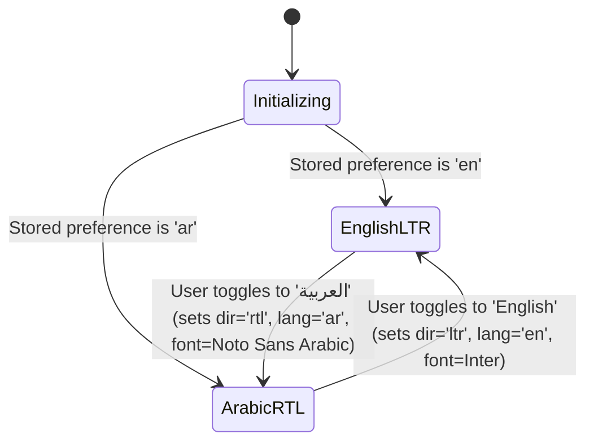
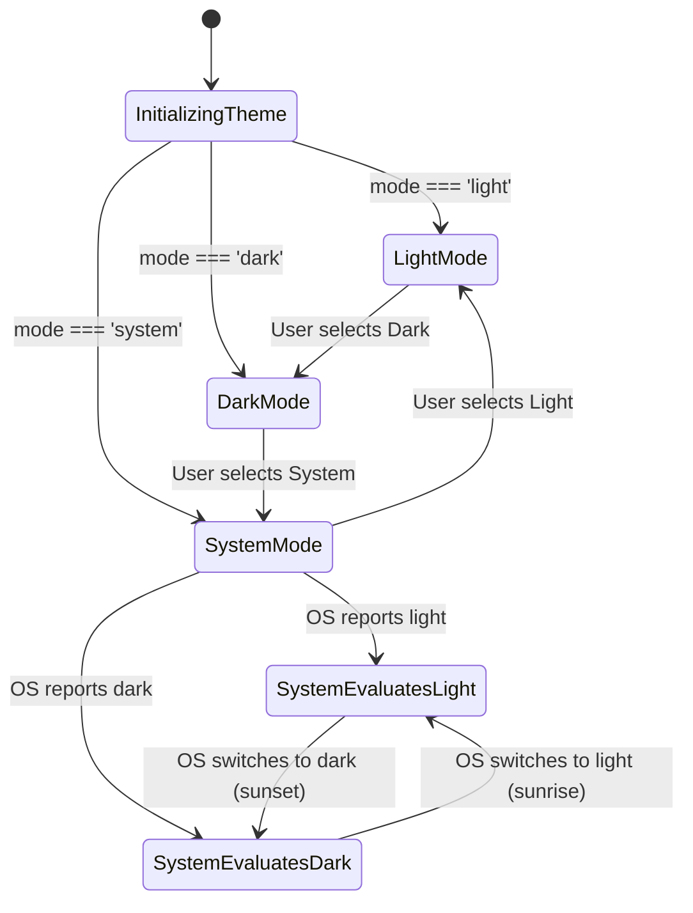
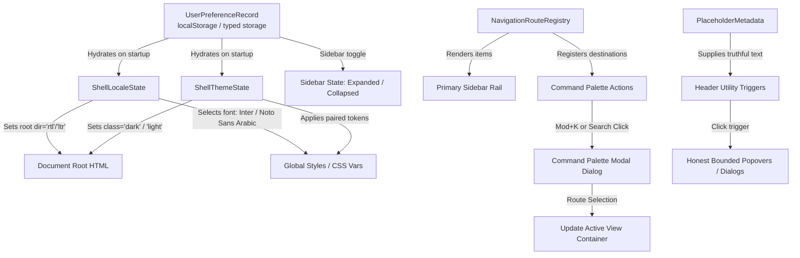

# Data Model: F005 — Accessible English/Arabic Application Shell

**Feature**: F005 — Accessible English/Arabic Application Shell  
**Milestone**: P01 — Secure desktop, identity, teams and offline cloud foundation  
**Date**: 2026-10-18  
**Status**: Complete — Design Phase 1 Artifact

---

## 1. Overview

The data model for F005 represents the client-side state of the SoloDesk application shell. It encapsulates:

- Personal display preferences (locale, theme mode, sidebar collapse state).
- Runtime shell state (resolved text direction, active typography stack, effective theme tokens).
- Navigation routing structure and current breadcrumb trail.
- Command palette registry and search query filter state.
- Truthful foundation placeholder metadata for unbuilt modules.

In accordance with Principle II (Unprivileged Renderer) and Principle V (Fail-Closed Security), preference persistence runs strictly within client-side local settings (e.g. `localStorage` or typed local store) with safe, fail-closed fallback to defaults (`en`, `system`, expanded sidebar). No server sync or encrypted database schema is required or introduced in F005.

---

## 2. Entity Definitions

### 2.1 User Preference Record (`UserPreferenceRecord`)

Represents the persistent personal settings configured by the user on the current desktop installation.

```typescript
export type SupportedLocale = "en" | "ar";
export type ThemeMode = "light" | "dark" | "system";

export interface UserPreferenceRecord {
  /**
   * Version of the user preference schema for forward compatibility.
   */
  schemaVersion: 1;

  /**
   * Selected interface language.
   * Default: 'en' (or detected OS locale if supported: 'ar').
   */
  locale: SupportedLocale;

  /**
   * Selected display theme mode.
   * Default: 'system'.
   */
  theme: ThemeMode;

  /**
   * Whether the primary navigation sidebar is collapsed into an icon-only rail.
   * Default: false (expanded).
   */
  sidebarCollapsed: boolean;

  /**
   * ISO-8601 UTC timestamp of last preference modification.
   */
  lastUpdated: string;
}
```

#### Validation Rules:

- `schemaVersion` must equal `1`.
- `locale` must be strictly `'en'` or `'ar'`.
- `theme` must be strictly `'light'`, `'dark'`, or `'system'`.
- `sidebarCollapsed` must be a boolean.
- If storage contains invalid, corrupted, or unparseable JSON, parsing MUST fail closed to safe defaults without throwing runtime exceptions:
  ```typescript
  export const DEFAULT_USER_PREFERENCES: Readonly<UserPreferenceRecord> =
    Object.freeze({
      schemaVersion: 1,
      locale: "en",
      theme: "system",
      sidebarCollapsed: false,
      lastUpdated: "1970-01-01T00:00:00.000Z",
    });
  ```

---

### 2.2 Shell Locale State (`ShellLocaleState`)

Represents the active runtime localization and typography state of the application shell.

```typescript
export type TextDirection = "ltr" | "rtl";

export interface ShellLocaleState {
  /**
   * Current active locale.
   */
  locale: SupportedLocale;

  /**
   * Current active root layout direction.
   * 'rtl' when locale === 'ar', 'ltr' when locale === 'en'.
   */
  direction: TextDirection;

  /**
   * Active CSS font family stack.
   * Latin: 'Inter, system-ui, sans-serif'
   * Arabic: 'Noto Sans Arabic, system-ui, sans-serif'
   */
  fontFamily: string;

  /**
   * Active body line-height token.
   * Latin: 1.625 (26px on 16px base)
   * Arabic: 1.625 (sufficient vertical clearance for Tashkeel/Harakat)
   */
  lineHeight: string;

  /**
   * In-bundle immutable translation dictionary for current locale.
   */
  messages: Readonly<Record<string, string>>;
}
```

#### State Transitions:



---

### 2.3 Shell Theme State (`ShellThemeState`)

Represents the active runtime theme and color token configuration.

```typescript
export type ResolvedTheme = "light" | "dark";

export interface ShellThemeState {
  /**
   * Configured preference: 'light' | 'dark' | 'system'.
   */
  mode: ThemeMode;

  /**
   * Effective evaluated theme applied to document: 'light' | 'dark'.
   * When mode === 'system', derived from matchMedia('(prefers-color-scheme: dark)').
   */
  resolvedTheme: ResolvedTheme;

  /**
   * Whether the operating system has high contrast / forced colors active.
   * Derived from matchMedia('(forced-colors: active)').
   */
  forcedColorsActive: boolean;

  /**
   * Paired semantic tokens currently applied to CSS variables.
   */
  tokens: Readonly<Record<string, string>>;
}
```

#### State Transitions:



---

### 2.4 Navigation Route Item (`NavigationRouteItem`)

Represents a top-level route in the shell's primary navigation system.

```typescript
export type RouteId =
  | "overview"
  | "my-work"
  | "projects"
  | "clients"
  | "time"
  | "finance"
  | "reports"
  | "knowledge"
  | "settings";

export interface NavigationRouteItem {
  /**
   * Stable unique route identifier.
   */
  id: RouteId;

  /**
   * Path fragment or route slug (e.g. '/overview', '/projects').
   */
  path: string;

  /**
   * Localization translation key for the route display name.
   */
  labelKey: string;

  /**
   * Identifier of the Lucide icon used in the navigation item.
   */
  iconName: string;

  /**
   * Whether the route is fully implemented or acts as an honest placeholder.
   * For F005, shell views render honest module containers.
   */
  status: "active" | "placeholder";

  /**
   * Delivery milestone / phase where this view will be fully built.
   */
  targetPhase: string;

  /**
   * Display sorting order in navigation rail (1-based index).
   */
  order: number;
}
```

#### Initial Route Registry (matching screens.md UI-001):

| Route ID    | Path         | Label Key       | Target Phase | Status                                |
| ----------- | ------------ | --------------- | ------------ | ------------------------------------- |
| `overview`  | `/overview`  | `nav.overview`  | F048 / F104  | Placeholder                           |
| `my-work`   | `/my-work`   | `nav.myWork`    | F033 / F034  | Placeholder                           |
| `projects`  | `/projects`  | `nav.projects`  | F032         | Placeholder                           |
| `clients`   | `/clients`   | `nav.clients`   | F031         | Placeholder                           |
| `time`      | `/time`      | `nav.time`      | F035 / F036  | Placeholder                           |
| `finance`   | `/finance`   | `nav.finance`   | F041 / F043  | Placeholder                           |
| `reports`   | `/reports`   | `nav.reports`   | F105         | Placeholder                           |
| `knowledge` | `/knowledge` | `nav.knowledge` | F115         | Placeholder                           |
| `settings`  | `/settings`  | `nav.settings`  | F021         | Active (Theme, Language, Window info) |

---

### 2.5 Command Palette Action (`CommandPaletteAction`)

Represents an action or route shortcut registered in the global Command Palette (`Mod+K`).

```typescript
export type CommandCategory = "navigation" | "actions" | "preferences";

export interface CommandPaletteAction {
  /**
   * Unique action identifier (e.g. 'nav.goto.projects', 'theme.toggle').
   */
  id: string;

  /**
   * Categorical grouping for result sectioning.
   */
  category: CommandCategory;

  /**
   * Translation key for the primary action label.
   */
  titleKey: string;

  /**
   * Search indexing keywords in both English and Arabic.
   */
  keywords: readonly string[];

  /**
   * Visual shortcut badge representation (e.g. 'Mod+K', 'Ctrl+T').
   */
  shortcutBadge?: string;

  /**
   * Lucide icon identifier.
   */
  iconName: string;

  /**
   * Execution callback triggered on user activation (Enter or click).
   */
  execute: () => void;

  /**
   * Whether the command is currently permitted and operable.
   */
  enabled: boolean;
}
```

#### Command Palette Filter State (`CommandPaletteFilterState`):

```typescript
export interface CommandPaletteFilterState {
  /**
   * Modal open state.
   */
  isOpen: boolean;

  /**
   * Raw user search query string.
   */
  query: string;

  /**
   * Normalized query (trimmed, lowercased, Arabic diacritics stripped).
   */
  normalizedQuery: string;

  /**
   * Filtered action items grouped by category.
   */
  filteredResults: ReadonlyArray<{
    category: CommandCategory;
    actions: readonly CommandPaletteAction[];
  }>;

  /**
   * ID of currently highlighted item for aria-activedescendant.
   */
  activeItemId: string | null;

  /**
   * Reference to document element that held focus prior to palette opening.
   */
  triggerElement: HTMLElement | null;
}
```

---

### 2.6 Honest Foundation Placeholder State (`PlaceholderMetadata`)

Represents the truthful status metadata displayed in the shell for unbuilt foundation capabilities.

```typescript
export type PlaceholderId = "workspaces" | "timer" | "sync" | "notifications";

export interface PlaceholderMetadata {
  /**
   * Unique placeholder identifier.
   */
  id: PlaceholderId;

  /**
   * Localization key for feature title.
   */
  titleKey: string;

  /**
   * Planned delivery phase (e.g. 'F012', 'F017', 'F036', 'F022').
   */
  targetPhase: string;

  /**
   * Truthful explanatory description key explaining why this feature is inactive.
   */
  explanationKey: string;

  /**
   * Truthful static display state (never synthetic revenue, fake client counts, or false sync checkmarks).
   */
  displayValue: string;

  /**
   * Project roadmap reference link.
   */
  roadmapRef: string;
}
```

#### Truthful Metadata Matrix (Strict Constitution I, III, IV, VIII adherence):

| Placeholder ID  | Planned Phase | Display Value               | Explanation                                                                                        |
| --------------- | ------------- | --------------------------- | -------------------------------------------------------------------------------------------------- |
| `workspaces`    | F012          | `"Personal Workspace"`      | Multi-workspace creation, switching, and cloud tenancy will be delivered in phase F012.            |
| `timer`         | F036          | `"00:00:00 (Inactive)"`     | Background time capture, idle detection, and system tray tracking will be delivered in phase F036. |
| `sync`          | F017          | `"Local Desktop (Offline)"` | Durable offline outbox and cloud synchronization with Supabase will be delivered in phase F017.    |
| `notifications` | F022          | `"No notifications"`        | In-app notification center and system alerts will be delivered in phase F022.                      |

---

## 3. Relationships & Data Flow



---

## 4. Invariant Rules

1. **User Content Immutability**: Toggling `locale` between `'en'` and `'ar'` updates `document.documentElement.dir`, typography, and translation dictionaries, but NEVER mutates, translates, or re-encodes user-entered entities (legal names, client descriptions, IDs, or amounts).
2. **Directional Isolation**: All rendered entity identifiers (e.g. `INV-2026-001`, `(USD)`, emails, URLs) MUST be encapsulated in `<bdi>` or directional isolates in both LTR and RTL rendering.
3. **Fail-Closed Storage**: If reading `UserPreferenceRecord` encounters invalid data or storage exceptions, the store MUST reset in-memory state to `DEFAULT_USER_PREFERENCES` without terminating the renderer process.
4. **Zero Synthetic Data**: Placeholders MUST NEVER generate synthetic client counts, simulated dollars, or fake sync statuses.
