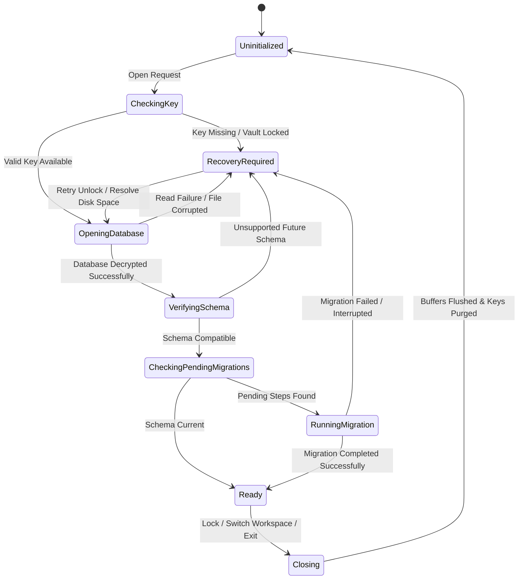
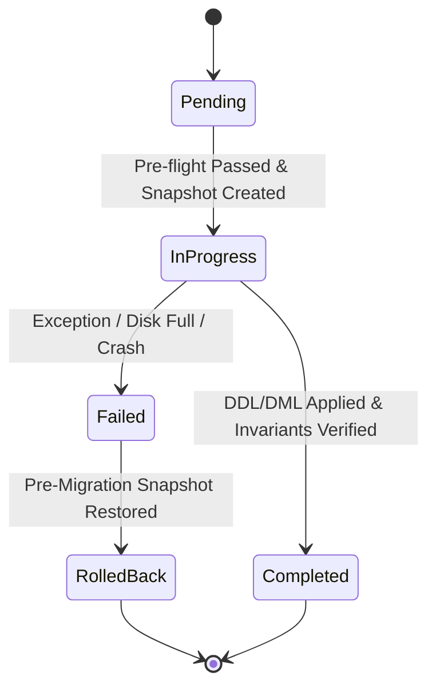

# Phase 1 Data Model: F007 Encrypted Local Persistence and Migrations

**Date**: 2026-10-19
**Status**: Technical design specification for F007 data entities, database schemas, and migration metadata.

This document defines the storage schemas, metadata structures, and state transitions required to deliver encrypted, isolated per-workspace persistence, atomic outbox persistence, and recoverable schema migrations.

---

## 1. Storage Layout and Namespace Isolation

Each enrolled workspace is assigned an isolated, encrypted database container.

### Directory Structure

```text
userData/
└── workspaces/
    └── <workspace_id>/
        ├── store.db            # Primary encrypted SQLite database (SQLCipher v4)
        ├── store.db-wal        # Write-Ahead Log (encrypted pages)
        ├── store.db-shm        # Shared memory index
        ├── .migration/         # Staging directory for migration snapshots
        │   └── pre-migration-v<version>-<timestamp>.snapshot
        └── attachments/        # Staged and cached private files (F023/F006 authenticated)
```

- **Isolation Rule**: Database connections are established strictly per `workspace_id`. A single connection cannot attach or query another workspace's database file.
- **Physical Encryption**: Entire database file (`store.db`) and WAL journal (`store.db-wal`) are encrypted using SQLCipher v4 (AES-256-CBC, PBKDF2/HMAC-SHA512).

---

## 2. Core Metadata Schemas

The following internal metadata tables exist in every workspace database to govern schema versioning and migration tracking.

### 2.1 Schema Version Table (`_schema_version`)

Tracks the current monotonic schema version and application version bounds.

```sql
CREATE TABLE IF NOT EXISTS _schema_version (
  id INTEGER PRIMARY KEY CHECK (id = 1), -- Enforces single row
  current_version INTEGER NOT NULL,
  min_app_version TEXT NOT NULL,
  max_app_version TEXT NOT NULL,
  last_migrated_at TEXT NOT NULL,       -- ISO-8601 UTC timestamp
  created_at TEXT NOT NULL              -- ISO-8601 UTC timestamp
);
```

- `current_version`: Monotonically increasing integer representing active schema version (e.g. `1`, `2`, `3`).
- `min_app_version` / `max_app_version`: Semantic version strings defining compatible application versions.

### 2.2 Migration Journal Table (`_migration_journal`)

Maintains an immutable, append-only history of migration steps and their execution lifecycle.

```sql
CREATE TABLE IF NOT EXISTS _migration_journal (
  step_id TEXT PRIMARY KEY,             -- e.g. "0001_initial_schema"
  from_version INTEGER NOT NULL,
  to_version INTEGER NOT NULL,
  status TEXT NOT NULL CHECK (
    status IN ('pending', 'in_progress', 'completed', 'failed', 'rolled_back')
  ),
  started_at TEXT NOT NULL,             -- ISO-8601 UTC
  completed_at TEXT,                    -- ISO-8601 UTC (null until finished)
  snapshot_path TEXT,                   -- Path to pre-migration snapshot file
  checksum TEXT NOT NULL,               -- SHA-256 of migration script/routine
  error_code TEXT,                      -- Standardized closed error code if failed
  error_message TEXT                    -- Redacted diagnostic message
);

CREATE INDEX IF NOT EXISTS idx_migration_journal_status
  ON _migration_journal (status, to_version);
```

---

## 3. Foundation Domain & Sync Schemas

F007 establishes the core tables required for atomic local mutations and outbound synchronization (PLT-008).

### 3.1 Synchronization Outbox Table (`outbox_operations`)

Durable queue of local changes awaiting synchronization with cloud services.

```sql
CREATE TABLE IF NOT EXISTS outbox_operations (
  operation_id TEXT PRIMARY KEY,        -- UUID v4
  workspace_id TEXT NOT NULL,
  aggregate_type TEXT NOT NULL,         -- e.g. "task", "draft_invoice", "time_entry"
  aggregate_id TEXT NOT NULL,           -- Entity identifier
  operation_type TEXT NOT NULL CHECK (
    operation_type IN ('create', 'update', 'delete', 'execute')
  ),
  payload_json TEXT NOT NULL,           -- Serialized domain mutation payload
  payload_hash TEXT NOT NULL,           -- SHA-256 digest of payload for deduplication
  expected_revision INTEGER NOT NULL,   -- Target entity revision for optimistic concurrency
  status TEXT NOT NULL CHECK (
    status IN ('queued', 'sending', 'acknowledged', 'conflicted', 'rejected')
  ),
  attempt_count INTEGER NOT NULL DEFAULT 0,
  last_attempted_at TEXT,
  error_details TEXT,
  created_at TEXT NOT NULL,
  updated_at TEXT NOT NULL
);

CREATE INDEX IF NOT EXISTS idx_outbox_operations_status
  ON outbox_operations (status, created_at);
CREATE INDEX IF NOT EXISTS idx_outbox_operations_aggregate
  ON outbox_operations (aggregate_type, aggregate_id);
```

### 3.2 Baseline Entity Record Pattern

All local domain tables adhere to a standardized metadata contract ensuring versioning, deletion tracking, and offline status.

```sql
-- Pattern implemented by all domain tables in F007 reference dataset
CREATE TABLE IF NOT EXISTS _entity_example (
  id TEXT PRIMARY KEY,                  -- UUID
  workspace_id TEXT NOT NULL,
  revision INTEGER NOT NULL DEFAULT 1,  -- Monotonic revision counter
  sync_state TEXT NOT NULL CHECK (
    sync_state IN ('synced', 'locally_created', 'locally_modified', 'locally_deleted')
  ),
  data_payload TEXT NOT NULL,           -- Encrypted entity attributes
  created_at TEXT NOT NULL,             -- ISO-8601 UTC
  updated_at TEXT NOT NULL,             -- ISO-8601 UTC
  deleted_at TEXT                       -- Soft-delete tombstone timestamp
);

CREATE INDEX IF NOT EXISTS idx_entity_example_sync
  ON _entity_example (sync_state, updated_at);
```

---

## 4. State Machines and Lifecycle Transitions

### 4.1 Persistence Store Lifecycle State Machine

Represents the connection and initialization lifecycle for a workspace database.



#### States:

- `Uninitialized`: Connection closed; no memory buffers allocated.
- `CheckingKey`: Validating encryption key availability from `ProtectionOwner`.
- `OpeningDatabase`: Decrypting header and opening SQLite connection.
- `VerifyingSchema`: Inspecting `_schema_version` table.
- `CheckingPendingMigrations`: Comparing stored version against application schema scripts.
- `RunningMigration`: Executing 5-phase migration sequence.
- `Ready`: Open, writable, active workspace store.
- `Closing`: Flushing pending WAL commits, wiping keys and memory buffers.
- `RecoveryRequired`: Fail-closed state presenting bilingual diagnostic guidance.

### 4.2 Migration Journal Step Lifecycle

Tracks an individual migration script from preparation to completion.



---

## 5. Persistence Recovery State Entity

When storage fails to open or migrate, the main process constructs an in-memory `PersistenceRecoveryState` payload for safe IPC delivery to the renderer shell.

```typescript
export interface PersistenceRecoveryState {
  workspaceId: string;
  reasonCode:
    | "vault_locked"
    | "key_missing"
    | "integrity_failed"
    | "disk_full"
    | "interrupted_migration"
    | "unsupported_future_version"
    | "io_error";
  isRecoverable: boolean;
  unsyncedWorkRetained: boolean;
  requiredFreeSpaceBytes?: number;
  availableFreeSpaceBytes?: number;
  currentSchemaVersion?: number;
  appSupportedSchemaVersion?: number;
  localizedTitle: {
    en: string;
    ar: string;
  };
  localizedMessage: {
    en: string;
    ar: string;
  };
  localizedGuidance: {
    en: string;
    ar: string;
  };
  permittedActions: Array<"retry" | "unlock" | "export_backup" | "quit">;
}
```

- **Security Constraint**: `PersistenceRecoveryState` never contains raw file paths, internal SQL queries, or key material.

---

## 6. Pre-Migration Snapshot Entity

Represents the safety snapshot created prior to applying migration steps.

```typescript
export interface PreMigrationSnapshot {
  snapshotId: string;
  workspaceId: string;
  fromVersion: number;
  toVersion: number;
  snapshotFilePath: string;
  snapshotChecksumSha256: string;
  originalDatabaseSizeBytes: number;
  createdAt: string; // ISO-8601 UTC
  verifiedAt: string; // Verification instant
}
```

- **Validation Rules**:
  1. Snapshot file size must match original database file size.
  2. SHA-256 digest is calculated and verified prior to beginning schema alterations.
  3. Snapshot file permissions must restrict access strictly to the current user.
