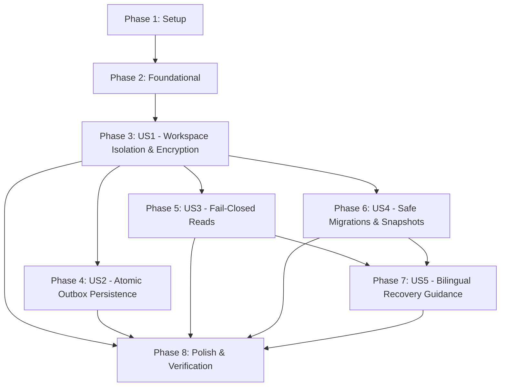

# Tasks: F007 — Encrypted Local Persistence and Migrations

**Input**: Design documents from `/specs/007-encrypted-local-persistence/` (`plan.md`, `spec.md`, `data-model.md`, `research.md`, `quickstart.md`, `contracts/`)

**Prerequisites**: plan.md (required), spec.md (required for user stories), research.md, data-model.md, contracts/

**Tests**: Test tasks are included per story, mapping directly to `quickstart.md` validation scenarios and Constitution Principle VIII evidence requirements.

**Organization**: Tasks are grouped by user story to enable independent implementation and testing of each story.

## Format: `[ID] [P?] [Story] Description`

- **[P]**: Can run in parallel (different files, no dependencies on incomplete tasks)
- **[Story]**: Which user story this task belongs to (e.g., US1, US2, US3, US4, US5)
- Include exact file paths in descriptions

## Path Conventions

- **Main process persistence**: `app/main/persistence/`
- **Main process bridge/bootstrap**: `app/main/bridge.ts`, `app/main/main.ts`
- **Preload facade**: `app/preload/preload.ts`
- **Shared contracts**: `app/shared/persistence-contracts.ts`
- **Renderer shell recovery UI**: `app/renderer/shell/`
- **Tooling & verification**: `tooling/f007/`
- **Automated test suites**: `tests/f007/`

---

## Phase 1: Setup (Shared Infrastructure)

**Purpose**: Project initialization, directory structure, and verification test harness setup

- [X] T001 Create directory structure for persistence, verification tooling, and test suites in app/main/persistence/, tooling/f007/, and tests/f007/
- [X] T002 [P] Configure F007 test script entries (test:f007, test:f007:unit, test:f007:integration, test:f007:migrations) in package.json
- [X] T003 [P] Create F007 test suite runner script in tooling/f007/verify.mjs

---

## Phase 2: Foundational (Blocking Prerequisites)

**Purpose**: Core infrastructure, types, database wrapper, metadata schemas, and baseline reference datasets that MUST be complete before ANY user story can be implemented

**⚠️ CRITICAL**: No user story work can begin until this phase is complete

- [X] T004 [P] Define shared persistence types, error codes, and DTOs in app/shared/persistence-contracts.ts including PersistenceStatusDto, PersistenceRecoveryState with reasonCode constrained to `'vault_locked' | 'key_missing' | 'integrity_failed' | 'disk_full' | 'interrupted_migration' | 'unsupported_future_version' | 'io_error'`, and permittedActions constrained to `Array<'retry' | 'unlock' | 'export_backup' | 'quit'>`
- [X] T005 [P] Create baseline reference dataset fixtures in tooling/f007/test-fixtures.mjs and app/main/persistence/schema/reference-dataset.ts with verbatim fixtures: Arabic company `شركة الأفق الرقمي للتطوير والحلول البرمجية ذ.م.م`, task `إعداد وتجهيز البيئة السحابية وتكامل قواعد البيانات المشفرة`, exact minor units `1250050` (USD), `350750` (KWD), and exact integer seconds `7200` and `86399`
- [X] T006 Create SQLCipher database connection wrapper in app/main/persistence/database-connection.ts integrating with `better-sqlite3-multiple-ciphers` in SQLCipher v4 mode with AES-256-CBC and PBKDF2/HMAC-SHA512
- [X] T007 Implement internal metadata table initialization for `_schema_version` and `_migration_journal` in app/main/persistence/schema/metadata-schema.ts with verbatim constraints: `_schema_version (id INTEGER PRIMARY KEY CHECK (id = 1), current_version INTEGER NOT NULL, min_app_version TEXT NOT NULL, max_app_version TEXT NOT NULL, last_migrated_at TEXT NOT NULL, created_at TEXT NOT NULL)` and `_migration_journal (step_id TEXT PRIMARY KEY, from_version INTEGER NOT NULL, to_version INTEGER NOT NULL, status TEXT NOT NULL CHECK (status IN ('pending', 'in_progress', 'completed', 'failed', 'rolled_back')), started_at TEXT NOT NULL, completed_at TEXT, snapshot_path TEXT, checksum TEXT NOT NULL, error_code TEXT, error_message TEXT)` and index `CREATE INDEX IF NOT EXISTS idx_migration_journal_status ON _migration_journal (status, to_version);`
- [X] T008 [P] Implement invariant reconciliation validator in tooling/f007/invariant-checker.mjs asserting `mismatchedCounts.length === 0`, `brokenForeignKeys.length === 0`, `corruptedUnicodeFields.length === 0`, and `arithmeticMismatches.length === 0`

**Checkpoint**: Foundation ready — user story implementation can now begin in parallel or sequentially.

---

## Phase 3: User Story 1 - Secure and Isolated Workspace Persistence (Priority: P1) 🎯 MVP

**Goal**: Persist local records, draft documents, and search indexes in isolated, per-workspace encrypted storage containers (`userData/workspaces/<workspace_id>/store.db`) using SQLCipher v4 with zero plaintext leakage on disk and clean memory purging on session close.

**Independent Test**: Create two test workspaces `ws-test-alpha` and `ws-test-beta`. Store distinct records containing marker strings (`ALPHA-SECRET-9941`, `مهمة سرية جداً`). Verify files on disk (`store.db`, `store.db-wal`) are 100% encrypted with zero plaintext occurrence, namespaces remain strictly isolated, and closing the connection wipes keys from memory.

### Tests for User Story 1 ⚠️

- [X] T009 [P] [US1] Unit test for workspace directory resolution and namespace isolation in tests/f007/unit/workspace-namespace.test.mjs
- [X] T010 [P] [US1] Integration test for SQLCipher page encryption and raw disk inspection in tests/f007/integration/raw-file-encryption.test.mjs
- [X] T011 [P] [US1] Integration test for session close and memory key purge in tests/f007/integration/session-close-purge.test.mjs

### Implementation for User Story 1

- [X] T012 [P] [US1] Implement workspace storage directory and path manager in app/main/persistence/workspace-storage-paths.ts resolving `userData/workspaces/<workspace_id>/` layout (`store.db`, `store.db-wal`, `.migration/`, `attachments/`)
- [X] T013 [US1] Implement `openWorkspaceStore(workspaceId, keyBinding)` lifecycle with F006 ProtectionOwner key binding in app/main/persistence/persistence-service.ts
- [X] T014 [US1] Implement `closeWorkspaceStore(workspaceId)` with WAL checkpoint and memory key buffer wiping in app/main/persistence/persistence-service.ts

**Checkpoint**: At this point, User Story 1 delivers isolated, encrypted workspace persistence.

---

## Phase 4: User Story 2 - Atomic Local Changes and Outbox Persistence (Priority: P1)

**Goal**: Save local record modifications and outbound synchronization queue entries together in a single atomic SQLite WAL transaction so offline changes never fall out of sync or leave half-applied edits.

**Independent Test**: Execute multi-table mutations paired with `outbox_operations` queue records under simulated process crash (SIGKILL before, during, and after commit). Restart the application and verify transactions either committed completely (both record and outbox entry exist) or rolled back completely (neither exists).

### Tests for User Story 2 ⚠️

- [X] T015 [P] [US2] Unit test for TransactionScope and outbox payload hashing in tests/f007/unit/transaction-scope.test.mjs
- [X] T016 [P] [US2] Integration crash-simulation test for atomic domain-outbox commits in tests/f007/integration/atomic-outbox-crash.test.mjs
- [X] T017 [P] [US2] Integration test for foreign key enforcement and optimistic revision checks in tests/f007/integration/relational-integrity.test.mjs

### Implementation for User Story 2

- [X] T018 [P] [US2] Implement outbox schema and helper methods in app/main/persistence/schema/outbox-schema.ts with verbatim constraints: `outbox_operations (operation_id TEXT PRIMARY KEY, workspace_id TEXT NOT NULL, aggregate_type TEXT NOT NULL, aggregate_id TEXT NOT NULL, operation_type TEXT NOT NULL CHECK (operation_type IN ('create', 'update', 'delete', 'execute')), payload_json TEXT NOT NULL, payload_hash TEXT NOT NULL, expected_revision INTEGER NOT NULL, status TEXT NOT NULL CHECK (status IN ('queued', 'sending', 'acknowledged', 'conflicted', 'rejected')), attempt_count INTEGER NOT NULL DEFAULT 0, last_attempted_at TEXT, error_details TEXT, created_at TEXT NOT NULL, updated_at TEXT NOT NULL)` and indexes `CREATE INDEX IF NOT EXISTS idx_outbox_operations_status ON outbox_operations (status, created_at);` and `CREATE INDEX IF NOT EXISTS idx_outbox_operations_aggregate ON outbox_operations (aggregate_type, aggregate_id);`
- [X] T019 [US2] Implement `executeTransaction()` with atomic domain entity and outbox coupling in app/main/persistence/persistence-service.ts
- [X] T020 [US2] Enforce `PRAGMA foreign_keys = ON` and optimistic concurrency revision checks in app/main/persistence/database-connection.ts

**Checkpoint**: At this point, User Stories 1 AND 2 work independently with durable, atomic offline persistence.

---

## Phase 5: User Story 3 - Fail-Closed Storage Reads Without Empty Replacements (Priority: P1)

**Goal**: Fail closed safely into a structured recovery state whenever a database file cannot be opened or decrypted, strictly refusing to create a blank or empty replacement database that could overwrite unpushed offline work.

**Independent Test**: Induce simulated storage read failures, missing key states, file permission denials, and header corruption on an existing populated database. Verify that initialization halts, no new empty database is created, the existing file is untouched, and an informative recovery state is returned.

### Tests for User Story 3 ⚠️

- [X] T021 [P] [US3] Unit test for fail-closed error mapping and status diagnostics in tests/f007/unit/fail-closed-diagnostics.test.mjs
- [X] T022 [P] [US3] Integration test asserting zero empty replacement on header corruption in tests/f007/integration/no-empty-replacement.test.mjs
- [X] T023 [P] [US3] Integration test for missing or locked key denial in tests/f007/integration/locked-vault-fail-closed.test.mjs

### Implementation for User Story 3

- [X] T024 [P] [US3] Implement storage integrity probe and failure classification in app/main/persistence/storage-probe.ts distinguishing uninitialized vs corrupt vs locked states
- [X] T025 [US3] Implement fail-closed gate in app/main/persistence/persistence-service.ts enforcing zero DDL execution and zero database recreation when an existing database file is unreadable
- [X] T026 [US3] Implement structured PersistenceRecoveryState generator in app/main/persistence/recovery-state.ts mapping native SQLite errors to closed reason codes

**Checkpoint**: At this point, existing offline databases are protected against silent replacement or corruption destruction.

---

## Phase 6: User Story 4 - Safe Schema Evolution and Migration Recovery (Priority: P1)

**Goal**: Execute 5-phase schema migrations safely with pre-flight disk space and key checks ($S_{required} \ge 2 \times S_{db} + 50\text{MB}$), restorable pre-migration safety snapshots (`.snapshot`), monotonic version tracking, and automatic rollback upon crash or failure.

**Independent Test**: Prepare a test database with baseline schema populated with the reference dataset. Execute schema migrations across sequential versions. Simulate process crash and disk-full errors at each migration step. Verify automatic detection of incomplete steps and clean restoration of the pre-migration snapshot on restart.

### Tests for User Story 4 ⚠️

- [X] T027 [P] [US4] Unit test for pre-flight disk space calculation ($S_{required} \ge 2 \times S_{db} + 50\text{MB}$) and version compatibility in tests/f007/unit/pre-flight-checks.test.mjs
- [X] T028 [P] [US4] Integration test for pre-migration snapshot creation and SHA-256 verification in tests/f007/integration/snapshot-lifecycle.test.mjs
- [X] T029 [P] [US4] Integration test for interrupted migration detection and snapshot rollback in tests/f007/migrations/interrupted-migration-rollback.test.mjs
- [X] T030 [P] [US4] Integration test for forward compatibility block (`current_version > app_max_supported_version`) in tests/f007/migrations/forward-compatibility-block.test.mjs
- [X] T031 [P] [US4] Integration test for reference dataset migration and invariant reconciliation in tests/f007/migrations/reference-dataset-reconciliation.test.mjs

### Implementation for User Story 4

- [X] T032 [P] [US4] Implement pre-flight space and version verifier in app/main/persistence/pre-flight-verifier.ts enforcing $S_{required} \ge 2 \times S_{db} + 50\text{MB}$ where $S_{db} = \text{size}(store.db) + \text{size}(store.db-wal)$
- [X] T033 [P] [US4] Implement snapshot manager with WAL checkpoint, SHA-256 digest, and `0600` file permissions in app/main/persistence/snapshot-manager.ts
- [X] T034 [US4] Implement 5-phase migration runner with journal lifecycle transitions (`pending` -> `in_progress` -> `completed`/`failed`) in app/main/persistence/migration-coordinator.ts
- [X] T035 [US4] Implement startup recovery routine for `in_progress` steps in app/main/persistence/migration-coordinator.ts restoring `.snapshot` over `store.db` and marking step `'rolled_back'`
- [X] T036 [US4] Implement baseline migration step definition `0001_initial_schema.ts` in app/main/persistence/schema/migrations/0001_initial_schema.ts

**Checkpoint**: At this point, migrations are completely crash-resilient and verifiable against baseline fixtures.

---

## Phase 7: User Story 5 - Bilingual Recovery Guidance and Unsaved Work Diagnostics (Priority: P2)

**Goal**: Expose safe storage diagnostic state to the sandboxed renderer shell and provide accessible English and Arabic recovery modal with clear unsynced work disclosures, keyboard navigation, and recovery actions (`retry`, `unlock`, `export_backup`, `quit`).

**Independent Test**: Trigger recovery states for disk-full, corrupted journal, locked vault, and future schema version. Verify that preload exposes only safe facade methods, IPC transfers sanitized DTOs without raw paths or keys, and the renderer modal renders bilingual text, RTL layout, and visible focus indicators meeting WCAG 2.2 AA.

### Tests for User Story 5 ⚠️

- [X] T037 [P] [US5] Contract test for preload persistence facade and IPC error sanitization in tests/f007/unit/ipc-contract.test.mjs
- [X] T038 [P] [US5] Component and accessibility test for PersistenceRecoveryModal (keyboard focus, screen reader aria, English/Arabic RTL) in tests/f007/unit/recovery-modal.test.mjs

### Implementation for User Story 5

- [X] T039 [P] [US5] Register validated IPC handlers for `solodesk.persistence.getState` and `retryOpen` in app/main/bridge.ts
- [X] T040 [P] [US5] Expose safe `window.solodesk.persistence` bridge facade in app/preload/preload.ts
- [X] T041 [US5] Implement accessible bilingual PersistenceRecoveryModal with RTL layout and WCAG 2.2 AA visible focus in app/renderer/shell/PersistenceRecoveryModal.tsx
- [X] T042 [US5] Integrate PersistenceRecoveryModal into application root shell in app/renderer/shell/App.tsx

**Checkpoint**: All user stories are now independently functional with accessible UI diagnostics.

---

## Phase 8: Polish & Cross-Cutting Concerns

**Purpose**: Quality gates, static analysis, full verification test runner, and documentation updates

- [X] T043 [P] Run oxlint and typescript typecheck across all F007 source files in app/ and tests/f007/
- [X] T044 Run complete F007 automated verification suite in tooling/f007/verify.mjs (`npm run test:f007`) and assert 100% pass across all scenarios
- [X] T045 [P] Update feature documentation and verification evidence in docs/features/F007.md and docs/qa/F007.md
- [X] T046 Run quickstart.md validation scenario walkthrough verifying all 6 scenarios in specs/007-encrypted-local-persistence/quickstart.md

---

## Dependencies & Execution Order

### Phase Dependencies

- **Setup (Phase 1)**: No dependencies — can start immediately.
- **Foundational (Phase 2)**: Depends on Setup completion — BLOCKS all user stories.
- **User Story 1 (Phase 3)**: Depends on Foundational completion. Delivers core encrypted workspace storage container.
- **User Story 2 (Phase 4)**: Depends on Foundational and User Story 1 (needs database connection and workspace store).
- **User Story 3 (Phase 5)**: Depends on Foundational and User Story 1 (needs database initialization path).
- **User Story 4 (Phase 6)**: Depends on Foundational and User Story 1 & 2 (needs store lifecycle, metadata schema, and baseline migrations).
- **User Story 5 (Phase 7)**: Depends on User Story 3 & 4 (needs recovery state payloads and status transitions).
- **Polish (Phase 8)**: Depends on all user story phases being complete.

### User Story Dependencies



### Within Each User Story

- Tests written first to establish acceptance assertions and failure modes
- Models, schemas, and paths implemented before core service operations
- Core service methods implemented before bridge registration
- Story complete and validated before moving to dependent stories

### Parallel Opportunities

- **Setup (Phase 1)**: T002 (`package.json`) and T003 (`tooling/f007/verify.mjs`) can run in parallel.
- **Foundational (Phase 2)**: T004 (`app/shared/persistence-contracts.ts`), T005 (`reference-dataset.ts`), and T008 (`invariant-checker.mjs`) can run in parallel.
- **User Story 1 (Phase 3)**: Tests T009, T010, T011 and path manager T012 can run in parallel.
- **User Story 2 (Phase 4)**: Tests T015, T016, T017 and outbox schema T018 can run in parallel.
- **User Story 3 (Phase 5)**: Tests T021, T022, T023 and storage probe T024 can run in parallel.
- **User Story 4 (Phase 6)**: Tests T027, T028, T029, T030, T031 and pre-flight verifier T032, snapshot manager T033 can run in parallel.
- **User Story 5 (Phase 7)**: Tests T037, T038 and bridge handlers T039, preload facade T040 can run in parallel.
- **Polish (Phase 8)**: Linter T043 and documentation T045 can run in parallel.

---

## Parallel Example: User Story 1

```bash
# Launch all test tasks for User Story 1 together:
Task: "Unit test for workspace directory resolution and namespace isolation in tests/f007/unit/workspace-namespace.test.mjs"
Task: "Integration test for SQLCipher page encryption and raw disk inspection in tests/f007/integration/raw-file-encryption.test.mjs"
Task: "Integration test for session close and memory key purge in tests/f007/integration/session-close-purge.test.mjs"

# Launch independent implementation files:
Task: "Implement workspace storage directory and path manager in app/main/persistence/workspace-storage-paths.ts"
```

---

## Parallel Example: User Story 4

```bash
# Launch test suite creation for User Story 4 together:
Task: "Unit test for pre-flight disk space calculation and version compatibility in tests/f007/unit/pre-flight-checks.test.mjs"
Task: "Integration test for pre-migration snapshot creation and SHA-256 verification in tests/f007/integration/snapshot-lifecycle.test.mjs"
Task: "Integration test for interrupted migration detection and snapshot rollback in tests/f007/migrations/interrupted-migration-rollback.test.mjs"
Task: "Integration test for forward compatibility block in tests/f007/migrations/forward-compatibility-block.test.mjs"
Task: "Integration test for reference dataset migration and invariant reconciliation in tests/f007/migrations/reference-dataset-reconciliation.test.mjs"

# Launch independent implementation modules:
Task: "Implement pre-flight space and version verifier in app/main/persistence/pre-flight-verifier.ts"
Task: "Implement snapshot manager with WAL checkpoint, SHA-256 digest, and 0600 file permissions in app/main/persistence/snapshot-manager.ts"
```

---

## Implementation Strategy

### MVP First (User Story 1 Only)

1. Complete Phase 1: Setup (`package.json`, directories, runner).
2. Complete Phase 2: Foundational (types, reference dataset, SQLCipher connection, metadata schemas).
3. Complete Phase 3: User Story 1 (isolated paths, `openWorkspaceStore`, `closeWorkspaceStore`, encryption verification).
4. **STOP and VALIDATE**: Test User Story 1 independently with `tests/f007/integration/raw-file-encryption.test.mjs`.
5. Deliver MVP core encryption foundation.

### Incremental Delivery

1. **Increment 1 (MVP)**: Setup + Foundation + US1 $\rightarrow$ Isolated encrypted workspace database containers.
2. **Increment 2**: US2 $\rightarrow$ Atomic domain mutations coupled with `outbox_operations` in WAL transactions.
3. **Increment 3**: US3 $\rightarrow$ Fail-closed read handling with zero empty replacements on corruption or locked keys.
4. **Increment 4**: US4 $\rightarrow$ 5-phase migration coordinator with pre-flight space check, restorable `.snapshot`, and automatic crash rollback.
5. **Increment 5**: US5 $\rightarrow$ Safe preload facade and accessible bilingual `PersistenceRecoveryModal` with WCAG 2.2 AA focus and RTL support.
6. **Increment 6**: Polish $\rightarrow$ Linting, typecheck, documentation evidence, and full scenario walkthrough.

### Parallel Team Strategy

With multiple developers:

1. Team completes Setup + Foundational together (T001–T008).
2. Once Foundational is done and US1 is established:
   - Developer A: User Story 2 (atomic transactions & outbox)
   - Developer B: User Story 3 (fail-closed read handling & diagnostics)
   - Developer C: User Story 4 (migration coordinator & snapshot manager)
3. Developer D joins for User Story 5 (bridge, preload, and recovery modal).
4. Stories complete and integrate cleanly through verified contracts.

---

## Notes

- **[P] tasks**: Different files, zero dependencies on incomplete tasks.
- **[Story] label**: Maps task strictly to user story (`[US1]`, `[US2]`, `[US3]`, `[US4]`, `[US5]`) for end-to-end traceability.
- **Fail-closed invariant**: Any read error or locked key MUST NEVER trigger `CREATE TABLE` or create an empty replacement database.
- **Exact money & duration preservation**: Verification asserts that minor units (e.g. `1250050`) and integer seconds (e.g. `7200`) are preserved without float coercion.
- **Multilingual RTL & Accessibility**: Error and recovery states provide complete English and Arabic strings adhering to WCAG 2.2 AA visible focus indicators and screen reader attributes.
- **Authorization boundary**: Delivery of `tasks.md` is a documentation planning milestone. Actual code implementation requires explicit user authorization.
