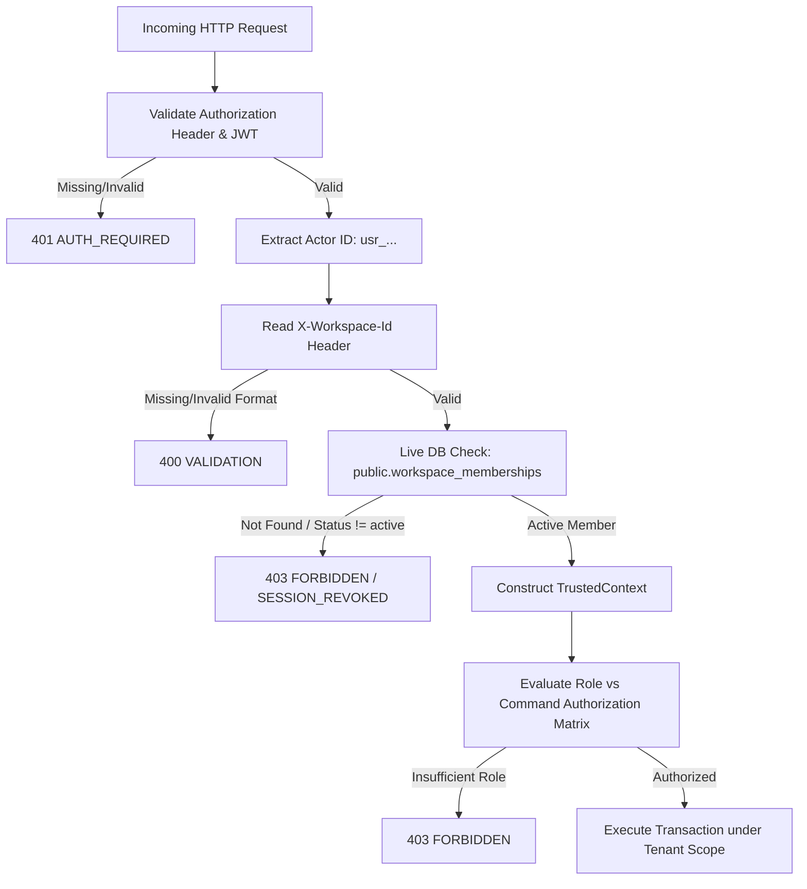

# Domain Gateway Boundary Contract: F008 Edge Function API

**Date**: 2026-10-19  
**Feature**: [F008 — Managed Backend and Tenant Isolation](../spec.md)  
**Parent Contract**: [Data Model](../data-model.md)  
**Status**: Authoritative Serverless Gateway and Security Boundary Specification

---

## 1. Architectural Scope

This contract defines the serverless Edge Function API execution boundary, request authentication, trusted context extraction, role authorization matrix, standardized error responses, and cryptographic secret isolation.

### 1.1. Invariants

1. **Zero Secret Leakage**: Service-role and database superuser keys reside strictly in secure backend environment secrets (`SUPABASE_SERVICE_ROLE_KEY`). They are NEVER distributed, bundled, or transmitted to desktop or browser clients.
2. **Context Integrity**: Every incoming request extracts the authenticated user identity (`usr_...`) and validates live workspace membership before command execution.
3. **Canonical Error Envelope**: All failed outcomes return the standardized F003 `PublicError` schema (`packages/contracts/src/errors.ts`) with unique diagnostic identifiers and paired English/Arabic recovery keys.
4. **Immediate Revocation**: Cached client privileges or stale JWT claims are superseded by live database membership lookups on every consequential mutation.

---

## 2. Request Envelope & Context Extraction

All domain commands submitted to Edge Functions must include standard authentication headers:

```http
POST /v1/commands/execute HTTP/1.1
Host: api.solodesk.internal
Authorization: Bearer <Supabase_Auth_JWT>
X-Workspace-Id: ws_01j7abc123...
X-Correlation-Id: dia_01j7xyz789...
X-Operation-Id: op_01j7def456...
Content-Type: application/json


{
  "command": "project.create",
  "payload": { ... }
}
```

### 2.1. Gateway Context Construction Pipeline



### 2.2. `TrustedContext` Type (F003 Compatible)

```typescript
export type TrustedContext = Readonly<{
  actorId: Id<"actor">; // 'usr_[...]'
  workspaceId: Id<"workspace">; // 'ws_[...]'
  deviceId?: Id<"device">; // 'dev_[...]' if enrolled
  role: "owner" | "admin" | "manager" | "contributor" | "finance" | "viewer";
  sessionObservation: string; // ISO 8601 verification instant
  authorityObservation: string; // DB transaction ID or membership revision
}>;
```

---

## 3. Role Authorization Matrix

The gateway enforces the standard SoloDesk role templates defined in `docs/specs/platform-and-workspaces.md`:

| Command / Capability Category           | Owner |       Admin       |      Manager      | Contributor |       Finance        | Viewer |
| :-------------------------------------- | :---: | :---------------: | :---------------: | :---------: | :------------------: | :----: |
| **Workspace Settings & Profile**        |  YES  |        YES        |        NO         |     NO      |          NO          |   NO   |
| **Ownership Transfer**                  |  YES  |        NO         |        NO         |     NO      |          NO          |   NO   |
| **Member Invite & Role Modification**   |  YES  |        YES        |        NO         |     NO      |          NO          |   NO   |
| **Client Management (Create/Edit)**     |  YES  |        YES        |        YES        |     NO      | Billing Profile Only |   NO   |
| **Project Management (Create/Edit)**    |  YES  |        YES        |        YES        |     NO      |          NO          |   NO   |
| **Task Management (Create/Edit)**       |  YES  |        YES        |        YES        |     YES     |          NO          |   NO   |
| **Time Tracking (Own Entries)**         |  YES  |        YES        |        YES        |     YES     |         YES          |   NO   |
| **Time Approval (Others' Entries)**     |  YES  | Explicit Reviewer | Explicit Reviewer |     NO      |  Explicit Reviewer   |   NO   |
| **Invoice Drafting**                    |  YES  |        YES        |        YES        |     NO      |         YES          |   NO   |
| **Invoice Issuance & Financial Commit** |  YES  |        NO         |        NO         |     NO      |         YES          |   NO   |
| **Cost Rates & Profitability**          |  YES  |        NO         |  Explicit Grant   |     NO      |         YES          |   NO   |
| **Storage Object Upload**               |  YES  |        YES        |        YES        |     YES     |         YES          |   NO   |
| **Storage Object Delete**               |  YES  |        YES        |        NO         |     NO      |          NO          |   NO   |
| **Audit Log Read**                      |  YES  |        YES        |        NO         |     NO      |          NO          |   NO   |

---

## 4. Standardized Error Mapping (F003 PublicError)

When an Edge Function encounters an error or constraint violation, it formats the response conforming strictly to `PublicError`:

```json
{
  "code": "FORBIDDEN",
  "messageKey": "error.forbidden",
  "params": {},
  "diagnosticId": "dia_01j7xyz7894561234567890abc",
  "recovery": "refresh_access",
  "outcomeCertainty": "not_applied"
}
```

### 4.1. Error Mapping Table

| Internal Backend Condition                      | HTTP Status | PublicError `code`     | PublicError `recovery` | `outcomeCertainty` |
| :---------------------------------------------- | :---------: | :--------------------- | :--------------------- | :----------------- |
| Missing or unparseable Bearer token             |     401     | `AUTH_REQUIRED`        | `sign_in`              | `not_applied`      |
| Revoked membership / expired session            |     401     | `SESSION_REVOKED`      | `sign_in`              | `not_applied`      |
| Cross-tenant access attempt / wrong workspace   |     403     | `FORBIDDEN`            | `refresh_access`       | `not_applied`      |
| Insufficient role permissions for command       |     403     | `FORBIDDEN`            | `refresh_access`       | `not_applied`      |
| Target record not found in workspace            |     404     | `RESOURCE_UNAVAILABLE` | `refresh_access`       | `not_applied`      |
| Schema validation failure / bad payload format  |     400     | `VALIDATION`           | `correct_fields`       | `not_applied`      |
| Storage quota exceeded (100% exhaustion)        |  429 / 507  | `STORAGE_UNAVAILABLE`  | `recover_storage`      | `not_applied`      |
| Cloud service paused / provider unavailable     |     503     | `SERVICE_UNAVAILABLE`  | `reconcile_operation`  | `unknown`          |
| Database transaction deadlock / retryable error |     429     | `RATE_LIMITED`         | `retry_after`          | `not_applied`      |

---

## 5. Secret Vault Isolation Verification

To guarantee that administrative database keys are never exposed (FR-012, SC-009):

1. **Environment Segregation**:
   - `SUPABASE_SERVICE_ROLE_KEY`: Loaded only in the Supabase Edge Function environment via `Deno.env.get("SUPABASE_SERVICE_ROLE_KEY")`.
   - `VITE_SUPABASE_PUBLISHABLE_KEY`: Public anonymous key provided to client desktop and web builds.
2. **Automated Static Scan Gate**:
   A dedicated automated security check (`check:security` / `verify`) scans 100% of packaged desktop application assets, renderer bundles, and configuration files, asserting that no service-role JWT or postgres superuser string exists in distribution files.
