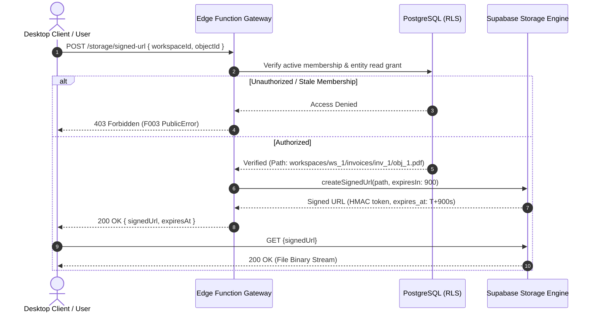

# Private Storage Protocol Contract: F008 Scoped Object Storage

**Date**: 2026-10-19  
**Feature**: [F008 — Managed Backend and Tenant Isolation](../spec.md)  
**Parent Contract**: [Data Model](../data-model.md)  
**Status**: Authoritative Storage & File Security Specification

---

## 1. Architectural Scope

This contract defines the object storage architecture, bucket policies, path naming conventions, and time-limited signed URL token lifecycle governing all private file assets (invoices, receipts, contracts, project attachments) in SoloDesk.

### 1.1. Invariants

1. **Private by Default**: Storage buckets are strictly private (`public = false`). Direct unauthenticated HTTP requests are rejected with `HTTP 403 Forbidden`.
2. **Tenant Path Partitioning**: Every stored object MUST be placed under a path prefixed by the owning `workspace_id`.
3. **Engine-Level Storage RLS**: Storage access is secured by PostgreSQL Row Level Security on the `storage.objects` table, matching the acting user's live workspace membership.
4. **Time-Limited Signed URLs**: Authorized file downloads execute exclusively through short-lived cryptographic signed URLs with a maximum lifespan of **15 minutes (900 seconds)**.
5. **Path Traversal Defense**: All entity IDs and filenames are sanitized; relative segments (`..`, `//`, `./`), leading/trailing slashes, and control characters are strictly rejected.

---

## 2. Storage Bucket Configuration

```sql
-- Supabase Storage Bucket Initialization
INSERT INTO storage.buckets (id, name, public, file_size_limit, allowed_mime_types)
VALUES (
  'workspaces',
  'workspaces',
  false,                              -- Private bucket; unauthenticated public access denied
  104857600,                          -- 100 MB maximum file size limit
  ARRAY[                              -- Allowed business MIME types
    'application/pdf',
    'image/png',
    'image/jpeg',
    'image/webp',
    'text/plain',
    'text/csv',
    'application/json'
  ]
)
ON CONFLICT (id) DO UPDATE SET
  public = false,
  file_size_limit = 104857600;
```

---

## 3. Canonical Path Taxonomy

All file objects in the `workspaces` bucket conform to the following deterministic hierarchical structure:

```text
workspaces/{workspace_id}/{entity_type}/{entity_id}/{file_id}-{sanitized_filename}
```

### Components:

- `workspaces`: The root container namespace.
- `{workspace_id}`: The immutable tenant identifier (e.g., `ws_01j7abc...`).
- `{entity_type}`: The owning business aggregate: `invoices`, `receipts`, `contracts`, `projects`, `profiles`.
- `{entity_id}`: The stable identifier of the owning entity (e.g., `inv_...`, `prj_...`).
- `{file_id}`: Unique base32/UUIDv7 file identifier (`obj_...`).
- `{sanitized_filename}`: Bounded alphanumeric ASCII string with single extension (`statement.pdf`).

### Path Validation Regex:

```text
^workspaces\/(ws_[a-zA-Z0-9_-]+)\/(invoices|receipts|contracts|projects|profiles)\/([a-zA-Z0-9_-]+)\/(obj_[a-zA-Z0-9_-]+)-[a-zA-Z0-9_.-]+$
```

Any upload path failing to match this regex is rejected immediately by the API gateway before storage invocation.

---

## 4. Storage Row Level Security Policies

Policies defined on `storage.objects` in PostgreSQL:

```sql
-- 1. SELECT Policy (Read / Download / Generate Signed URL)
CREATE POLICY "storage_select_tenant_member" ON storage.objects
  FOR SELECT USING (
    bucket_id = 'workspaces' AND
    (storage.foldername(name))[1] = 'workspaces' AND
    public.has_active_membership((storage.foldername(name))[2])
  );

-- 2. INSERT Policy (Upload New File)
CREATE POLICY "storage_insert_tenant_contributor" ON storage.objects
  FOR INSERT WITH CHECK (
    bucket_id = 'workspaces' AND
    (storage.foldername(name))[1] = 'workspaces' AND
    public.has_active_membership((storage.foldername(name))[2]) AND
    public.get_workspace_role((storage.foldername(name))[2]) IN (
      'owner', 'admin', 'manager', 'contributor', 'finance'
    )
  );

-- 3. DELETE Policy (Remove File)
CREATE POLICY "storage_delete_tenant_admin" ON storage.objects
  FOR DELETE USING (
    bucket_id = 'workspaces' AND
    (storage.foldername(name))[1] = 'workspaces' AND
    public.has_active_membership((storage.foldername(name))[2]) AND
    public.get_workspace_role((storage.foldername(name))[2]) IN ('owner', 'admin')
  );

-- 4. UPDATE Policy (Prohibited; Files are immutable)
CREATE POLICY "storage_update_deny_all" ON storage.objects
  FOR UPDATE USING (false);
```

---

## 5. Signed URL Token Lifecycle

Downloads are never accessed via persistent public endpoints. The client application requests a signed URL through the domain command gateway.



### Lifecycle Rules:

1. **Lifespan**: Maximum TTL is 900 seconds (15 minutes). No client-requested expiration may exceed 900 seconds.
2. **One-Way Cryptographic Token**: The URL contains an HMAC signature computed with the storage engine's secret key.
3. **Token Expiration**: Upon expiration ($T > \text{expires\_at}$), the storage engine immediately returns `HTTP 400 ExpiredToken` or `HTTP 403 SignatureDoesNotMatch`.
4. **Tenant Isolation Guarantee**: A signed token generated for `workspaces/ws_alpha/...` cannot be used or modified to access `workspaces/ws_beta/...`; any parameter alteration invalidates the cryptographic signature.

---

## 6. Upload Verification Protocol

To prevent orphaned storage consumption and enforce quota tracking, file uploads follow a two-phase commit protocol:

1. **Phase 1: Quota Pre-Flight Check**:
   The domain gateway checks `provider_quota_profiles` for the workspace. If `object_storage_bytes + new_file_size > object_storage_limit_bytes`, the upload is rejected before transfer with `STORAGE_UNAVAILABLE` (F003 PublicError).
2. **Phase 2: Storage Upload**:
   The client uploads the file to the validated path using an authenticated session token.
3. **Phase 3: Relational Registration**:
   The client commits the metadata record in `tenant_storage_objects` including SHA-256 digest, size in bytes, and owning entity reference. The database trigger updates `provider_quota_profiles.object_storage_bytes`.
4. **Orphan Cleanup**: Any file uploaded to storage that lacks a corresponding `tenant_storage_objects` record after 1 hour is automatically purged by a background sweeper job.
