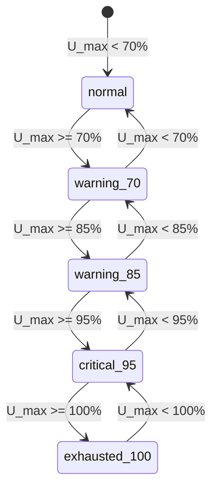
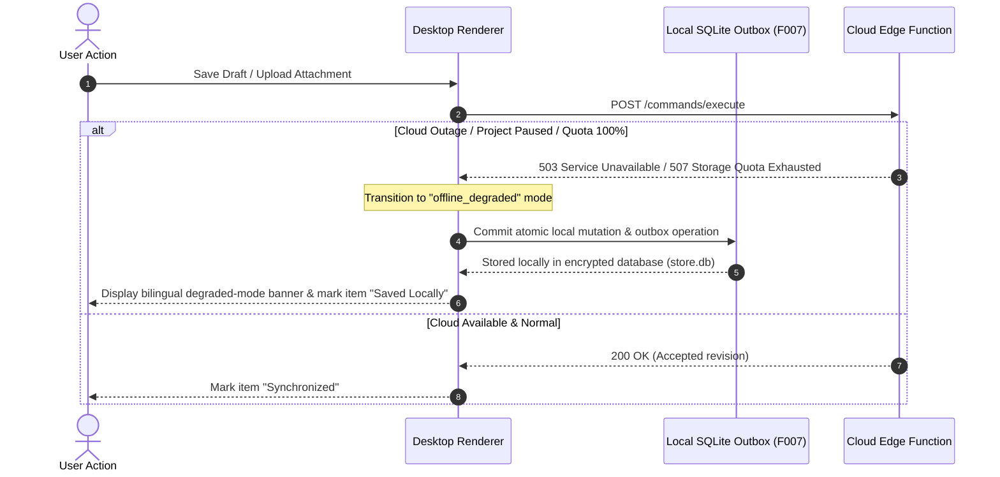

# Quota & Degraded Mode Contract: F008 Cloud Resilience

**Date**: 2026-10-19  
**Feature**: [F008 — Managed Backend and Tenant Isolation](../spec.md)  
**Parent Contract**: [Data Model](../data-model.md)  
**Status**: Authoritative Quota Management and Offline Degraded-Mode Specification

---

## 1. Architectural Scope

This contract defines operational quota tracking, progressive threshold alerts, clean write rejection on capacity exhaustion, non-destructive offline degradation during cloud outages, and accessible bilingual notifications in English and Arabic.

### 1.1. Invariants

1. **Zero Data Discard**: Under no circumstance does the system silently drop, delete, or overwrite existing records or files to accommodate quota limits or handle provider outages.
2. **Deterministic Write Rejection**: When capacity reaches 100%, new cloud mutations are cleanly rejected with standard F003 `STORAGE_UNAVAILABLE` or `UPGRADE_REQUIRED` error envelopes.
3. **Local Draft Preservation**: The desktop client responds to cloud write rejections and connection dropouts by cleanly retaining all user inputs in the local encrypted SQLite outbox (F007).
4. **Bilingual Accessibility**: All quota alerts, error banners, and degraded-mode indicators are fully localized in English and Arabic with compliant RTL layouts (WCAG 2.2 AA).

---

## 2. Quota Threshold Tiers & Triggers

Quota utilization is evaluated across three primary dimensions:

- $U_{db}$: Database Storage bytes used / Database limit bytes.
- $U_{obj}$: Object Storage bytes used / Object limit bytes.
- $U_{egress}$: Monthly Egress bytes used / Monthly egress limit bytes.

$$U_{max} = \max(U_{db}, U_{obj}, U_{egress})$$

### 2.1. Threshold Specifications

| Tier                | Range                | Severity       | Action & UI Presentation                                                                                 |
| :------------------ | :------------------- | :------------- | :------------------------------------------------------------------------------------------------------- |
| **`normal`**        | $0\% \le U < 70\%$   | Info           | Normal system operation; no active warning banners.                                                      |
| **`warning_70`**    | $70\% \le U < 85\%$  | Low Warning    | Informational banner in Settings > Workspace Storage. Recommendations to review large attachments.       |
| **`warning_85`**    | $85\% \le U < 95\%$  | Medium Warning | Persistent badge on navigation shell. Actionable cleanup dialog.                                         |
| **`critical_95`**   | $95\% \le U < 100\%$ | High Warning   | Modal alert on application launch. Notice that cloud writes will halt upon reaching 100%.                |
| **`exhausted_100`** | $U \ge 100\%$        | Error / Lock   | Cloud write operations rejected. App prompts offline mode or plan upgrade. Existing records 100% intact. |

---

## 3. Bilingual Localization & Text Specifications

All threshold notices and recovery states provide parallel English and Arabic translations:

### 3.1. Quota Warning 70% (`warning_70`)

- **Key**: `quota.warning_70`
- **English**: _"Workspace storage is at {percent}% of your current plan allowance. Consider reviewing older attachments."_
- **Arabic**: _"وصلت مساحة تخزين مساحة العمل إلى {percent}% من الحد المسموح به في خطتك الحالية. يُرجى مراجعة المرفقات القديمة."_

### 3.2. Quota Warning 85% (`warning_85`)

- **Key**: `quota.warning_85`
- **English**: _"Warning: Workspace storage has reached {percent}%. Cloud write capabilities may be limited soon."_
- **Arabic**: _"تحذير: وصلت مساحة تخزين مساحة العمل إلى {percent}%. قد يتم تقييد عمليات الكتابة السحابية قريبًا."_

### 3.3. Quota Critical 95% (`critical_95`)

- **Key**: `quota.critical_95`
- **English**: _"Critical capacity: {percent}% of quota utilized. New cloud uploads and records will be halted at 100%."_
- **Arabic**: _"سعة حرجة: تم استخدام {percent}% من الحصة المحددة. ستتوقف عمليات الرفع والتسجيل السحابية الجديدة عند بلوغ 100%."_

### 3.4. Quota Exhausted 100% (`exhausted_100`)

- **Key**: `quota.exhausted_100`
- **English**: _"Quota exhausted. Cloud writes are temporarily suspended. Your existing records are safe, and new edits are saved locally."_
- **Arabic**: _"تم استنفاد الحصة المحددة. تم تعليق عمليات الكتابة السحابية مؤقتًا. سجلاتك الحالية آمنة، ويتم حفظ التعديلات الجديدة محليًا."_

### 3.5. Provider Outage / Degraded Mode (`provider_degraded`)

- **Key**: `quota.provider_degraded`
- **English**: _"Cloud backend unavailable (maintenance or paused). SoloDesk is running safely in offline mode with local persistence."_
- **Arabic**: _"الخدمة السحابية غير متاحة حاليًا (صيانة أو متوقفة مؤقتًا). يعمل سولو ديسك بأمان في وضع عدم الاتصال مع حفظ محلي كامل."_

---

## 4. Offline Degraded-Mode Transition Protocol

When the cloud backend encounters network errors, HTTP 503 (`SERVICE_UNAVAILABLE`), HTTP 507 (`STORAGE_UNAVAILABLE`), or project inactivity pause:

### Protocol Steps:

1. **Detection**: The desktop bridge detects a connection timeout, HTTP 503, or quota-exhausted error envelope.
2. **Non-Destructive Local Commit**: The mutation payload is committed directly to the local encrypted SQLite database (`store.db`) with `status = 'pending_outbox'`.
3. **UI Status Update**: The UI updates the sync indicator to _"Saved Locally (Offline)"_, displays the bilingual explanation banner, and suppresses destructive error popups.
4. **Automatic Reconnection Backoff**: When connectivity or quota headroom is restored, the local sync worker (F017) resumes pushing pending outbox operations in strict commit order.
