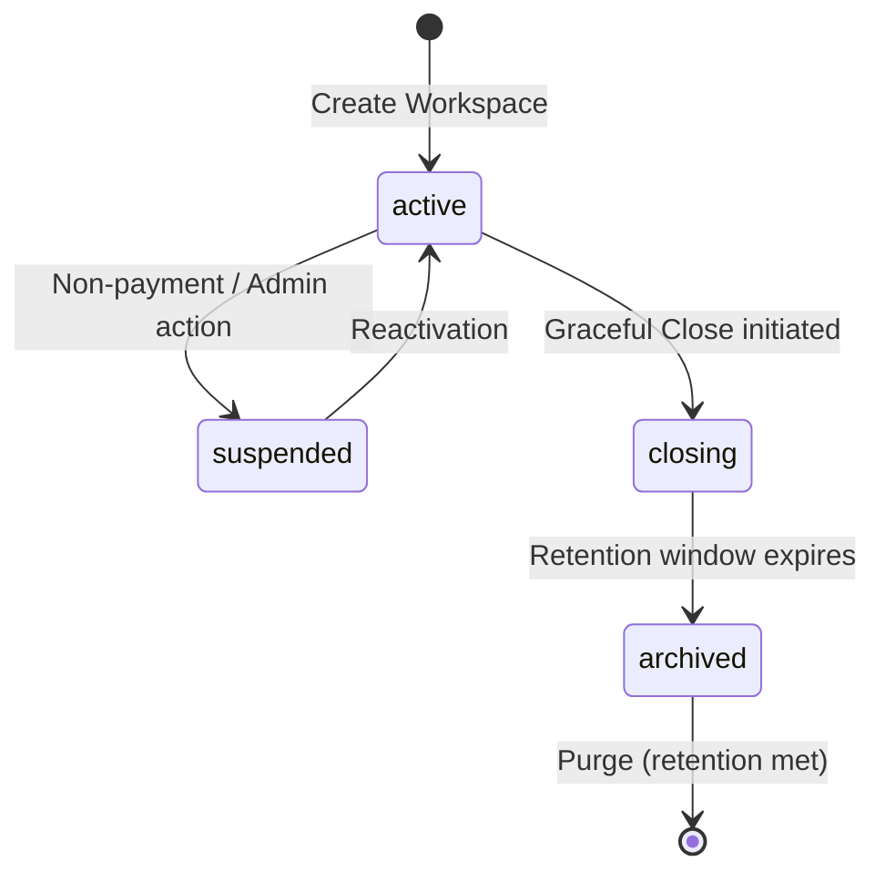
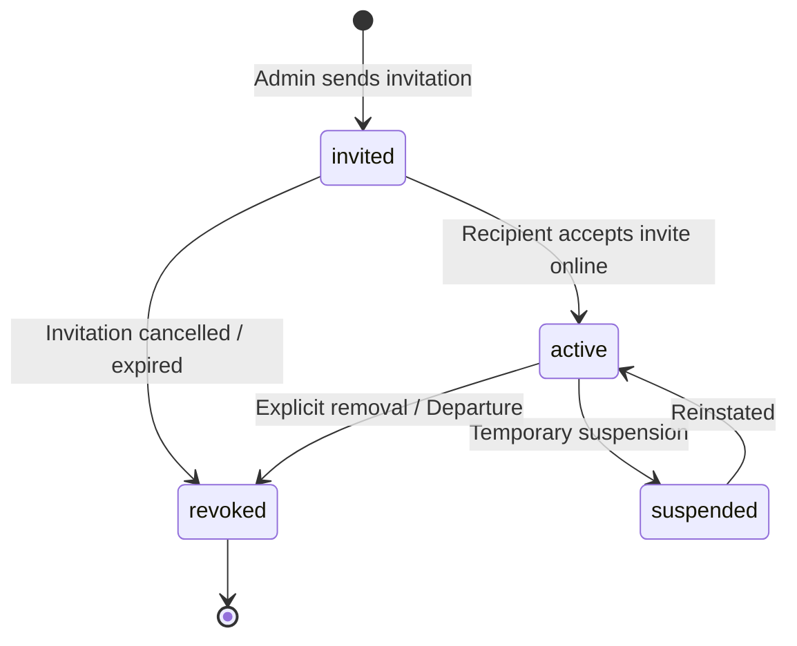
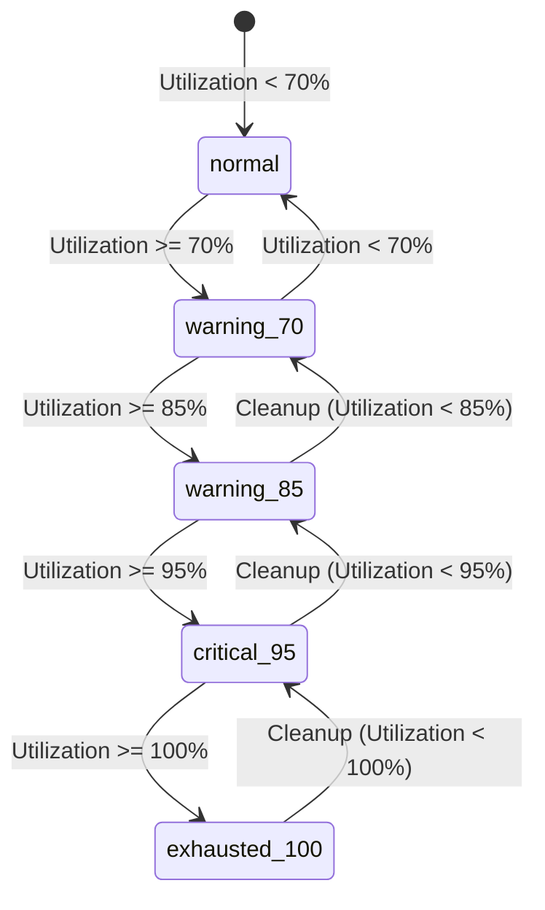

# Data Model: F008 — Managed Backend and Tenant Isolation

**Date**: 2026-10-19  
**Feature**: [F008 — Managed Backend and Tenant Isolation](spec.md)  
**Status**: Phase 1 Design Specification (authoritative relational schema, constraints, RLS policies, and state machines)

---

## 1. Overview and Relational Architecture

The authoritative backend persistence layer is built on PostgreSQL 16+ using a shared database and shared schema model with mandatory row-level tenant discrimination via the immutable `workspace_id` column.

Every tenant-scoped table incorporates:

1. An immutable `workspace_id text NOT NULL` column.
2. A composite uniqueness constraint or primary key `(workspace_id, id)`.
3. A `BEFORE UPDATE` trigger rejecting any modification of `workspace_id`.
4. Mandatory composite foreign keys `(workspace_id, parent_id)` on child entities.
5. Fail-closed Row Level Security (`ENABLE & FORCE ROW LEVEL SECURITY`) with `SELECT`, `INSERT`, `UPDATE`, and `DELETE` policies evaluated dynamically against live workspace memberships.

---

## 2. Core Tables and Schemas

### 2.1. `workspace_tenants` (The Tenant Boundary)

Represents an independent organization, business entity, or solo freelancer account.

```sql
CREATE TABLE public.workspace_tenants (
  id text PRIMARY KEY,                                      -- Format: 'ws_[base32/uuidv7]'
  legal_name text NOT NULL CHECK (char_length(legal_name) BETWEEN 1 AND 255),
  trade_name text CHECK (trade_name IS NULL OR char_length(trade_name) BETWEEN 1 AND 255),
  default_timezone text NOT NULL DEFAULT 'UTC',             -- Valid IANA timezone identifier
  default_currency text NOT NULL CHECK (char_length(default_currency) = 3), -- ISO 4217 code (e.g., 'USD', 'SAR', 'EUR')
  default_locale text NOT NULL DEFAULT 'en' CHECK (default_locale IN ('en', 'ar')),
  status text NOT NULL DEFAULT 'active' CHECK (status IN ('active', 'suspended', 'closing', 'archived')),
  created_at timestamptz NOT NULL DEFAULT clock_timestamp(),
  updated_at timestamptz NOT NULL DEFAULT clock_timestamp()
);

CREATE INDEX idx_workspace_tenants_status ON public.workspace_tenants(status);
```

### 2.2. `workspace_memberships` (Actor-Tenant Binding)

Binds an authenticated user identity (`auth.users.id`) to a workspace tenant with an assigned role template.

```sql
CREATE TABLE public.workspace_memberships (
  workspace_id text NOT NULL REFERENCES public.workspace_tenants(id) ON DELETE RESTRICT,
  user_id text NOT NULL,                                    -- Supabase Auth UUID as text: 'usr_[...]'
  role text NOT NULL CHECK (role IN ('owner', 'admin', 'manager', 'contributor', 'finance', 'viewer')),
  status text NOT NULL DEFAULT 'active' CHECK (status IN ('invited', 'active', 'suspended', 'revoked')),
  invited_email text CHECK (invited_email IS NULL OR invited_email ~* '^[A-Za-z0-9._%+-]+@[A-Za-z0-9.-]+\.[A-Za-z]{2,}$'),
  invitation_token text UNIQUE,
  invitation_expires_at timestamptz,
  granted_by text,                                          -- Acting user ID who created the grant
  created_at timestamptz NOT NULL DEFAULT clock_timestamp(),
  updated_at timestamptz NOT NULL DEFAULT clock_timestamp(),

  PRIMARY KEY (workspace_id, user_id)
);

CREATE INDEX idx_workspace_memberships_user ON public.workspace_memberships(user_id, status);
CREATE INDEX idx_workspace_memberships_workspace_status ON public.workspace_memberships(workspace_id, status);
CREATE INDEX idx_workspace_memberships_role ON public.workspace_memberships(workspace_id, role) WHERE status = 'active';
```

### 2.3. `tenant_audit_events` (Immutable Audit Trail)

Records high-consequence administrative actions, role adjustments, and ownership transfers.

```sql
CREATE TABLE public.tenant_audit_events (
  id text PRIMARY KEY,                                      -- Format: 'aud_[...]'
  workspace_id text NOT NULL REFERENCES public.workspace_tenants(id) ON DELETE RESTRICT,
  actor_id text NOT NULL,                                   -- Acting user ID ('usr_[...]')
  action_type text NOT NULL CHECK (action_type IN (
    'membership_invited', 'membership_accepted', 'membership_revoked',
    'role_granted', 'role_changed', 'owner_transferred',
    'workspace_created', 'workspace_updated', 'policy_updated'
  )),
  target_resource_type text NOT NULL CHECK (char_length(target_resource_type) BETWEEN 1 AND 64),
  target_resource_id text NOT NULL CHECK (char_length(target_resource_id) BETWEEN 1 AND 128),
  change_diff jsonb NOT NULL DEFAULT '{}'::jsonb,           -- Redacted previous vs new attributes
  correlation_id text NOT NULL,                             -- Request correlation ID / diagnostic ID
  occurred_at timestamptz NOT NULL DEFAULT clock_timestamp(),

  CONSTRAINT uq_audit_event_workspace UNIQUE (workspace_id, id)
);

CREATE INDEX idx_tenant_audit_workspace_date ON public.tenant_audit_events(workspace_id, occurred_at DESC);
CREATE INDEX idx_tenant_audit_resource ON public.tenant_audit_events(workspace_id, target_resource_type, target_resource_id);
```

### 2.4. `tenant_storage_objects` (Managed Attachment Metadata)

Tracks file assets stored in the private `workspaces` storage bucket, binding files to tenant and business entities.

```sql
CREATE TABLE public.tenant_storage_objects (
  id text NOT NULL,                                         -- Format: 'obj_[...]'
  workspace_id text NOT NULL REFERENCES public.workspace_tenants(id) ON DELETE RESTRICT,
  bucket_id text NOT NULL DEFAULT 'workspaces' CHECK (bucket_id = 'workspaces'),
  storage_path text NOT NULL,                               -- 'workspaces/{workspace_id}/{entity_type}/{entity_id}/{file_id}'
  content_type text NOT NULL CHECK (char_length(content_type) BETWEEN 1 AND 128),
  size_bytes bigint NOT NULL CHECK (size_bytes >= 0 AND size_bytes <= 104857600), -- Max 100MB per file
  sha256_hash text NOT NULL CHECK (sha256_hash ~ '^[a-f0-9]{64}$'),
  access_tier text NOT NULL DEFAULT 'private' CHECK (access_tier = 'private'),
  owning_entity_type text NOT NULL CHECK (owning_entity_type IN ('invoice', 'receipt', 'contract', 'project', 'profile')),
  owning_entity_id text NOT NULL CHECK (char_length(owning_entity_id) BETWEEN 1 AND 128),
  uploaded_by text NOT NULL,                                -- User ID
  created_at timestamptz NOT NULL DEFAULT clock_timestamp(),

  PRIMARY KEY (workspace_id, id),
  CONSTRAINT uq_storage_path_workspace UNIQUE (workspace_id, storage_path)
);

CREATE INDEX idx_tenant_storage_entity ON public.tenant_storage_objects(workspace_id, owning_entity_type, owning_entity_id);
CREATE INDEX idx_tenant_storage_size ON public.tenant_storage_objects(workspace_id, size_bytes);
```

### 2.5. `provider_quota_profiles` (Operational Capacity & Health)

Maintains real-time and snapshot resource utilization against provider allowances.

```sql
CREATE TABLE public.provider_quota_profiles (
  workspace_id text PRIMARY KEY REFERENCES public.workspace_tenants(id) ON DELETE RESTRICT,
  db_storage_bytes bigint NOT NULL DEFAULT 0 CHECK (db_storage_bytes >= 0),
  object_storage_bytes bigint NOT NULL DEFAULT 0 CHECK (object_storage_bytes >= 0),
  monthly_egress_bytes bigint NOT NULL DEFAULT 0 CHECK (monthly_egress_bytes >= 0),
  db_storage_limit_bytes bigint NOT NULL DEFAULT 524288000,   -- 500 MB default (Free tier allowance)
  object_storage_limit_bytes bigint NOT NULL DEFAULT 1073741824, -- 1 GB default
  monthly_egress_limit_bytes bigint NOT NULL DEFAULT 5368709120, -- 5 GB default
  quota_tier text NOT NULL DEFAULT 'normal' CHECK (quota_tier IN (
    'normal', 'warning_70', 'warning_85', 'critical_95', 'exhausted_100'
  )),
  provider_status text NOT NULL DEFAULT 'operational' CHECK (provider_status IN (
    'operational', 'degraded', 'paused', 'maintenance'
  )),
  last_evaluated_at timestamptz NOT NULL DEFAULT clock_timestamp()
);
```

---

## 3. Representative Child Domain Tables (Composite Foreign Key Defense)

To prove relational tenant integrity (Acceptance A-13, A-14, A-15), representative business entities (`clients`, `projects`, `tasks`, `time_entries`) establish composite keys and composite foreign keys:

```sql
-- 1. Clients Table
CREATE TABLE public.clients (
  workspace_id text NOT NULL REFERENCES public.workspace_tenants(id) ON DELETE RESTRICT,
  id text NOT NULL,                                         -- 'cli_[...]'
  name text NOT NULL CHECK (char_length(name) BETWEEN 1 AND 255),
  currency text NOT NULL CHECK (char_length(currency) = 3),
  status text NOT NULL DEFAULT 'active' CHECK (status IN ('active', 'archived')),
  created_at timestamptz NOT NULL DEFAULT clock_timestamp(),
  updated_at timestamptz NOT NULL DEFAULT clock_timestamp(),

  PRIMARY KEY (workspace_id, id)
);

-- 2. Projects Table (references clients via composite FK)
CREATE TABLE public.projects (
  workspace_id text NOT NULL REFERENCES public.workspace_tenants(id) ON DELETE RESTRICT,
  id text NOT NULL,                                         -- 'prj_[...]'
  client_id text NOT NULL,
  name text NOT NULL CHECK (char_length(name) BETWEEN 1 AND 255),
  status text NOT NULL DEFAULT 'active' CHECK (status IN ('active', 'completed', 'archived')),
  created_at timestamptz NOT NULL DEFAULT clock_timestamp(),
  updated_at timestamptz NOT NULL DEFAULT clock_timestamp(),

  PRIMARY KEY (workspace_id, id),
  CONSTRAINT fk_projects_client FOREIGN KEY (workspace_id, client_id)
    REFERENCES public.clients(workspace_id, id) ON DELETE RESTRICT
);

-- 3. Tasks Table (references projects via composite FK)
CREATE TABLE public.tasks (
  workspace_id text NOT NULL REFERENCES public.workspace_tenants(id) ON DELETE RESTRICT,
  id text NOT NULL,                                         -- 'tsk_[...]'
  project_id text NOT NULL,
  title text NOT NULL CHECK (char_length(title) BETWEEN 1 AND 255),
  status text NOT NULL DEFAULT 'todo' CHECK (status IN ('todo', 'in_progress', 'done', 'cancelled')),
  created_at timestamptz NOT NULL DEFAULT clock_timestamp(),
  updated_at timestamptz NOT NULL DEFAULT clock_timestamp(),

  PRIMARY KEY (workspace_id, id),
  CONSTRAINT fk_tasks_project FOREIGN KEY (workspace_id, project_id)
    REFERENCES public.projects(workspace_id, id) ON DELETE CASCADE
);

-- 4. Time Entries Table (references tasks via composite FK)
CREATE TABLE public.time_entries (
  workspace_id text NOT NULL REFERENCES public.workspace_tenants(id) ON DELETE RESTRICT,
  id text NOT NULL,                                         -- 'tim_[...]'
  task_id text NOT NULL,
  user_id text NOT NULL,
  duration_seconds integer NOT NULL CHECK (duration_seconds > 0 AND duration_seconds <= 86400),
  work_date date NOT NULL,
  billable boolean NOT NULL DEFAULT true,
  status text NOT NULL DEFAULT 'draft' CHECK (status IN ('draft', 'submitted', 'approved', 'billed')),
  created_at timestamptz NOT NULL DEFAULT clock_timestamp(),
  updated_at timestamptz NOT NULL DEFAULT clock_timestamp(),

  PRIMARY KEY (workspace_id, id),
  CONSTRAINT fk_time_entries_task FOREIGN KEY (workspace_id, task_id)
    REFERENCES public.tasks(workspace_id, id) ON DELETE RESTRICT
);
```

---

## 4. Helper Functions and Security Triggers

### 4.1. Security Definer Helper Functions

These functions execute with table-owner privileges in a controlled `public` search path, providing safe, sub-millisecond membership lookups without recursive RLS invocation.

```sql
-- Returns current authenticated user ID from Supabase Auth context
CREATE OR REPLACE FUNCTION public.current_user_id()
RETURNS text AS $$
  SELECT COALESCE(auth.uid()::text, '');
$$ LANGUAGE sql STABLE SECURITY DEFINER SET search_path = public;

-- Checks if the acting user holds an active membership in the specified workspace
CREATE OR REPLACE FUNCTION public.has_active_membership(p_workspace_id text)
RETURNS boolean AS $$
  SELECT EXISTS (
    SELECT 1
    FROM public.workspace_memberships
    WHERE workspace_id = p_workspace_id
      AND user_id = public.current_user_id()
      AND status = 'active'
  );
$$ LANGUAGE sql STABLE SECURITY DEFINER SET search_path = public;

-- Returns the acting user's current role in the workspace (or NULL if not active)
CREATE OR REPLACE FUNCTION public.get_workspace_role(p_workspace_id text)
RETURNS text AS $$
  SELECT role
  FROM public.workspace_memberships
  WHERE workspace_id = p_workspace_id
    AND user_id = public.current_user_id()
    AND status = 'active'
  LIMIT 1;
$$ LANGUAGE sql STABLE SECURITY DEFINER SET search_path = public;
```

### 4.2. Immutable Workspace ID Trigger

Applied to all tenant tables to prevent cross-tenant record re-parenting:

```sql
CREATE OR REPLACE FUNCTION public.reject_workspace_id_mutation()
RETURNS TRIGGER AS $$
BEGIN
  IF NEW.workspace_id IS DISTINCT FROM OLD.workspace_id THEN
    RAISE EXCEPTION 'Immutable workspace_id: cannot alter tenant ownership of an existing record (old: %, new: %)',
      OLD.workspace_id, NEW.workspace_id
      USING ERRCODE = 'integrity_constraint_violation';
  END IF;
  RETURN NEW;
END;
$$ LANGUAGE plpgsql;

-- Apply to all tenant tables
CREATE TRIGGER trg_clients_immutable_ws
  BEFORE UPDATE ON public.clients
  FOR EACH ROW EXECUTE FUNCTION public.reject_workspace_id_mutation();

CREATE TRIGGER trg_projects_immutable_ws
  BEFORE UPDATE ON public.projects
  FOR EACH ROW EXECUTE FUNCTION public.reject_workspace_id_mutation();

CREATE TRIGGER trg_tasks_immutable_ws
  BEFORE UPDATE ON public.tasks
  FOR EACH ROW EXECUTE FUNCTION public.reject_workspace_id_mutation();

CREATE TRIGGER trg_time_entries_immutable_ws
  BEFORE UPDATE ON public.time_entries
  FOR EACH ROW EXECUTE FUNCTION public.reject_workspace_id_mutation();

CREATE TRIGGER trg_storage_immutable_ws
  BEFORE UPDATE ON public.tenant_storage_objects
  FOR EACH ROW EXECUTE FUNCTION public.reject_workspace_id_mutation();
```

### 4.3. Ownership Continuity Guard Trigger

Ensures a workspace can never be left without at least one active Owner:

```sql
CREATE OR REPLACE FUNCTION public.prevent_last_owner_removal()
RETURNS TRIGGER AS $$
DECLARE
  v_other_active_owners integer;
BEGIN
  IF (TG_OP = 'DELETE' AND OLD.role = 'owner' AND OLD.status = 'active') OR
     (TG_OP = 'UPDATE' AND OLD.role = 'owner' AND OLD.status = 'active' AND
      (NEW.role <> 'owner' OR NEW.status <> 'active')) THEN

    SELECT count(*) INTO v_other_active_owners
    FROM public.workspace_memberships
    WHERE workspace_id = OLD.workspace_id
      AND role = 'owner'
      AND status = 'active'
      AND user_id <> OLD.user_id;

    IF v_other_active_owners < 1 THEN
      RAISE EXCEPTION 'Ownership continuity violation: cannot remove, revoke, or downgrade the sole workspace Owner. Ownership must be transferred to another active member first.'
        USING ERRCODE = 'integrity_constraint_violation';
    END IF;
  END IF;

  RETURN COALESCE(NEW, OLD);
END;
$$ LANGUAGE plpgsql;

CREATE TRIGGER trg_memberships_owner_continuity
  BEFORE UPDATE OR DELETE ON public.workspace_memberships
  FOR EACH ROW EXECUTE FUNCTION public.prevent_last_owner_removal();
```

---

## 5. Row Level Security Policies

All tenant tables have RLS enabled and forced:

```sql
ALTER TABLE public.workspace_tenants ENABLE ROW LEVEL SECURITY;
ALTER TABLE public.workspace_tenants FORCE ROW LEVEL SECURITY;

ALTER TABLE public.workspace_memberships ENABLE ROW LEVEL SECURITY;
ALTER TABLE public.workspace_memberships FORCE ROW LEVEL SECURITY;

ALTER TABLE public.tenant_audit_events ENABLE ROW LEVEL SECURITY;
ALTER TABLE public.tenant_audit_events FORCE ROW LEVEL SECURITY;

ALTER TABLE public.tenant_storage_objects ENABLE ROW LEVEL SECURITY;
ALTER TABLE public.tenant_storage_objects FORCE ROW LEVEL SECURITY;

ALTER TABLE public.provider_quota_profiles ENABLE ROW LEVEL SECURITY;
ALTER TABLE public.provider_quota_profiles FORCE ROW LEVEL SECURITY;

ALTER TABLE public.clients ENABLE ROW LEVEL SECURITY;
ALTER TABLE public.clients FORCE ROW LEVEL SECURITY;

ALTER TABLE public.projects ENABLE ROW LEVEL SECURITY;
ALTER TABLE public.projects FORCE ROW LEVEL SECURITY;

ALTER TABLE public.tasks ENABLE ROW LEVEL SECURITY;
ALTER TABLE public.tasks FORCE ROW LEVEL SECURITY;

ALTER TABLE public.time_entries ENABLE ROW LEVEL SECURITY;
ALTER TABLE public.time_entries FORCE ROW LEVEL SECURITY;
```

### 5.1. Policy Matrix by Table

| Table                     | Operation              | Policy Definition                                                                                                                                          | Role Requirement                   |
| :------------------------ | :--------------------- | :--------------------------------------------------------------------------------------------------------------------------------------------------------- | :--------------------------------- |
| `workspace_tenants`       | `SELECT`               | `has_active_membership(id)`                                                                                                                                | Any active member                  |
| `workspace_tenants`       | `UPDATE`               | `has_active_membership(id) AND get_workspace_role(id) IN ('owner', 'admin')`                                                                               | Owner, Admin                       |
| `workspace_memberships`   | `SELECT`               | `has_active_membership(workspace_id)`                                                                                                                      | Any active member                  |
| `workspace_memberships`   | `INSERT`               | `has_active_membership(workspace_id) AND get_workspace_role(workspace_id) IN ('owner', 'admin')`                                                           | Owner, Admin                       |
| `workspace_memberships`   | `UPDATE`               | `has_active_membership(workspace_id) AND get_workspace_role(workspace_id) IN ('owner', 'admin')`                                                           | Owner, Admin                       |
| `workspace_memberships`   | `DELETE`               | `has_active_membership(workspace_id) AND get_workspace_role(workspace_id) IN ('owner', 'admin')`                                                           | Owner, Admin                       |
| `clients`                 | `SELECT`               | `has_active_membership(workspace_id)`                                                                                                                      | Any active member                  |
| `clients`                 | `INSERT`               | `has_active_membership(workspace_id) AND get_workspace_role(workspace_id) IN ('owner', 'admin', 'manager')`                                                | Owner, Admin, Manager              |
| `clients`                 | `UPDATE`               | `has_active_membership(workspace_id) AND get_workspace_role(workspace_id) IN ('owner', 'admin', 'manager')`                                                | Owner, Admin, Manager              |
| `clients`                 | `DELETE`               | `has_active_membership(workspace_id) AND get_workspace_role(workspace_id) IN ('owner', 'admin')`                                                           | Owner, Admin                       |
| `projects`                | `SELECT`               | `has_active_membership(workspace_id)`                                                                                                                      | Any active member                  |
| `projects`                | `INSERT`               | `has_active_membership(workspace_id) AND get_workspace_role(workspace_id) IN ('owner', 'admin', 'manager')`                                                | Owner, Admin, Manager              |
| `projects`                | `UPDATE`               | `has_active_membership(workspace_id) AND get_workspace_role(workspace_id) IN ('owner', 'admin', 'manager')`                                                | Owner, Admin, Manager              |
| `projects`                | `DELETE`               | `has_active_membership(workspace_id) AND get_workspace_role(workspace_id) IN ('owner', 'admin')`                                                           | Owner, Admin                       |
| `tasks`                   | `SELECT`               | `has_active_membership(workspace_id)`                                                                                                                      | Any active member                  |
| `tasks`                   | `INSERT`               | `has_active_membership(workspace_id) AND get_workspace_role(workspace_id) IN ('owner', 'admin', 'manager', 'contributor')`                                 | Owner, Admin, Manager, Contributor |
| `tasks`                   | `UPDATE`               | `has_active_membership(workspace_id) AND get_workspace_role(workspace_id) IN ('owner', 'admin', 'manager', 'contributor')`                                 | Owner, Admin, Manager, Contributor |
| `tasks`                   | `DELETE`               | `has_active_membership(workspace_id) AND get_workspace_role(workspace_id) IN ('owner', 'admin', 'manager')`                                                | Owner, Admin, Manager              |
| `time_entries`            | `SELECT`               | `has_active_membership(workspace_id)`                                                                                                                      | Any active member                  |
| `time_entries`            | `INSERT`               | `has_active_membership(workspace_id) AND user_id = current_user_id() AND get_workspace_role(workspace_id) IN ('owner', 'admin', 'manager', 'contributor')` | Own entry; Contributor+            |
| `time_entries`            | `UPDATE`               | `has_active_membership(workspace_id) AND (user_id = current_user_id() OR get_workspace_role(workspace_id) IN ('owner', 'admin', 'manager'))`               | Own entry or Manager+              |
| `time_entries`            | `DELETE`               | `has_active_membership(workspace_id) AND (user_id = current_user_id() OR get_workspace_role(workspace_id) IN ('owner', 'admin'))`                          | Own entry or Admin+                |
| `tenant_audit_events`     | `SELECT`               | `has_active_membership(workspace_id) AND get_workspace_role(workspace_id) IN ('owner', 'admin')`                                                           | Owner, Admin only                  |
| `tenant_audit_events`     | `INSERT`               | `false` (Direct client inserts forbidden; appended exclusively by service functions)                                                                       | Edge Function / Trigger            |
| `tenant_audit_events`     | `UPDATE`               | `false` (Audit history is strictly immutable)                                                                                                              | Deny-all                           |
| `tenant_audit_events`     | `DELETE`               | `false` (Audit history cannot be deleted by tenants)                                                                                                       | Deny-all                           |
| `provider_quota_profiles` | `SELECT`               | `has_active_membership(workspace_id)`                                                                                                                      | Any active member                  |
| `provider_quota_profiles` | `INSERT/UPDATE/DELETE` | `false` (Managed exclusively by system quota monitors)                                                                                                     | System / Edge function             |

---

## 6. State Machines and Lifecycle Transitions

### 6.1. Workspace Tenant Lifecycle



- **active**: Normal operation; full read/write capabilities within role grants and quota allowances.
- **suspended**: Read-only access; cloud writes rejected with `FORBIDDEN` / `UPGRADE_REQUIRED`.
- **closing**: 30-day graceful closing period; data export enabled; creation of new business entities blocked.
- **archived**: Inactive cold storage; inaccessible to standard queries; available only for legal compliance export.

### 6.2. Membership Status Lifecycle



- **immediate enforcement**: Any transition from `active` to `suspended` or `revoked` causes `has_active_membership(workspace_id)` to return `false` on the **immediate next query**, halting all in-flight or subsequent access.

### 6.3. Quota Tier State Progression



- **normal**: Full operation; zero warning banners.
- **warning_70**: Informational bilingual banner in settings; advice to review attachment sizes.
- **warning_85**: Persistent warning badge on navigation shell; recommended file cleanups.
- **critical_95**: Prominent high-priority warning dialog; notification that cloud writes will halt soon.
- **exhausted_100**: Cloud write operations halt cleanly with `STORAGE_UNAVAILABLE` or `UPGRADE_REQUIRED` error; existing data 100% preserved; client seamlessly queues edits in local encrypted outbox.
