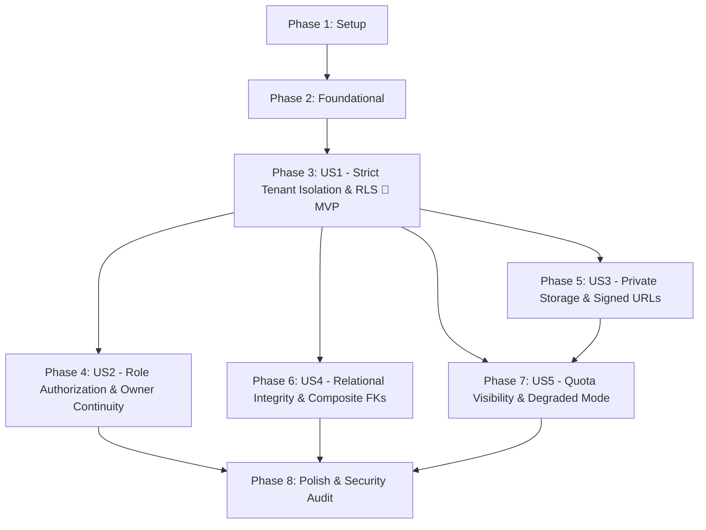

# Tasks: F008 — Managed Backend and Tenant Isolation

**Input**: Design documents from `/specs/008-managed-backend-and-tenant-isolation/` (`plan.md`, `spec.md`, `data-model.md`, `research.md`, `quickstart.md`, `contracts/`)

**Prerequisites**: [plan.md](plan.md) (required), [spec.md](spec.md) (required for user stories), [data-model.md](data-model.md), [research.md](research.md), [quickstart.md](quickstart.md), [contracts/](contracts/)

**Tests**: Test tasks are included per user story, mapping directly to `quickstart.md` validation scenarios and Constitution Principle VIII evidence requirements.

**Organization**: Tasks are grouped by user story to enable independent implementation and testing of each story.

## Format: `[ID] [P?] [Story] Description`

- **[P]**: Can run in parallel (different files, no dependencies on incomplete tasks)
- **[Story]**: Which user story this task belongs to (`[US1]`, `[US2]`, `[US3]`, `[US4]`, `[US5]`)
- Include exact file paths in descriptions

## Path Conventions

- **Database migrations**: `supabase/migrations/`
- **Edge Functions (Deno runtime)**: `supabase/functions/`
- **Main process cloud integration**: `app/main/cloud/`
- **Shared contracts & types**: `app/shared/cloud-contracts.ts`
- **Renderer shell notifications**: `app/renderer/shell/`
- **Verification tooling & seeders**: `tooling/f008/`
- **Automated test suites**: `tests/f008/`

---

## Phase 1: Setup (Shared Infrastructure)

**Purpose**: Project initialization, directory structure, local Supabase emulator configuration, and verification harness setup

- [X] T001 Create directory structure for Supabase migrations, edge functions, cloud client modules, verification tooling, and test suites in supabase/migrations/, supabase/functions/, app/main/cloud/, tooling/f008/, and tests/f008/
- [X] T002 [P] Configure Supabase local emulator environment in supabase/config.toml enabling PostgreSQL 16, Supabase Auth, Supabase Storage, and local Edge Functions runtime on ports 54321/54322
- [X] T003 [P] Configure F008 test scripts (test:f008, test:f008:isolation, test:f008:roles, test:f008:storage, test:f008:constraints, test:f008:quota) in package.json
- [X] T004 [P] Create F008 master test suite runner script in tooling/f008/verify.mjs with multi-suite execution and ANSI reporting

---

## Phase 2: Foundational (Blocking Prerequisites)

**Purpose**: Core schema migrations, security-definer helper functions, trigger infrastructure, shared context types, and synthetic test seeders that MUST be complete before ANY user story can be implemented

**⚠️ CRITICAL**: No user story work can begin until this phase is complete

- [X] T005 [P] Define shared cloud types, DTOs, and error codes in app/shared/cloud-contracts.ts including WorkspaceTenantDto, WorkspaceMembershipDto, TrustedContext, ProviderQuotaProfileDto with quota_tier constrained to `'normal' | 'warning_70' | 'warning_85' | 'critical_95' | 'exhausted_100'` and provider_status constrained to `'operational' | 'degraded' | 'paused' | 'maintenance'`
- [X] T006 Implement baseline administration schema migration in supabase/migrations/20261020000001_workspace_tenants.sql with verbatim table definitions: `workspace_tenants (id text PRIMARY KEY, legal_name text NOT NULL CHECK (char_length(legal_name) BETWEEN 1 AND 255), trade_name text CHECK (trade_name IS NULL OR char_length(trade_name) BETWEEN 1 AND 255), default_timezone text NOT NULL DEFAULT 'UTC', default_currency text NOT NULL CHECK (char_length(default_currency) = 3), default_locale text NOT NULL DEFAULT 'en' CHECK (default_locale IN ('en', 'ar')), status text NOT NULL DEFAULT 'active' CHECK (status IN ('active', 'suspended', 'closing', 'archived')), created_at timestamptz NOT NULL DEFAULT clock_timestamp(), updated_at timestamptz NOT NULL DEFAULT clock_timestamp())`, `workspace_memberships (workspace_id text NOT NULL REFERENCES public.workspace_tenants(id) ON DELETE RESTRICT, user_id text NOT NULL, role text NOT NULL CHECK (role IN ('owner', 'admin', 'manager', 'contributor', 'finance', 'viewer')), status text NOT NULL DEFAULT 'active' CHECK (status IN ('invited', 'active', 'suspended', 'revoked')), invited_email text CHECK (invited_email IS NULL OR invited_email ~* '^[A-Za-z0-9._%+-]+@[A-Za-z0-9.-]+\.[A-Za-z]{2,}$'), invitation_token text UNIQUE, invitation_expires_at timestamptz, granted_by text, created_at timestamptz NOT NULL DEFAULT clock_timestamp(), updated_at timestamptz NOT NULL DEFAULT clock_timestamp(), PRIMARY KEY (workspace_id, user_id))`, and `tenant_audit_events (id text PRIMARY KEY, workspace_id text NOT NULL REFERENCES public.workspace_tenants(id) ON DELETE RESTRICT, actor_id text NOT NULL, action_type text NOT NULL CHECK (action_type IN ('membership_invited', 'membership_accepted', 'membership_revoked', 'role_granted', 'role_changed', 'owner_transferred', 'workspace_created', 'workspace_updated', 'policy_updated')), target_resource_type text NOT NULL CHECK (char_length(target_resource_type) BETWEEN 1 AND 64), target_resource_id text NOT NULL CHECK (char_length(target_resource_id) BETWEEN 1 AND 128), change_diff jsonb NOT NULL DEFAULT '{}'::jsonb, correlation_id text NOT NULL, occurred_at timestamptz NOT NULL DEFAULT clock_timestamp(), CONSTRAINT uq_audit_event_workspace UNIQUE (workspace_id, id))`
- [X] T007 Implement Security Definer helper functions migration in supabase/migrations/20261020000002_security_helper_functions.sql defining `current_user_id() RETURNS text` returning `COALESCE(auth.uid()::text, '')`, `has_active_membership(p_workspace_id text) RETURNS boolean` asserting `EXISTS (SELECT 1 FROM public.workspace_memberships WHERE workspace_id = p_workspace_id AND user_id = public.current_user_id() AND status = 'active')`, and `get_workspace_role(p_workspace_id text) RETURNS text` with `SECURITY DEFINER SET search_path = public`
- [X] T008 Implement immutability and ownership trigger functions in supabase/migrations/20261020000003_immutability_and_ownership.sql defining `reject_workspace_id_mutation()` raising exception on `NEW.workspace_id IS DISTINCT FROM OLD.workspace_id` and `prevent_last_owner_removal()` raising exception when active owner count in workspace drops below 1
- [X] T009 [P] Implement Edge Function JWT validator and TrustedContext constructor in supabase/functions/_shared/auth.ts extracting actor ID (`usr_...`), asserting active membership in target `workspace_id`, and returning F003-compatible `TrustedContext`
- [X] T010 [P] Implement synthetic multi-tenant test seeder in tooling/f008/seed-test-tenants.mjs generating Workspace Alpha (`ws_alpha_01`) with Owner (`usr_alice`) and Contributor (`usr_bob`), and Workspace Beta (`ws_beta_02`) with Owner (`usr_charlie`)

**Checkpoint**: Foundation ready — user story implementation can now begin in parallel or sequentially.

---

## Phase 3: User Story 1 - Strict Multi-Tenant Data Isolation and Cross-Workspace Boundary Defense (Priority: P1) 🎯 MVP

**Goal**: Enforce fail-closed multi-tenant data isolation at the PostgreSQL database engine level using Row Level Security policies so that an authenticated user in Workspace Alpha can never read, mutate, count, or discover records belonging to Workspace Beta.

**Independent Test**: Provision Workspace Alpha and Workspace Beta with distinct records. Submit authenticated queries as `usr_alice` (Alpha) attempting to read records from Beta by ID, query lists with Beta's ID, execute aggregate `COUNT` queries, perform fuzzy text search, and submit insert/update mutations targeting Beta. Verify 100% of cross-tenant attempts fail closed with zero rows modified or leaked.

### Tests for User Story 1 ⚠️

- [X] T011 [P] [US1] Contract test for denied cross-workspace read queries (Acceptance A-01) in tests/f008/cross-tenant-reads.test.mjs asserting empty result / 404 RESOURCE_UNAVAILABLE without revealing record existence
- [X] T012 [P] [US1] Contract test for denied cross-workspace mutations (Acceptance A-02) in tests/f008/cross-tenant-mutations.test.mjs asserting PostgreSQL error 42501 (insufficient_privilege) and zero rows modified
- [X] T013 [P] [US1] Integration test for zero aggregate count and search leakage (Acceptance A-03) in tests/f008/zero-aggregate-leakage.test.mjs asserting `COUNT(*)` and full-text searches reflect exclusively Alpha records
- [X] T014 [P] [US1] Integration test for workspace identifier immutability (Acceptance A-04) in tests/f008/workspace-immutability.test.mjs asserting `UPDATE` altering `workspace_id` throws integrity constraint violation

### Implementation for User Story 1

- [X] T015 [US1] Implement Row Level Security policies migration for core tables in supabase/migrations/20261020000004_tenant_rls_policies.sql enforcing `ALTER TABLE ... ENABLE ROW LEVEL SECURITY; ALTER TABLE ... FORCE ROW LEVEL SECURITY` on `workspace_tenants`, `workspace_memberships`, and `tenant_audit_events` with policies `tenants_select_member`, `tenants_update_admin`, `memberships_select_member`, `memberships_insert_admin`, `memberships_update_admin`, `memberships_delete_admin`, and `audit_select_admin`
- [X] T016 [P] [US1] Implement tenant-scoped Supabase client factory in supabase/functions/\_shared/rls-client.ts configuring RLS context headers and bearer tokens
- [X] T017 [US1] Implement core command gateway entry point in supabase/functions/command-gateway/index.ts validating `X-Workspace-Id` header against verified user membership and returning F003 `PublicError` (`FORBIDDEN` / `AUTH_REQUIRED`) on cross-tenant mismatch
- [X] T018 [US1] Attach `reject_workspace_id_mutation()` trigger to `workspace_tenants` and `workspace_memberships` in supabase/migrations/20261020000003_immutability_and_ownership.sql

**Checkpoint**: At this point, User Story 1 delivers impenetrable database-level tenant isolation and zero cross-tenant leakage.

---

## Phase 4: User Story 2 - Least-Privilege Role Authorization and Ownership Continuity (Priority: P1)

**Goal**: Dynamically evaluate acting user role permissions (Owner, Admin, Manager, Contributor, Finance, Viewer) against the live database membership table, enforce member revocations and downgrades immediately on subsequent queries without awaiting token expiry, protect against sole owner removal, and record append-only audit entries.

**Independent Test**: Configure a test workspace with users assigned across all 6 roles. Submit role-restricted commands (Finance actions, Admin settings). Revoke a member's access during an active session and verify immediate rejection on their next request. Attempt to remove or downgrade the sole workspace Owner and verify constraint failure.

### Tests for User Story 2 ⚠️

- [X] T019 [P] [US2] Unit test for authoritative role capability evaluation (Acceptance A-05) in tests/f008/role-authorization.test.mjs verifying permission matrix rules for all 6 roles
- [X] T020 [P] [US2] Integration test for immediate revocation and downgrade enforcement (Acceptance A-06) in tests/f008/immediate-revocation.test.mjs asserting active session is rejected immediately upon status change to `revoked`
- [X] T021 [P] [US2] Integration test for protected workspace ownership continuity (Acceptance A-07) in tests/f008/owner-continuity.test.mjs asserting sole Owner cannot leave, be deleted, or demoted without prior transfer
- [X] T022 [P] [US2] Integration test for auditable membership and role modifications (Acceptance A-08) in tests/f008/tenant-audit-events.test.mjs asserting immutable append-only record creation with actor, target, timestamp, and diff

### Implementation for User Story 2

- [X] T023 [P] [US2] Implement role capability matrix authorizer in supabase/functions/command-gateway/role-authorizer.ts matching capabilities defined in `docs/specs/platform-and-workspaces.md`
- [X] T024 [US2] Implement membership lifecycle command handler (invite, accept, update role, revoke) in supabase/functions/command-gateway/membership-handler.ts enforcing live membership lookups
- [X] T025 [P] [US2] Implement audit event logger in supabase/functions/\_shared/audit-service.ts writing immutable records to `tenant_audit_events` with correlation IDs and redacted change diffs
- [X] T026 [US2] Implement atomic two-phase ownership transfer transaction in supabase/functions/command-gateway/ownership-transfer.ts promoting new owner before demoting previous owner
- [X] T027 [US2] Attach `prevent_last_owner_removal()` trigger to `workspace_memberships` in supabase/migrations/20261020000003_immutability_and_ownership.sql

**Checkpoint**: At this point, User Stories 1 AND 2 deliver dynamic least-privilege authorization and owner continuity.

---

## Phase 5: User Story 3 - Private Object Storage and Scoped Asset Access (Priority: P1)

**Goal**: Store business attachments in private cloud storage containers partitioned by `workspace_id`, enforce storage-level RLS policies, and issue time-limited (15-minute / 900-second) signed download URLs only after verifying current entity read access.

**Independent Test**: Upload attachments into Workspace Alpha. Attempt unauthenticated public HTTP access $\rightarrow$ 403 Forbidden. Attempt cross-tenant download from Workspace Beta $\rightarrow$ 403 Forbidden. Generate signed download URL and verify download succeeds within 15 minutes and fails at $T + 901\text{s}$.

### Tests for User Story 3 ⚠️

- [X] T028 [P] [US3] Integration test asserting private storage by default (Acceptance A-09) in tests/f008/private-storage-default.test.mjs verifying direct unauthenticated HTTP requests return 403 Forbidden
- [X] T029 [P] [US3] Integration test for tenant-partitioned storage hierarchy and path traversal defense (Acceptance A-10) in tests/f008/storage-path-partitioning.test.mjs verifying rejection of `..` segments and wrong tenant prefixes
- [X] T030 [P] [US3] Contract test for time-limited signed URL token lifecycle (Acceptance A-11) in tests/f008/signed-url-lifecycle.test.mjs asserting 900-second expiration and cross-tenant tampering failure
- [X] T031 [P] [US3] Integration test asserting denied cross-tenant file manipulation (Acceptance A-12) in tests/f008/cross-tenant-storage-denial.test.mjs asserting files in Beta cannot be deleted or overwritten by Alpha members

### Implementation for User Story 3

- [X] T032 [US3] Implement private storage bucket initialization and RLS policies migration in supabase/migrations/20261020000005_private_storage_setup.sql creating bucket `workspaces` (`public = false`, `file_size_limit = 104857600`) and RLS policies on `storage.objects` (`storage_select_tenant_member`, `storage_insert_tenant_contributor`, `storage_delete_tenant_admin`, `storage_update_deny_all`)
- [X] T033 [US3] Implement metadata schema for stored assets in supabase/migrations/20261020000005_private_storage_setup.sql creating table `tenant_storage_objects (id text NOT NULL, workspace_id text NOT NULL REFERENCES public.workspace_tenants(id) ON DELETE RESTRICT, bucket_id text NOT NULL DEFAULT 'workspaces' CHECK (bucket_id = 'workspaces'), storage_path text NOT NULL, content_type text NOT NULL CHECK (char_length(content_type) BETWEEN 1 AND 128), size_bytes bigint NOT NULL CHECK (size_bytes >= 0 AND size_bytes <= 104857600), sha256_hash text NOT NULL CHECK (sha256_hash ~ '^[a-f0-9]{64}$'), access_tier text NOT NULL DEFAULT 'private' CHECK (access_tier = 'private'), owning_entity_type text NOT NULL CHECK (owning_entity_type IN ('invoice', 'receipt', 'contract', 'project', 'profile')), owning_entity_id text NOT NULL CHECK (char_length(owning_entity_id) BETWEEN 1 AND 128), uploaded_by text NOT NULL, created_at timestamptz NOT NULL DEFAULT clock_timestamp(), PRIMARY KEY (workspace_id, id), CONSTRAINT uq_storage_path_workspace UNIQUE (workspace_id, storage_path))`
- [X] T034 [P] [US3] Implement canonical storage path builder and regex sanitizer in supabase/functions/_shared/storage-path.ts enforcing regex `^workspaces\/(ws_[a-zA-Z0-9_-]+)\/(invoices|receipts|contracts|projects|profiles)\/([a-zA-Z0-9_-]+)\/(obj*[a-zA-Z0-9*-]+)-[a-zA-Z0-9_.-]+$`
- [X] T035 [US3] Implement signed download URL generator Edge Function in supabase/functions/storage-signed-url/index.ts verifying entity read grants and calling Supabase Storage `createSignedUrl(path, 900)`

**Checkpoint**: At this point, cloud object storage is private, tenant-partitioned, and secured by 15-minute expiring signed tokens.

---

## Phase 6: User Story 4 - Relational Integrity and Cross-Tenant Constraint Defense (Priority: P1)

**Goal**: Enforce composite foreign key constraints `(workspace_id, parent_id)` across relational child entities (`clients`, `projects`, `tasks`, `time_entries`) at the PostgreSQL engine level to mathematically prevent cross-tenant pointer poisoning or orphaned records.

**Independent Test**: Attempt to insert a project in Workspace Alpha referencing a client in Workspace Beta. Attempt to insert a task in Workspace Alpha referencing a project in Workspace Beta. Attempt to link a time entry in Alpha to a task in Beta. Verify that composite foreign keys reject 100% of cross-tenant reference attempts.

### Tests for User Story 4 ⚠️

- [X] T036 [P] [US4] Integration test for composite foreign key constraint rejection (Acceptance A-13) in tests/f008/composite-fk-defense.test.mjs asserting cross-tenant foreign key attempts throw SQLSTATE 23503
- [X] T037 [P] [US4] Integration test for orphan prevention across tenant graphs (Acceptance A-14) in tests/f008/orphan-prevention.test.mjs asserting cascading delete and restrict policies remain within tenant boundaries
- [X] T038 [P] [US4] Integration test for uniform tenant attribution across multi-entity transactions (Acceptance A-15) in tests/f008/uniform-tenant-attribution.test.mjs asserting mismatched tenant batches roll back completely

### Implementation for User Story 4

- [X] T039 [US4] Implement representative domain tables migration in supabase/migrations/20261020000007_domain_composite_tables.sql creating `clients (workspace_id text NOT NULL REFERENCES public.workspace_tenants(id) ON DELETE RESTRICT, id text NOT NULL, name text NOT NULL CHECK (char_length(name) BETWEEN 1 AND 255), currency text NOT NULL CHECK (char_length(currency) = 3), status text NOT NULL DEFAULT 'active' CHECK (status IN ('active', 'archived')), created_at timestamptz NOT NULL DEFAULT clock_timestamp(), updated_at timestamptz NOT NULL DEFAULT clock_timestamp(), PRIMARY KEY (workspace_id, id))`
- [X] T040 [US4] Implement projects, tasks, and time entries with composite FKs in supabase/migrations/20261020000007_domain_composite_tables.sql: `projects` with `CONSTRAINT fk_projects_client FOREIGN KEY (workspace_id, client_id) REFERENCES public.clients(workspace_id, id) ON DELETE RESTRICT`, `tasks` with `CONSTRAINT fk_tasks_project FOREIGN KEY (workspace_id, project_id) REFERENCES public.projects(workspace_id, id) ON DELETE CASCADE`, and `time_entries` with `CONSTRAINT fk_time_entries_task FOREIGN KEY (workspace_id, task_id) REFERENCES public.tasks(workspace_id, id) ON DELETE RESTRICT`
- [X] T041 [US4] Attach `reject_workspace_id_mutation()` trigger and RLS policies (`clients_select_member`, `projects_select_member`, `tasks_select_member`, `time_entries_select_member`) to domain tables in supabase/migrations/20261020000007_domain_composite_tables.sql
- [X] T042 [P] [US4] Implement atomic multi-entity transaction builder in supabase/functions/\_shared/batch-transaction.ts verifying uniform tenant attribution before commit

**Checkpoint**: At this point, relational integrity constraints prevent cross-tenant pointer poisoning independently of RLS.

---

## Phase 7: User Story 5 - Quota Visibility, Provider Limits, and Graceful Degraded Operation (Priority: P2)

**Goal**: Track database storage, object storage, and egress consumption against provider allowances; deliver progressive bilingual warning alerts at 70%, 85%, and 95%; halt new cloud writes cleanly at 100% capacity without data loss; and transition desktop clients gracefully to local encrypted offline operation (F007) during cloud outages or project pauses.

**Independent Test**: Simulate reaching 70%, 85%, 95%, and 100% capacity thresholds. Verify bilingual UI notifications in English and Arabic. Simulate cloud service pause/outage (`supabase stop`). Verify desktop client transitions into `offline_degraded` mode, displays status banner, and queues edits in local encrypted SQLite outbox without crashing or losing work.

### Tests for User Story 5 ⚠️

- [X] T043 [P] [US5] Unit test for quota calculation and threshold tier progression (Acceptance A-16) in tests/f008/quota-threshold-tiers.test.mjs verifying transitions between `normal`, `warning_70`, `warning_85`, `critical_95`, and `exhausted_100`
- [X] T044 [P] [US5] Integration test for clean write rejection on 100% quota exhaustion (Acceptance A-17) in tests/f008/quota-exhaustion-rejection.test.mjs asserting `STORAGE_UNAVAILABLE` error and 100% preservation of existing records
- [X] T045 [P] [US5] Integration test for non-destructive desktop offline degradation (Acceptance A-18) in tests/f008/offline-degraded-mode.test.mjs asserting local SQLite outbox commit during cloud disconnection
- [X] T046 [P] [US5] Component accessibility and visual test for bilingual QuotaWarningBanner in tests/f008/quota-warning-banner.test.mjs verifying English/Arabic text, RTL direction, and WCAG 2.2 AA visible focus

### Implementation for User Story 5

- [X] T047 [US5] Implement quota tracking schema migration in supabase/migrations/20261020000006_provider_quota_profiles.sql creating `provider_quota_profiles (workspace_id text PRIMARY KEY REFERENCES public.workspace_tenants(id) ON DELETE RESTRICT, db_storage_bytes bigint NOT NULL DEFAULT 0 CHECK (db_storage_bytes >= 0), object_storage_bytes bigint NOT NULL DEFAULT 0 CHECK (object_storage_bytes >= 0), monthly_egress_bytes bigint NOT NULL DEFAULT 0 CHECK (monthly_egress_bytes >= 0), db_storage_limit_bytes bigint NOT NULL DEFAULT 524288000, object_storage_limit_bytes bigint NOT NULL DEFAULT 1073741824, monthly_egress_limit_bytes bigint NOT NULL DEFAULT 5368709120, quota_tier text NOT NULL DEFAULT 'normal' CHECK (quota_tier IN ('normal', 'warning_70', 'warning_85', 'critical_95', 'exhausted_100')), provider_status text NOT NULL DEFAULT 'operational' CHECK (provider_status IN ('operational', 'degraded', 'paused', 'maintenance')), last_evaluated_at timestamptz NOT NULL DEFAULT clock_timestamp())`
- [X] T048 [P] [US5] Implement quota pre-flight write verifier in supabase/functions/\_shared/quota.ts halting uploads at 100% capacity with F003 `PublicError` (`STORAGE_UNAVAILABLE`)
- [X] T049 [US5] Implement desktop cloud gateway client and degraded mode manager in app/main/cloud/cloud-gateway-client.ts and app/main/cloud/degraded-mode-manager.ts seamlessly falling back to local encrypted SQLite outbox (F007) on network failure or 503/507 status
- [X] T050 [US5] Implement accessible bilingual QuotaWarningBanner component in app/renderer/shell/QuotaWarningBanner.tsx with RTL layout, visible focus indicators, and localized strings for `quota.warning_70`, `quota.warning_85`, `quota.critical_95`, `quota.exhausted_100`, and `quota.provider_degraded`
- [X] T051 [US5] Integrate QuotaWarningBanner into desktop application root shell in app/renderer/shell/App.tsx


**Checkpoint**: All user stories are now independently functional with quota resilience and offline fallback.

---

## Phase 8: Polish & Cross-Cutting Concerns

**Purpose**: Secret vault security verification, static code scans, bilingual translation audit, and end-to-end evidence collection

- [X] T052 [P] Implement static security scanner in tooling/f008/test-secrets.mjs asserting zero service-role keys, superuser credentials, or database passwords in packaged desktop assets and client bundles (FR-012, SC-009)
- [X] T053 [P] Audit bilingual English and Arabic translations for quota alerts, degraded status, and backend error envelopes in packages/localization/src/
- [X] T054 [P] Run oxlint and typescript typecheck across all F008 source and test files in supabase/, app/, tooling/f008/, and tests/f008/
- [X] T055 Run complete F008 automated verification suite in tooling/f008/verify.mjs (`npm run test:f008`) and assert 100% pass across all 57 scenarios
- [X] T056 [P] Update feature documentation and operational runbook in docs/features/F008.md and docs/qa/F008.md
- [X] T057 Run end-to-end quickstart.md validation walkthrough verifying all 6 scenarios in specs/008-managed-backend-and-tenant-isolation/quickstart.md


---

## Dependencies & Execution Order

### Phase Dependencies

- **Setup (Phase 1)**: No dependencies — can start immediately.
- **Foundational (Phase 2)**: Depends on Setup completion — BLOCKS all user stories.
- **User Story 1 (Phase 3)**: Depends on Foundational completion. Delivers core RLS isolation and workspace immutability (MVP).
- **User Story 2 (Phase 4)**: Depends on Foundational and User Story 1 (needs membership schema and RLS policies).
- **User Story 3 (Phase 5)**: Depends on Foundational and User Story 1 (needs tenant paths, storage bucket, and RLS).
- **User Story 4 (Phase 6)**: Depends on Foundational and User Story 1 (needs tenant tables and immutability trigger).
- **User Story 5 (Phase 7)**: Depends on User Story 1, 3, and F007 outbox (needs storage objects and client error handling).
- **Polish (Phase 8)**: Depends on all user story phases being complete.

### User Story Dependencies



### Within Each User Story

- Test tasks written first to establish acceptance assertions and failure modes
- Migrations and schema definitions implemented before service logic
- Helper functions and triggers attached before data insertion
- Story complete and validated before moving to dependent stories

### Parallel Opportunities

- **Setup (Phase 1)**: T002 (`supabase/config.toml`), T003 (`package.json`), and T004 (`tooling/f008/verify.mjs`) can run in parallel.
- **Foundational (Phase 2)**: T005 (`cloud-contracts.ts`), T009 (`auth.ts`), and T010 (`seed-test-tenants.mjs`) can run in parallel.
- **User Story 1 (Phase 3)**: Tests T011, T012, T013, T014 and client wrapper T016 can run in parallel.
- **User Story 2 (Phase 4)**: Tests T019, T020, T021, T022 and role authorizer T023, audit service T025 can run in parallel.
- **User Story 3 (Phase 5)**: Tests T028, T029, T030, T031 and path sanitizer T034 can run in parallel.
- **User Story 4 (Phase 6)**: Tests T036, T037, T038 and batch transaction builder T042 can run in parallel.
- **User Story 5 (Phase 7)**: Tests T043, T044, T045, T046 and quota verifier T048 can run in parallel.
- **Polish (Phase 8)**: Scanner T052, localization T053, linter T054, and docs T056 can run in parallel.

---

## Parallel Example: User Story 1

```bash
# Launch all test tasks for User Story 1 together:
Task: "Contract test for denied cross-workspace read queries in tests/f008/cross-tenant-reads.test.mjs"
Task: "Contract test for denied cross-workspace mutations in tests/f008/cross-tenant-mutations.test.mjs"
Task: "Integration test for zero aggregate count and search leakage in tests/f008/zero-aggregate-leakage.test.mjs"
Task: "Integration test for workspace identifier immutability in tests/f008/workspace-immutability.test.mjs"

# Launch independent implementation file:
Task: "Implement tenant-scoped Supabase client factory in supabase/functions/_shared/rls-client.ts"
```

---

## Parallel Example: User Story 3

```bash
# Launch all test tasks for User Story 3 together:
Task: "Integration test asserting private storage by default in tests/f008/private-storage-default.test.mjs"
Task: "Integration test for tenant-partitioned storage hierarchy in tests/f008/storage-path-partitioning.test.mjs"
Task: "Contract test for time-limited signed URL token lifecycle in tests/f008/signed-url-lifecycle.test.mjs"
Task: "Integration test asserting denied cross-tenant file manipulation in tests/f008/cross-tenant-storage-denial.test.mjs"

# Launch independent path sanitizer:
Task: "Implement canonical storage path builder and regex sanitizer in supabase/functions/_shared/storage-path.ts"
```

---

## Implementation Strategy

### MVP First (User Story 1 Only)

1. Complete Phase 1: Setup (emulator config, directories, runner).
2. Complete Phase 2: Foundational (base tables, security definer functions, immutability trigger, seeder).
3. Complete Phase 3: User Story 1 (RLS policies, tenant client wrapper, command gateway dispatcher).
4. **STOP and VALIDATE**: Test User Story 1 independently with `tests/f008/cross-tenant-reads.test.mjs` and `cross-tenant-mutations.test.mjs`.
5. Deliver MVP core database tenant isolation.

### Incremental Delivery

1. **Increment 1 (MVP)**: Setup + Foundation + US1 $\rightarrow$ Fail-closed database tenant isolation and zero aggregate leakage.
2. **Increment 2**: US2 $\rightarrow$ Least-privilege role validation, immediate revocation, owner continuity, and audit logging.
3. **Increment 3**: US3 $\rightarrow$ Private cloud storage, tenant path partitioning, and 15-minute signed download URLs.
4. **Increment 4**: US4 $\rightarrow$ Composite foreign key integrity `(workspace_id, parent_id)` preventing cross-tenant references.
5. **Increment 5**: US5 $\rightarrow$ Quota threshold monitoring, clean write rejection, and desktop offline degraded-mode fallback.
6. **Increment 6**: Polish $\rightarrow$ Static secret scanning, bilingual English/Arabic audit, and full quickstart walkthrough.

### Parallel Team Strategy

With multiple developers:

1. Team completes Setup + Foundational together (T001–T010).
2. Once Foundational is done and US1 is established:
   - Developer A: User Story 2 (role authorizer, membership handler, audit service)
   - Developer B: User Story 3 (private storage setup, signed URL Edge Function)
   - Developer C: User Story 4 (composite domain tables & batch transactions)
3. Developer D joins for User Story 5 (quota tracking, degraded mode manager, and warning banner).
4. Stories complete and integrate cleanly through verified contracts.

---

## Notes

- **[P] tasks**: Different files, zero dependencies on incomplete tasks.
- **[Story] label**: Maps task strictly to user story (`[US1]`, `[US2]`, `[US3]`, `[US4]`, `[US5]`) for end-to-end traceability.
- **Fail-closed invariant**: Cross-tenant queries return zero rows; unauthorized mutations throw PostgreSQL error 42501; unauthenticated storage access returns 403 Forbidden.
- **Zero data loss on quota exhaustion**: Reaching 100% capacity halts new cloud writes with `STORAGE_UNAVAILABLE` while preserving 100% of existing stored records and files.
- **Offline degraded mode**: Desktop client catches cloud outages or write rejections and seamlessly queues edits into the local encrypted SQLite outbox ([F007](file:///home/mohamed-s/Desktop/SoloDesk/specs/007-encrypted-local-persistence/spec.md)).
- **Zero service-role keys**: Desktop builds and distributions contain exclusively `VITE_SUPABASE_PUBLISHABLE_KEY` (anon key); service-role credentials reside strictly in cloud environment vaults.
- **Multilingual RTL & Accessibility**: Error messages, quota notifications, and recovery banners provide complete English and Arabic strings adhering to WCAG 2.2 AA visible focus indicators and screen reader attributes.
- **Authorization boundary**: Delivery of `tasks.md` is a documentation planning milestone. Actual code implementation requires explicit user authorization.
